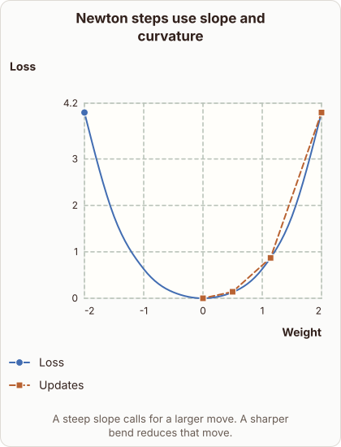

# Newton Optimization and Curvature

- Prompt (reference.prompts[0]): How does Newton optimization use curvature to move to a minimum?
- Reference id: d2l-newton-convex-curvature-steps (source: D2L)
- Intended kind (reference.spec.diagram.kind): coordinate-plot
- Planner kind: coordinate-plot (fixed); planner routed to picture: no
- Model kind (first diagram): coordinate-plot; all diagrams: coordinate-plot
- Selector hit (intended reference among the references sent): yes
- References sent to the author (attempt 0): shape-coordinate-plot, d2l-newton-convex-curvature-steps, gradient-descent-contours
- Structure (faithful-ref-v1, reference vs model spec): fully - The diagram matches the reference exactly: same coordinate plot, axes, title, caption, and both series (Loss curve and Updates path) with identical points.
- Factual (factual-v2): 4/5, error no - Minor simplifications: the Hessian is the matrix of second derivatives (the second derivative only in 1D), and 'converge rapidly' is accepted loosely. Quadratics converge in one step, and the step is scaled by the inverse curvature, so the claims are correct.
- Repaired: no; visual fallback: no; authored by google / gemini-3.5-flash-lite
- Time 4234 ms; author tokens in/out 4388/520; cost US$0.002617

| model (408 px) | reference (408 px) |
|---|---|
|  |  |

## Card body (as saved)

Newton optimization finds the minimum of a function by using both the gradient and the second derivative, known as the Hessian.

While standard gradient descent relies solely on the slope to choose a direction, Newton method adjusts the step size using local curvature.

```rh-diagram
{"version":1,"diagram":{"title":"Newton steps use slope and curvature","caption":"A steep slope calls for a larger move. A sharper bend reduces that move.","kind":"coordinate-plot","x":{"label":"Weight","min":-2,"max":2,"scale":"linear"},"y":{"label":"Loss","min":0,"max":4.2},"series":[{"label":"Loss","kind":"line","points":[{"x":-2,"y":4},{"x":-1.5,"y":1.76},{"x":-1,"y":0.63},{"x":-0.5,"y":0.13},{"x":0,"y":0},{"x":0.5,"y":0.13},{"x":1,"y":0.63},{"x":1.5,"y":1.76},{"x":2,"y":4}]},{"label":"Updates","kind":"line","smooth":false,"points":[{"x":2,"y":4},{"x":1.14,"y":0.87},{"x":0.5,"y":0.14},{"x":0,"y":0}]}]}}
```

When the local bend is very sharp, the Hessian is large, which shrinks the optimization step to prevent overshooting the minimum.

Conversely, a flat region with a small second derivative produces a larger step toward the target.

By scaling the gradient inverse-proportionally by the curvature, Newton updates converge rapidly on quadratic and well-conditioned convex objectives.
