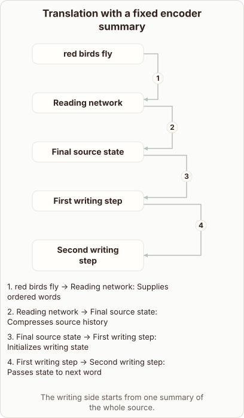

# Why a Fixed Summary is a Bottleneck in RNN Translation

- Prompt (reference.prompts[0]): Why is one fixed summary a bottleneck for an RNN translator?
- Reference id: d2l-recurrent-translation-fixed-context (source: D2L)
- Intended kind (reference.spec.diagram.kind): relationship
- Planner kind: relationship (reference override; the planner said block-stack); planner routed to picture: no
- Model kind (first diagram): relationship; all diagrams: relationship
- Selector hit (intended reference among the references sent): yes
- References sent to the author (attempt 0): shape-relationship, d2l-recurrent-translation-fixed-context
- Structure (faithful-ref-v1, reference vs model spec): fully - The diagram matches the reference exactly. It has the same nodes, the same four labeled edges in the same order, and the same title and caption.
- Factual (factual-v2): 5/5, error no
- Repaired: no; visual fallback: no; authored by google / gemini-3.5-flash-lite
- Time 3531 ms; author tokens in/out 3864/631; cost US$0.002737

| model (408 px) | reference (408 px) |
|---|---|
|  |  |

## Card body (as saved)

An encoder-decoder translator reads a source sentence word by word into a hidden state vector. This single vector must compress every detail of the entire input sentence before decoding begins.

```rh-diagram
{"version":1,"diagram":{"title":"Translation with a fixed encoder summary","caption":"The writing side starts from one summary of the whole source.","kind":"relationship","layout":"graph","nodes":[{"id":"source","label":"red birds fly"},{"id":"enc","label":"Reading network"},{"id":"summary","label":"Final source state"},{"id":"d1","label":"First writing step"},{"id":"d2","label":"Second writing step"}],"edges":[{"from":"source","to":"enc","label":"Supplies ordered words"},{"from":"enc","to":"summary","label":"Compresses source history"},{"from":"summary","to":"d1","label":"Initializes writing state"},{"from":"d1","to":"d2","label":"Passes state to next word"}]}}
```

When sentences grow long, this fixed-length vector loses early details. The decoder relies entirely on that one summary to generate every target word, creating a severe information bottleneck.
