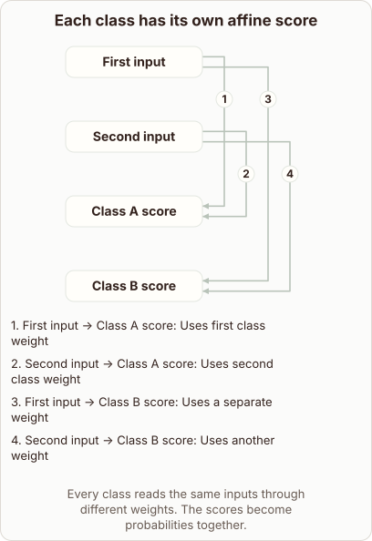

# Raw Class Scores in Softmax Regression

- Prompt (reference.prompts[0]): How does softmax regression create its raw class scores?
- Reference id: d2l-softmax-affine-class-scores (source: D2L)
- Intended kind (reference.spec.diagram.kind): relationship
- Planner kind: relationship (reference override; the planner said layers); planner routed to picture: no
- Model kind (first diagram): relationship; all diagrams: relationship
- Selector hit (intended reference among the references sent): yes
- References sent to the author (attempt 0): shape-relationship, d2l-softmax-affine-class-scores, regression-residuals
- Structure (faithful-ref-v1, reference vs model spec): fully - The diagram matches the reference exactly. It has the same four nodes and the same four weighted edges, from each input to each class score.
- Factual (factual-v2): 4/5, error no - Minor ambiguity: the diagram's 'first/second class weight' wording for Class A's weights could be misread as per-class weights, but the content is correct.
- Repaired: no; visual fallback: no; authored by google / gemini-3.5-flash-lite
- Time 3712 ms; author tokens in/out 4112/537; cost US$0.002577

| model (408 px) | reference (408 px) |
|---|---|
|  |  |

## Card body (as saved)

Softmax regression calculates raw class scores by computing an affine transformation of the input features. For every possible class, the model maintains a dedicated set of weights and a bias term.

It multiplies each input feature by its corresponding weight for that specific class and sums them up.

```rh-diagram
{"version":1,"diagram":{"title":"Each class has its own affine score","caption":"Every class reads the same inputs through different weights. The scores become probabilities together.","kind":"relationship","layout":"graph","nodes":[{"id":"a","label":"First input"},{"id":"b","label":"Second input"},{"id":"x","label":"Class A score"},{"id":"y","label":"Class B score"}],"edges":[{"from":"a","to":"x","label":"Uses first class weight"},{"from":"b","to":"x","label":"Uses second class weight"},{"from":"a","to":"y","label":"Uses a separate weight"},{"from":"b","to":"y","label":"Uses another weight"}]}}
```

Adding the bias term yields the final raw score, often called a logit, for that class. Because each class possesses its own parameter set, multiple classes evaluate the identical input vector independently.

These raw scores can take any real value before the softmax function scales them into probabilities.
