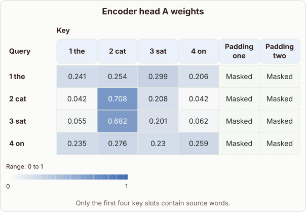

# Comparing Encoder Self-Attention Heatmaps

- Prompt (reference.prompts[0]): How can I compare encoder self-attention heatmaps from different heads?
- Reference id: d2l-transformer-encoder-head-weight-grids (source: D2L)
- Intended kind (reference.spec.diagram.kind): heatmap
- Planner kind: comparison (fixed); planner routed to picture: no
- Model kind (first diagram): heatmap; all diagrams: heatmap, heatmap
- Selector hit (intended reference among the references sent): yes
- References sent to the author (attempt 0): shape-comparison, d2l-transformer-encoder-head-weight-grids
- Structure (faithful-ref-v1, reference vs model spec): fully - The diagram matches the reference heatmap exactly. It has the same title, range, axes, rows, values, masked padding columns and caption.
- Factual (factual-v2): 4/5, error no - The prose is accurate: attention weights are softmax distributions over keys, and different heads can weight the same tokens differently. One imprecision is that 'aligning their query and key axes' is loosely phrased. The diagram's labels also look slightly inconsistent, with padding keys listed but only four query rows, though this is a layout matter and not a factual error.
- Repaired: no; visual fallback: no; authored by google / gemini-3.5-flash-lite
- Time 3438 ms; author tokens in/out 4227/628; cost US$0.002839

| model (408 px) | reference (408 px) |
|---|---|
|  |  |

## Card body (as saved)

Comparing self-attention heads involves aligning their query and key axes to inspect how different heads focus on distinct tokens.

```rh-diagram
{"version":1,"diagram":{"title":"Encoder head A weights","caption":"Only the first four key slots contain source words.","kind":"heatmap","rowLabel":"Query","columnLabel":"Key","columns":["1 the","2 cat","3 sat","4 on","Padding one","Padding two"],"rows":[{"label":"1 the","cells":[0.241,0.254,0.299,0.206,null,null]},{"label":"2 cat","cells":[0.042,0.708,0.208,0.042,null,null]},{"label":"3 sat","cells":[0.055,0.682,0.201,0.062,null,null]},{"label":"4 on","cells":[0.235,0.276,0.23,0.259,null,null]}],"range":{"min":0,"max":1}}}
```

Each head computes a distribution over the sequence, producing a matrix of attention weights for the same tokens.

```rh-diagram
{"version":1,"diagram":{"title":"Encoder head B weights","caption":"The available positions stay the same. The head can give them different weights.","kind":"heatmap","rowLabel":"Query","columnLabel":"Key","columns":["1 the","2 cat","3 sat","4 on","Padding one","Padding two"],"rows":[{"label":"1 the","cells":[0.563,0.244,0.111,0.082,null,null]},{"label":"2 cat","cells":[0.469,0.261,0.156,0.114,null,null]},{"label":"3 sat","cells":[0.551,0.248,0.131,0.07,null,null]},{"label":"4 on","cells":[0.525,0.25,0.115,0.11,null,null]}],"range":{"min":0,"max":1}}}
```

By placing these matrices side by side under a unified color scale, we can directly see how head A and head B distribute their attention differently across identical inputs.
