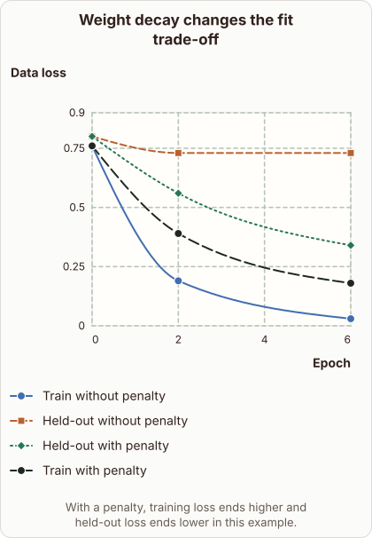
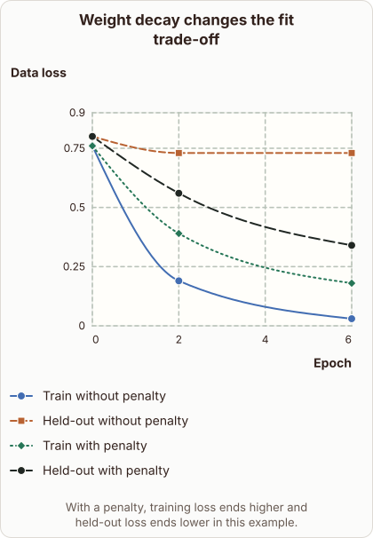

# Weight Decay in Training and Validation Loss

- Prompt (reference.prompts[0]): How does weight decay change training and validation loss?
- Reference id: d2l-weight-decay-heldout-loss (source: D2L)
- Intended kind (reference.spec.diagram.kind): coordinate-plot
- Planner kind: coordinate-plot (fixed); planner routed to picture: no
- Model kind (first diagram): coordinate-plot; all diagrams: coordinate-plot
- Selector hit (intended reference among the references sent): yes
- References sent to the author (attempt 0): shape-coordinate-plot, d2l-weight-decay-heldout-loss, ml-tree-pruning
- Structure (faithful-ref-v1, reference vs model spec): fully - The diagram has the same coordinate-plot, axes, four line series and point values as the reference. Only the order of two series differs, which doesn't change the structure.
- Factual (factual-v2): 4/5, error no - Weight decay is described correctly as an L2-style penalty that limits weight growth and reduces overfitting. 'Smoother functions' is a standard simplification. 'Decreases significantly' is slightly strong, but the diagram frames it as 'in this example'.
- Repaired: no; visual fallback: no; authored by google / gemini-3.5-flash-lite
- Time 3868 ms; author tokens in/out 4270/486; cost US$0.002496

| model (408 px) | reference (408 px) |
|---|---|
|  |  |

## Card body (as saved)

Weight decay adds a penalty on large parameter values to prevent overfitting on training data. By restricting the growth of weights, the model learns smoother functions that generalize better to unseen examples.

```rh-diagram
{"version":1,"diagram":{"title":"Weight decay changes the fit trade-off","caption":"With a penalty, training loss ends higher and held-out loss ends lower in this example.","kind":"coordinate-plot","x":{"label":"Epoch","min":0,"max":6,"scale":"linear"},"y":{"label":"Data loss","min":0,"max":0.9},"series":[{"label":"Train without penalty","kind":"line","points":[{"x":0,"y":0.76},{"x":2,"y":0.19},{"x":6,"y":0.03}]},{"label":"Held-out without penalty","kind":"line","points":[{"x":0,"y":0.8},{"x":2,"y":0.73},{"x":6,"y":0.73}]},{"label":"Held-out with penalty","kind":"line","points":[{"x":0,"y":0.8},{"x":2,"y":0.56},{"x":6,"y":0.34}]},{"label":"Train with penalty","kind":"line","points":[{"x":0,"y":0.76},{"x":2,"y":0.39},{"x":6,"y":0.18}]}]}}
```

Without this penalty, training loss drops very low while validation loss stagnates or increases due to memorizing noise.

When weight decay is applied, training loss stays slightly higher, but the held-out validation loss decreases significantly.
