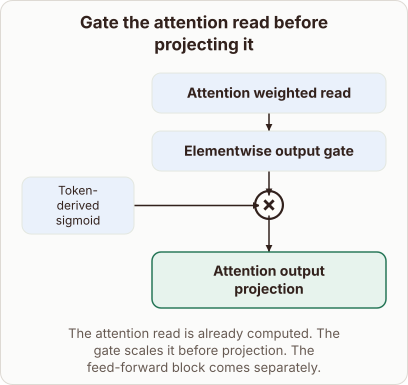

# Gating the Attention Read

- Prompt (reference.prompts[0]): Where does the output gate act after attention has read the token values?
- Reference id: figure-attention-output-gate (source: Architecture gallery)
- Intended kind (reference.spec.diagram.kind): block-stack
- Planner kind: block-stack (reference override; the planner said flow); planner routed to picture: no
- Model kind (first diagram): block-stack; all diagrams: block-stack
- Selector hit (intended reference among the references sent): yes
- References sent to the author (attempt 0): shape-block-stack, figure-attention-output-gate
- Structure (faithful-ref-v1, reference vs model spec): fully - The diagram's description is identical to the reference. It has the same three-block stack, the token-derived sigmoid multiply join into the gate, and the same caption.
- Factual (factual-v2): 5/5, error no
- Repaired: no; visual fallback: no; authored by google / gemini-3.5-flash-lite
- Time 2969 ms; author tokens in/out 3802/421; cost US$0.002194

| model (408 px) | reference (408 px) |
|---|---|
|  |  |

## Card body (as saved)

After the attention mechanism has computed its weighted read over token values, an output gate scales these vectors elementwise.

This gating step acts directly on the read output before it passes into the final attention projection layer. It modulates the information flow depending on the specific token context.

```rh-diagram
{"version":1,"diagram":{"title":"Gate the attention read before projecting it","caption":"The attention read is already computed. The gate scales it before projection. The feed-forward block comes separately.","kind":"block-stack","blocks":[{"id":"read","label":"Attention weighted read","role":"attention"},{"id":"gate","label":"Elementwise output gate","role":"attention","merge":"multiply","inputs":[{"label":"Token-derived sigmoid"}]},{"id":"out","label":"Attention output projection","role":"output"}]}}
```

By applying this multiplicative scaling, the model can suppress noisy channels or amplify relevant features from the read operation.

This takes place independently of any subsequent feed-forward blocks or residual additions in the layer.
