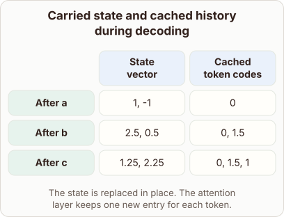

# Memory Growth in Hybrid State-Space and Attention Models

- Prompt (reference.prompts[0]): What grows during decoding in a hybrid model with recurrent state and an attention cache?
- Reference id: figure-gallery-hybrid-state-and-cache-growth (source: Architecture gallery)
- Intended kind (reference.spec.diagram.kind): matrix
- Planner kind: matrix (reference override; the planner said block-stack); planner routed to picture: no
- Model kind (first diagram): matrix; all diagrams: matrix
- Selector hit (intended reference among the references sent): yes
- References sent to the author (attempt 0): shape-matrix, figure-gallery-hybrid-state-and-cache-growth
- Structure (faithful-ref-v1, reference vs model spec): fully - The diagram matches the reference exactly. It is a matrix with the same title, columns, rows, cells and caption.
- Factual (factual-v2): 5/5, error no
- Repaired: no; visual fallback: no; authored by google / gemini-3.5-flash-lite
- Time 2622 ms; author tokens in/out 4008/323; cost US$0.00201

| model (408 px) | reference (408 px) |
|---|---|
|  |  |

## Card body (as saved)

During decoding, hybrid models manage two distinct memory structures. The recurrent state has a fixed size because old values are updated in place.

```rh-diagram
{"version":1,"diagram":{"title":"Carried state and cached history during decoding","caption":"The state is replaced in place. The attention layer keeps one new entry for each token.","kind":"matrix","layout":"teaching","columns":["State vector","Cached token codes"],"rows":[{"id":"r0","heading":"After a","cells":["1, -1","0"]},{"id":"r1","heading":"After b","cells":["2.5, 0.5","0, 1.5"]},{"id":"r2","heading":"After c","cells":["1.25, 2.25","0, 1.5, 1"]}]}}
```

In contrast, the attention cache grows linearly as each new token appends an entry. This dual behavior balances constant memory overhead with expanding context history.
