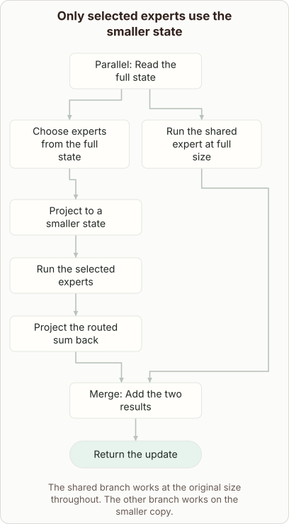

# Latent Mixture of Experts

- Prompt (reference.prompts[0]): What is compressed inside a latent mixture of experts?
- Reference id: figure-latent-expert-widths (source: Architecture gallery)
- Intended kind (reference.spec.diagram.kind): flow
- Planner kind: flow (reference override; the planner said transformation); planner routed to picture: no
- Model kind (first diagram): flow; all diagrams: flow
- Selector hit (intended reference among the references sent): yes
- References sent to the author (attempt 0): shape-flow, figure-latent-expert-widths
- Structure (faithful-ref-v1, reference vs model spec): fully - The diagram's description matches the reference exactly. It has the same title, the same fork and merge roles, all 8 edges, and the same caption.
- Factual (factual-v2): 4/5, error no - Matches the LatentMoE design: the router sees the full state, the routed experts run in a smaller latent space and project back, and the shared expert runs at full size. The 'retain fine details' rationale for the shared expert is a mild simplification, and the prose's 'before being routed' is slightly loose about where routing happens.
- Repaired: no; visual fallback: no; authored by google / gemini-3.5-flash-lite
- Time 2948 ms; author tokens in/out 3969/722; cost US$0.002996

| model (408 px) | reference (408 px) |
|---|---|
|  |  |

## Card body (as saved)

In a latent mixture of experts, token representations are compressed into a smaller latent bottleneck before being routed to specific experts.

This compression reduces the heavy compute cost normally required when running numerous large feed-forward layers.

```rh-diagram
{"version":1,"diagram":{"title":"Only selected experts use the smaller state","caption":"The shared branch works at the original size throughout. The other branch works on the smaller copy.","kind":"flow","nodes":[{"id":"x","label":"Read the full state","role":"fork"},{"id":"r","label":"Choose experts from the full state","role":"process"},{"id":"z","label":"Project to a smaller state","role":"process"},{"id":"e","label":"Run the selected experts","role":"process"},{"id":"up","label":"Project the routed sum back","role":"process"},{"id":"s","label":"Run the shared expert at full size","role":"process"},{"id":"j","label":"Add the two results","role":"merge"},{"id":"o","label":"Return the update","role":"outcome"}],"edges":[{"from":"x","to":"r"},{"from":"r","to":"z"},{"from":"z","to":"e"},{"from":"e","to":"up"},{"from":"x","to":"s"},{"from":"up","to":"j"},{"from":"s","to":"j"},{"from":"j","to":"o"}]}}
```

By shrinking the hidden dimension specifically for the routed experts, the model saves memory while preserving expressive capacity.

Meanwhile, a shared expert processes the uncompressed state to retain fine details that compression might otherwise destroy.
