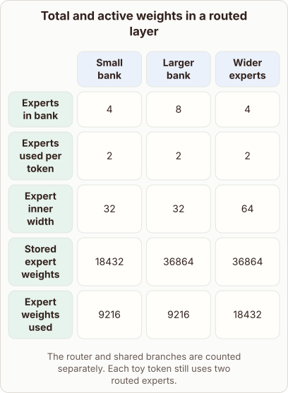

# Scaling Expert Banks Without Increasing Active Parameters

- Prompt (reference.prompts[0]): How can a model double its expert bank but use the same number of expert weights per token?
- Reference id: figure-routed-expert-parameter-split (source: Architecture gallery)
- Intended kind (reference.spec.diagram.kind): matrix
- Planner kind: matrix (reference override; the planner said token-links); planner routed to picture: no
- Model kind (first diagram): matrix; all diagrams: matrix
- Selector hit (intended reference among the references sent): yes
- References sent to the author (attempt 0): shape-matrix, figure-routed-expert-parameter-split
- Structure (faithful-ref-v1, reference vs model spec): fully - The diagram is identical to the reference matrix: same title, columns, rows, cell values and caption.
- Factual (factual-v2): 5/5, error no
- Repaired: no; visual fallback: no; authored by google / gemini-3.5-flash-lite
- Time 3704 ms; author tokens in/out 3872/680; cost US$0.002862

| model (408 px) | reference (408 px) |
|---|---|
|  |  |

## Card body (as saved)

Mixture of experts models separate the total capacity stored in memory from the compute used per token.

Doubling the total number of experts in the bank increases the storage footprint because more parameter matrices must reside in device memory.

However, the router selects a fixed subset of experts for any given token, keeping active parameters constant.

```rh-diagram
{"version":1,"diagram":{"title":"Total and active weights in a routed layer","caption":"The router and shared branches are counted separately. Each toy token still uses two routed experts.","kind":"matrix","layout":"teaching","columns":["Small bank","Larger bank","Wider experts"],"rows":[{"id":"r1","heading":"Experts in bank","cells":["4","8","4"]},{"id":"r2","heading":"Experts used per token","cells":["2","2","2"]},{"id":"r3","heading":"Expert inner width","cells":["32","32","64"]},{"id":"r4","heading":"Stored expert weights","cells":["18432","36864","36864"]},{"id":"r5","heading":"Expert weights used","cells":["9216","9216","18432"]}]}}
```

This decoupling relies on sparse conditional routing where only $k$ out of $N$ experts process each input vector.

When the bank grows from $4$ to $8$ experts while $k$ remains $2$, total parameters double but active compute per token stays identical.
