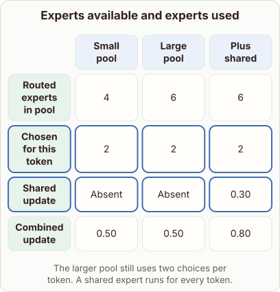

# Adding a Shared Expert to a Routed Layer

- Prompt (reference.prompts[0]): What changes when a routed expert layer adds a shared expert?
- Reference id: figure-routed-vs-shared-experts (source: Architecture gallery)
- Intended kind (reference.spec.diagram.kind): matrix
- Planner kind: matrix (reference override; the planner said transformation); planner routed to picture: no
- Model kind (first diagram): matrix; all diagrams: matrix
- Selector hit (intended reference among the references sent): yes
- References sent to the author (attempt 0): shape-matrix, figure-routed-vs-shared-experts, general-layers-2
- Structure (faithful-ref-v1, reference vs model spec): fully - The diagram matches the reference matrix exactly: same columns, rows, cell values, highlighted rows and caption.
- Factual (factual-v2): 4/5, error no - Mostly accurate. The arithmetic is consistent (0.50 + 0.30 = 0.80). The phrase 'constant baseline update' is slightly loose, because the shared expert's output depends on the token even though it always runs.
- Repaired: no; visual fallback: no; authored by google / gemini-3.5-flash-lite
- Time 3260 ms; author tokens in/out 3917/524; cost US$0.002486

| model (408 px) | reference (408 px) |
|---|---|
|  |  |

## Card body (as saved)

Adding a shared expert ensures that every token receives a constant baseline update alongside the selectively routed choices.

This guarantees that common linguistic features are always processed without relying solely on the routing mechanism.

```rh-diagram
{"version":1,"diagram":{"title":"Experts available and experts used","caption":"The larger pool still uses two choices per token. A shared expert runs for every token.","kind":"matrix","layout":"teaching","columns":["Small pool","Large pool","Plus shared"],"rows":[{"id":"r1","heading":"Routed experts in pool","cells":["4","6","6"]},{"id":"r2","heading":"Chosen for this token","cells":["2","2","2"]},{"id":"r3","heading":"Shared update","cells":["Absent","Absent","0.30"]},{"id":"r4","heading":"Combined update","cells":["0.50","0.50","0.80"]}],"emphasis":{"rows":["r2","r3"]}}}
```

Because the shared path runs unconditionally, the total computation per token increases slightly.

However, representation quality improves because general knowledge is stored in the shared parameters rather than competing for routed slots.
