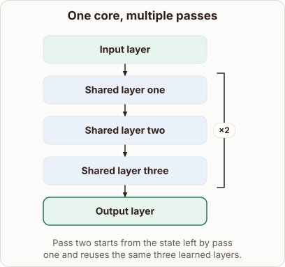

# Running Decoder Blocks Twice

- Prompt (reference.prompts[0]): How does a decoder get deeper by running the same blocks twice?
- Reference id: ml-architecture-shared-core (source: Architecture gallery)
- Intended kind (reference.spec.diagram.kind): block-stack
- Planner kind: block-stack (fixed); planner routed to picture: no
- Model kind (first diagram): block-stack; all diagrams: block-stack
- Selector hit (intended reference among the references sent): yes
- References sent to the author (attempt 0): shape-block-stack, ml-architecture-shared-core
- Structure (faithful-ref-v1, reference vs model spec): fully - The diagram's description matches the reference exactly. It has the same block order, the same repeat of layers one through three 2 times, and the same input and output layers.
- Factual (factual-v2): 5/5, error no
- Repaired: no; visual fallback: no; authored by google / gemini-3.5-flash-lite
- Time 4876 ms; author tokens in/out 3801/453; cost US$0.002273

| model (408 px) | reference (408 px) |
|---|---|
|  |  |

## Card body (as saved)

Running decoder blocks twice allows a model to achieve greater depth without adding new unique parameter weights.

By looping the hidden states back through the identical attention and feed-forward layers, the network refines its representation progressively.

```rh-diagram
{"version":1,"diagram":{"title":"One core, multiple passes","caption":"Pass two starts from the state left by pass one and reuses the same three learned layers.","kind":"block-stack","blocks":[{"id":"prefix","label":"Input layer","role":"embedding"},{"id":"core-a","label":"Shared layer one","repeat":2,"repeatTo":"core-c","role":"attention"},{"id":"core-b","label":"Shared layer two","role":"attention"},{"id":"core-c","label":"Shared layer three","role":"attention"},{"id":"tail","label":"Output layer","role":"output"}]}}
```

This recurrence lets early layers operate on intermediate features rather than just raw inputs.

Each pass updates the residual stream, letting the model perform iterative reasoning steps using the exact same physical weights.
