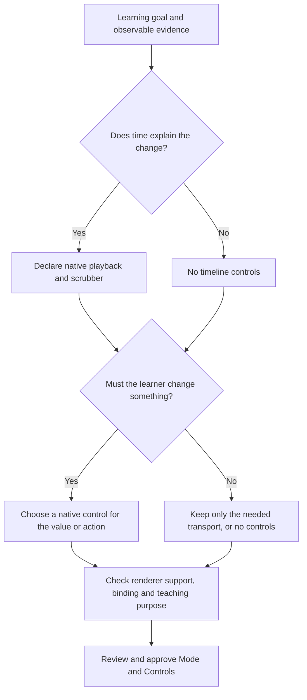

# /interact — workflow and implementation specification

Built from [slash-command-template.md](slash-command-template.md), template version 1. This is the authoritative implementation handoff for the agreed **new scene-plan workflow**; it does not claim that workflow is already built.

| Field | Value |
| --- | --- |
| Repository / delivery branch | `Rabbit-Hole-App/Rabbit-Hole` / `chatgpt/tutor` |
| Document review | 2026-11-08; documentation restructure plus owner-requested MVP sprint ladder, parallel lanes and pre-manual local gates |
| Sprint amendment base | `6129c9362796132d4ac4966ca532b6012ee07393`; existing SDK clarification and all detailed tasks retained |
| Target branch inspected | `1f4f6953850c0ed2011a4f2ffc0cd156119e7f33` |
| Earlier source-map audit | `34a63b7d2322d0bb70a086612f4bfb749776496a`; detailed historical audit uses `80eb86183de67e2baabaa4b8edb58b4d932e40bc` |
| Source document | `interact.md`, version 11; full roadmap/checklist retained with stable requirement IDs |
| Current implementation evidence | **I0 foundation** on a main base: ScenePlan schema, control catalogue, role profiles with an all-Opus adapter (disabled switch), and the player support for signed time, display pacing, exact-seek markers and a card description. Receipt: [2026-11-08-6576e731.md](interact/reviews/2026-11-08-6576e731.md). The new design, approval and build workflow (I1) is not built or accepted; no checkbox was checked at I0. **I2 (branch `interact/i2`, 2026-11-08):** Deep Experiment on the same real job, route and capture path with the Deep oracle computed from the equations (2u/g, u²/2g, 0.049 m), `reset_pause` and the endpoint of the card's own inputs in the player, the accessible description and the state check, and the supporting comparison tested as a recomputed read-only snapshot under the two-Worker limit. Checked: INT-10-C03 (local contract gate) and INT-04-C13. Browser acceptance, a real model run and the mounted-component wiring (INT-04-C07, C08, C14) are pending and those boxes stay open. Receipt: [2026-11-08-i2.md](interact/reviews/2026-11-08-i2.md). **I3 (branch `interact/i3`, offline part):** the Overview as a static program card, a different subject (the period of a simple pendulum, an untimed Experiment) through the same job, runner and card with oracles computed from the equations, and the actual-route restart, unknown-outcome, access, late-render, share and SDK-compatibility checks. No box is checked: INT-10-C04 stays open (Current / Proposed and Apply / Discard of a composed card are not built, an Edit of one is refused), and every real-model and browser acceptance is pending. Receipt: [2026-11-08-i3.md](interact/reviews/2026-11-08-i3.md). |
| Acceptance scope | Standalone 2D `/interact` design → Chat approval → runnable card; fixture, browser and real-generation evidence tracked separately |
| Runtime rollout | Proposed new flow behind a per-job versioned server switch; this documentation push does not deploy or activate it |

## Navigation

1. [Start here and preflight](#start)
2. [Product contract and decisions](#product)
3. [End-to-end workflow](#workflow)
4. [Card UI and control selection](#ui)
5. [Data contracts, prompts and LLM roles](#contracts)
6. [Implementation map and branch differences](#code-map)
7. [References and canonical examples](#references)
8. [Roadmap — WHAT](#roadmap)
9. [Implementation checklist — HOW](#checklist)
10. [Validation, benchmark and delivery](#validation)
11. [Commit review and checkbox maintenance](#commit-review)

[Benchmark result files and run index](#benchmark-results)

<a id="start"></a>
## 1. Start here and preflight

**Sprint execution:** follow the [MVP delivery ladder and parallel agent allocation](#sprint-mvps), then the [local checks required before owner manual testing](#sprint-checks). Deliver each dependency-ready increment through the existing MVP main-release path; the full checklist remains intact.

Read sections 2–5 before changing behavior; section 6 identifies code to reuse; section 7 identifies examples and UI sources. Pick the next dependency-ready checklist group in section 9, implement its full requirements, then use sections 10–11 to verify and update status. Do not implement from roadmap headings alone. Do not shorten tasks when handing them to another Claude session.

Read repository `AGENTS.md` and the authoritative `CLAUDE.md` on main. For any UI work also read [UI.md on main](https://github.com/Rabbit-Hole-App/Rabbit-Hole/blob/main/UI.md), `packages/web/DESIGN.md` and `packages/web/design/`. `UI.md` is absent at the inspected target branch; absence is not permission to invent UI. Reuse existing templates and controls.

The target branch and the earlier source-map revision have diverged. This docs change preserves the branch's unrelated work and does not rebase it. Before implementation, record the chosen working SHA and reconcile the relevant source files once with the intended integration base. The existing short brief, fixed duration and legacy Notes paths are present on the inspected branch; the proposed `interact-plan`, `interact-design`, `interact-composition`, `interact-models` and `interact-runner` modules are absent. This is source evidence, not execution evidence. Do not check a box merely because related older infrastructure exists.

Preflight outputs: exact working SHA; relevant-file delta from the source-map audit; available reference paths; dependency-ready checklist group; missing capabilities or credentials; focused checks to run. Use current source to replace stale function names in this document. Do not repeatedly re-audit main between small edits, copy unrelated main changes into this branch, or treat a missing optional benchmark adapter as a reason to stop fixture work.

**Command baseline.** At reviewed `chatgpt/tutor` `e6e12b3d`, `packages/web/src/agent/slash.js` still exposes internal `explain` as the older public Explanation entry; main already separates written `explanation` / typed `explain` from playable `explain` / typed `interactive`. I0 must integrate that existing mapping and callers, including saved bindings, picker, Ctrl+K, Quick Edit and written-command regression coverage. Choose a compatible main base or bring over the cohesive existing change; a docs push alone does not supply it.

**SDK baseline.** `main` defaults to `sdk-2` with the 2D visual kit. `chatgpt/tutor` still seals and runs `sdk-1` Programs. Record the target's supported SDK tuple across the server, review renderer and learner player before choosing helpers for the scene plan. [Branch comparison and integration requirements](#existing-2d-visual-sdk)

**Specification status:** checkbox IDs in this document are requirement identifiers. The coordinator's task UUID ledger remains outside the repository under current `CLAUDE.md`; link requirement IDs to those UUIDs there. Do not create a competing task ledger in this file. Progress states are To Do / Doing / Done, with phase and blocker recorded separately.

<a id="product"></a>
## 2. Product contract and decisions

**Goal:** A learner supplies a prompt and depth, receives a complete reviewed scene plan in Chat, approves it, and receives one working Canvas card whose explanation, scene, timeline and controls agree.

| Decision | Required behavior |
| --- | --- |
| Scope and names | Strictly 2D. Target command `/interactive`, picker prefix `/interact`, preserved internal ID `explain`, endpoint `/api/learn/explain/jobs`, block type `animation`. Preserve stored identifiers. Written `/explain` is internal `explanation`; live 3D `/animation` and video `/motion` are separate. I0 must reconcile the older target-branch registry with main's existing split; reuse that mapping rather than inventing another rename. |
| Depth | Overview / Standard / Deep change teaching depth, independently of Static / Over time / Experiment. |
| Approval order | Final Title, full Story, separate cardDescription, support design, Scene, Mode and Controls exist and pass design review before Chat offers Generate. |
| Scene before approval | “Updated scene” means the complete revised design. Generate starts executable scene building. |
| Card text | Title and a separate 2–4-rendered-line description above every scene. Full Story stays in the plan/review and benchmark artifacts. No explanatory paragraphs, captions, Notes or takeaways below any scene or controls. |
| Card order | Title → description → optional supporting static visuals → main scene → external playback/timeline when timed → experiment controls when declared. Animation touches its controls; no static diagram or prose between them. |
| Native UI | Use existing SVG components, trusted Frame, players, control widgets and card shell. Generated code stays in the existing sandbox; models cannot return arbitrary app UI. |
| Static sizing | Fit content at initial size; omit absent rows and their space. Preserve deliberate user resizing. The earlier HTML spacing attempt was not a verified fix. |
| Review and repair | Independent design and rendered-artifact reviews; bounded corrections; no ready card on unresolved major/blocking findings. |
| Models | Six independently configurable production roles; begin with all Opus, then benchmark role substitutions and mixed profiles. Benchmark evaluator is separate. No model winner has been established here. |
| Compatibility | Preserve legacy cards/jobs and delivered-card Current / Proposed / Apply / Discard. Do not silently turn legacy briefs into reviewed plans. |
| Exclusions | No Tutor roadmap orchestration, new 3D/audio player, new widget family, or changes to unrelated generators. Existing roadmap handoff is a separate feature. |

**Authority:** latest explicit owner decisions → this active specification → cited UI/examples within their stated scope → historical audit. If code differs from the target, treat it as a gap, not permission to weaken the requirement. If an older HTML/example has long card prose or a supporting comparison below the animation, apply this document's later composition decision. Engineering defaults (schema limits, token/call caps and trial counts) are proposed implementation defaults, not measured claims or new owner authorizations; record justified revisions before running a comparison. No paid benchmark cap is set here.

<a id="workflow"></a>
## 3. End-to-end workflow

1. Authorize the prompt, readable context/evidence and selected depth; create the stable job and pending Canvas card.
2. Design Author drafts the whole plan; independent Design Reviewer assesses learning/transfer and then facts, scene, Mode and Controls; Design Reviser returns the whole updated plan. Bounded follow-up review closes substantive changes and blocking findings.
3. Validate the final design, capability bindings and description fit. Persist final Title, full Story, cardDescription, supporting visuals, Scene, Mode, Controls and review provenance.
4. Show **Review scene plan** in Chat. **Edit** returns through design/review with a new revision. **Cancel** stops and fences late results. **Generate** consumes only the current signed, reviewed plan identity.
5. Scene Builder produces main/support artifacts from that approved plan. Trusted validation compiles composition before capture, so the reviewer sees the actual complete card. Render actual frames, perform numerical/behavioral checks and obtain independent Rendered Scene Reviewer findings. Repair within limits and recapture changed candidates.
6. Save the accepted composition/artifacts and populate the same Canvas card. Recovery retains the request and valid completed work; failed or exhausted candidates never become ready.

Composition is deterministic both during validation/capture and at delivery; it is not an unreviewed layout transformation after the last reviewer. Six logical roles do not mean six calls: follow-up review, correction rounds and learner edits are counted separately. See section 5 for exact bounds and section 9 for durable states, effects and approval fencing.

<a id="ui"></a>
## 4. Card UI and control selection

The card-content contract in section 2 is implemented by INT-06 and verified by INT-09. Use `AnimationBody`, `AnimatedScene` / `ProgramScene`, SVG `Frame`, `SceneControls`, existing card title and Focus layout. `InteractCardContent` is a scoped composition wrapper around those components, not a replacement player or a new visual design.

### Control selection workflow — choose the smallest useful set

The Design Author chooses controls while writing Mode, using a runtime-provided control catalogue. The Design Reviewer checks the choice; the Reviser updates it; the Scene Builder binds the approved controls. These are responsibilities of existing roles, not another agent or LLM call. Availability means the actual enabled renderer and component can implement the control, not merely that a React widget exists somewhere in the repository.



If a choice is unsupported, revise the design before approval while preserving its learning goal. If the essential interaction cannot be represented, return a capability gap. Never promise a widget the selected runtime cannot render or silently substitute a different interaction after Generate.

| Learner need | Preferred existing control | Declarative renderer | Program renderer | Selection rule |
| --- | --- | --- | --- | --- |
| Watch and inspect a time-dependent change | Native Play/Pause/Replay plus scrubber/current time | `AnimatedScene` transport | `ProgramScene` transport when timed | One shared timeline for linked views. No timeline for a still comparison or merely revealing text. |
| Vary a numerical quantity over a bounded range | Numeric slider with value and unit | Only a component-supported numeric/discrete domain; its generic index slider is not an arbitrary continuous number slider | `NumberInput` for a declared number input | Use when intermediate values teach something; set meaningful default/range/step. For two or three named cases, prefer choices. |
| Choose one of a small set of named alternatives | Segmented choice buttons/chips | `ChoiceButtons` through `InputWidget` type `choice`, or `IndexPicker` for indexed data | Declared `select` input rendered as native choice buttons | Use descriptive option labels. Prefer 2–5 options when sufficient; honor the runtime limit. Do not invent a dropdown because it is common elsewhere. |
| Turn one property on or off | Boolean switch | `BoolToggle`, input type `bool` | No native Boolean switch in the audited manifest | Use a switch only when the enabled declarative component exposes Boolean state. If the program route is selected, an explicitly planned two-option `select` such as Off/On is supported; declare it as `select`, not an imaginary program switch. |
| Move through ordered items or an indexed state | Index picker chips for few items; index slider with Previous/Next for more items | `IndexPicker` or `IndexSlider`, input type `index`; slider presentation is explicitly declared | No native index pager; a number/select input can represent the index only if explicitly planned with clear labels | This is a discrete state choice, not a physical-time scrubber. Step size is one; resolve actual data length and label the selected item. |
| Select multiple independent items | Multi-select chips/marks | `IndicesMarks`, input type `indices` | No native multi-select input in the audited manifest | Use only when combinations answer the question. Do not make mutually exclusive choices multi-select or imitate a missing widget with unrelated buttons. |
| Perform a meaningful state transition | Action button | Only actions already expressible by the offered component/input semantics; no generic program-style action event | Schema 2 declared `actions`, when stateful capability is enabled | Use for actions such as Run one iteration or Add one sample. A button changes state; a selector chooses a persistent value. Do not invent a new Steps presentation. |
| Inspect or manipulate an object | Existing object selection; drag only when supported | Component/scene-supported pick targets; direct manipulation must be confirmed for the specific component | Schema 2 `targets`, with explicit `drag:true` for dragging | Use when object identity or position is itself the teaching variable. Keep existing visible/keyboard operation available; do not make an undiscoverable click the only way to operate the experiment. |
| Return an experiment to its starting conditions | Reset | Existing reset path | Existing reset path | Declare when mutable state/inputs make it useful; disable/hide appropriately at defaults. New-flow Reset restores defaults and initial state/time; Replay retains parameter values. Preserve legacy reset behavior for legacy artifacts. |
| Read a quantity or understand a fixed comparison | In-scene label/readout, or no control | Existing scene annotations | Existing frame/readouts | A displayed value is not automatically an editable parameter. If changing it has no teaching purpose, keep it fixed. |

**Controls that are not new-plan choices:** existing `StepPager` supports legacy Steps cards; `CardPager` is navigation for an already-declared multi-part declarative card, not an experiment input. Existing mute/audio, practice-answer controls, Focus, Prompt and recovery buttons belong to their existing features/chrome and are not automatically added to generated experiments. This workflow stays 2D. No new widget family, playback-speed selector, loop selector, audio feature or 3D control is introduced by this inventory.

Selection principles for the prompts and reviewer:

1. Start with no experiment controls and add a control only if the learner can use it to observe, compare or test a stated relationship. Start with one key variable when that answers the question; add more only for a named learning benefit. Never add controls just because depth is Deep.
2. Keep causal inputs distinct from outputs. For example, Launch speed can be an input and Peak height a derived readout; do not expose both as unrelated independent sliders when the model links them.
3. Match the control to the value's semantics: range → slider, one named option → choice buttons, true/false → supported toggle or explicit two-option select, ordered item → index control, set → multi-select, event → action, spatial variable → supported manipulation.
4. Keep each native control bound to one authoritative state value/action. Multiple views can share that binding; do not duplicate inconsistent controls or clocks. Existing keyboard alternatives to object manipulation are synchronized access paths, not separate parameters.
5. Choose a useful initial value and honest domain from the stated model. Labels name the quantity/action; units and current values stay with the control. Changing the parameter must produce the approved visible consequence or demonstrate a specified invariant.
6. Record `purpose` and `selectionReason` in the plan/review data. The reviewer asks whether removing the control would weaken the explanation, whether a simpler supported control is sufficient, and whether it can be operated at the target card widths. Do not display these explanatory paragraphs below the scene or controls.

Reference decisions: Overview toss-and-drop uses no controls; Standard uses only Play/Pause/Replay and the signed-time scrubber; Deep uses Time since launch for its main scrubber, apex-relative time only in its supporting comparison, and adds the Launch speed slider, default 5.0 m/s, range 3.0–5.0 m/s, step 0.1 m/s, because it tests whether a higher throw changes motion around its own peak. Depth itself is not the reason for adding the slider. Replay and Reset have distinct bindings; use the reset declaration only when restoring defaults is part of the approved interaction.


Timeline arithmetic: define `ScalarExpr` as `{op:'literal',value:number}`, `{op:'input',id:string}`, or `{op:'add'|'subtract'|'multiply'|'divide',left:ScalarExpr,right:ScalarExpr}`. Limit to 32 nodes and depth 8. Only declared numeric inputs are readable; constants use literal nodes. Reject non-finite results, division by zero and unknown IDs. Validate interval bounds across the admitted input ranges, not just defaults; reject expressions whose safety cannot be established within this bounded language. The elapsed-time end must stay positive and within the existing 120-second runtime ceiling; displayOffset can be negative but must be finite. Markers use elapsed time and stay inside the resolved timeline. The scrubber displays [displayOffset, end + displayOffset]; convert user scrubbing back to elapsed time before evaluation. UI and accessibility labels use displayed time. An empty marker array is valid. No `eval`, arbitrary expression string or generated function runs in the host.

Depth rubric embedded for builders and reviewers:

| Depth | Story requirement | Scene requirement |
| --- | --- | --- |
| Overview | Familiar situation and one question; essential terms in plain language; resolve it through a small concrete comparison. | One readable comparison with starting state and visible evidence for the answer. |
| Standard | Explain the mechanism through a worked example, meaningful quantities and a causal ending. | Explicit states/instants, shared scales, changing measurements and visible invariants. |
| Deep | Trace or derive why the result holds, its assumptions, and a useful contrasting case or boundary. | Inspectable relationships, linked measurements/plots, units and reference points; meaningful controlled comparisons. |

Mode rules: Static has no timeline and can have controls that recompute a still view. Over time has a timeline and fixed experiment inputs; transport controls do not count as adjustable experiment inputs. Experiment requires a meaningful adjustable input, action or interactive target; it may be timed or untimed. Accept the example document's term **Interact** only when importing references, normalize it to **Experiment**. New plans never offer Steps. Existing Steps artifacts retain their current playback/pager behavior.

<a id="contracts"></a>
## 5. Data contracts, prompts and LLM roles

The following interfaces are proposed new work. Reuse an equivalent existing implementation if found on the chosen working revision and update its actual path here. Product requirements are fixed by section 2; numeric engineering defaults are explicitly identified below.

### ScenePlan v1

Create `packages/web/src/interact-plan.js` as a shared, pure schema/validation module. It can be imported by server code just as the existing `explain-contract.js` is. Export `ScenePlanSchema`, `DesignReviewSchema`, `DesignRevisionSchema`, `parseScenePlan(raw, capabilities)`, `validatePlanBindings(plan, capabilities)` and `scenePlanJsonSchema()`. `parseScenePlan` returns `{ok:true,value}` or `{ok:false,problems:[{path,code,message}]}`; it never silently strips required content.

| Field | Required shape and meaning |
| --- | --- |
| `schemaVersion` | Integer `1`. |
| `depth` | `overview\|standard\|deep`, supplied by the request and unchanged by models. |
| `title` | Non-empty learner-facing title, maximum 120 characters. |
| `story` | Full teaching narrative retained in design/review and benchmark outputs, maximum 12,000 characters as a transport bound, not a writing target. No raw HTML or executable content. Includes setup, discovery and ending. It is not rendered as the card body. |
| `cardDescription` | Separate required non-empty plain text derived from the Story, maximum 500 characters as an input bound. The actual UI requirement is **2–4 rendered lines**, verified at the supported card text widths; character count is not a substitute. States what the scene explains or what to observe, preserving the essential scientific qualification. Render once, immediately below Title and above every scene. |
| `learningGoal` | One concrete thing the learner should explain, predict or do. |
| `supportingVisuals` | Explicit array, maximum two for this first implementation. Each has stable `id`, `title`, `description`, required `runtime`, `observations`, `parameterBindings` and `readoutIds`. These are untimed explanatory panels above the main scene. `parameterBindings` is an array of `{fromInputId,toInputId}` mapping the main state to support inputs; use an explicit empty array for fixed panels. |
| `scene` | `{description, runtime, entities, quantities, observations, checkpoints, readoutIds}`. Entities have stable `id`, `label`, `purpose`. Quantities have `id`, `label`, `unit`, `meaning`, `reference`, and optional `relation` in plain text. Observations identify what visibly supports the conclusion. Checkpoints are `{id,label,time,inputOverrides,actions,expected}`: `time` is ScalarExpr or null for an untimed state, `inputOverrides` is a validated partial input map, `actions` is an ordered list of declared action IDs, and `expected` describes observable evidence. Use explicit empty maps/lists where none apply. Shared scales, axes and reference origins must be specified in `description` and quantity references. No executable formula strings. |
| `mode` | `{kind, initialState, fixedValues, adjustableIds, timeline, onInputChange}`. `kind` is `static\|time\|experiment`; UI labels are Static, Over time, Experiment. `initialState` is a complete plain-language description. `fixedValues` is a scalar map with units recorded in quantity definitions; `adjustableIds` names declared input IDs. |
| `mode.timeline` | `null` for untimed, otherwise `{label, unit:'s', start:0, end, displayOffset, markers, initialTime:0, initialPlayback:'paused', playbackRate}`. `end`, `displayOffset` and marker times use the bounded ScalarExpr defined below. Internal elapsed time starts at zero; displayed time equals elapsed time plus `displayOffset`. Standard can therefore show a signed time-from-apex range while the runtime retains nonnegative elapsed time. Labels explain the displayed time origin. Deep's full-flight timeline uses displayOffset=0 and Time since launch; only its supporting peak comparison is apex-relative. `playbackRate` is a finite positive physics-seconds-per-wall-second value, validated against the host transport; the canonical Standard fixture uses 0.1 (engineering pacing default), not a new learner-facing speed selector. |
| `mode.onInputChange` | `recompute_still` for untimed scenes or `reset_pause` for timed ones in this implementation. A timed parameter change resets to time zero, pauses, and recomputes dependent views and endpoint. |
| `controls` | Explicit array. Every item has `id`, `label`, `type`, `purpose`, `selectionReason`, `nativeControlId`, `binding`, `affects`. Types: `playback`, `scrubber`, `number`, `select`, `boolean`, `index`, `multi_select`, `action`, `target`, `reset`; at most 24 entries overall and the existing stricter per-type runtime limits apply. Type-specific fields below. Use `[]` when there are none. |
| `assumptions`, `limitations` | Explicit arrays of plain-language strings. |
| `claims` | Array of `{id,text,evidenceIds,check}`. Evidence IDs may only reference supplied evidence. `check` describes a verifiable calculation or observation; it is not a model-issued factuality certificate. |

Implementation defaults: at most 24 entities, 16 quantities, 12 observations, 12 checkpoints and 32 claims. Bound individual explanatory entries to 1,200 characters. Apply existing runtime input/action/target/viewport limits during capability validation. These are initial engineering limits; report a capability gap if a valid request needs more. Do not truncate silently.

Control details:

- `number`: `default`, `min`, `max`, positive `step`, `unit`, binding `{kind:'input',id}`. Default must be in range and on the declared step grid within numerical tolerance.
- `select`: `default`, distinct `options:[{value,label}]`, binding `{kind:'input',id}`; default must be an option.
- `boolean`: Boolean `default`, binding `{kind:'input',id}`; allowed only when the enabled renderer/component catalogue advertises a Boolean switch. Map to declarative type `bool`.
- `index`: integer `default`, `dataRef`, ordered `items:[{id,label}]`, `presentation:'picker'|'slider'`, binding `{kind:'input',id}`. Derive bounds from the approved ordered items, with step one; `dataRef` names the dataset binding the builder must supply. Validate the built dataset has the same item IDs/order as the plan; map to declarative type `index`. A program number/select alternative is declared with its actual supported semantic type.
- `multi_select`: `default` as a sorted unique index array, `dataRef`, and ordered `items:[{id,label}]`, binding `{kind:'input',id}`; map to declarative `indices`. Bounds come from the approved items and must match the built dataset exactly. Refuse on a renderer without this capability. For index and multi-select, cap items at the smaller of 256 and the offered component limit; empty datasets must be handled explicitly without an invalid slider range.
- `nativeControlId`: exact ID offered by the runtime control catalogue, not a model-invented widget or component name. `selectionReason` states why this control is useful for the learning goal and preferable to the simpler available alternatives. These metadata fields are stored and reviewed, not rendered as text beneath controls.
- `playback`: binding `{kind:'timeline'}`, `labels:{paused:'Play',playing:'Pause',ended:'Replay'}`. One control drives all linked timed views.
- `scrubber`: binding `{kind:'timeline'}`, unit seconds, positive step, and range/markers derived from `mode.timeline`. Do not duplicate independently authored endpoint values.
- `action`: binding `{kind:'action',id}` and complete `effect` description; implementation uses the runtime's existing action events.
- `target`: binding `{kind:'target',id}`, `interaction:'select'|'drag'`, and `effect`; reuse accessible object interaction support.
- `reset`: binding `{kind:'reset'}`, effect is restore default inputs and initial state/time, paused for a timed scene. Preserve old artifact reset semantics on the legacy path. This is distinct from Replay, which retains current inputs.
- Every binding resolves to a declared runtime input/action/target or the native timeline. Every mutable input has a declared control; all `affects`, quantity and readout references resolve. `controls` must not contain arbitrary HTML, CSS, JavaScript or URLs.

### Schema closure and hashing details

These are proposed contract clarifications to implement in INT-01, not additional LLM agents:

- Export and validate `DesignRevisionSchema` as well as ScenePlan and DesignReview. Reject unknown top-level versioned fields rather than stripping required data; any provider schema normalization must round-trip through the same authoritative validator.
- `observations` are bounded `{id, text, quantityIds, readoutIds}` records; references resolve within their named main/support scene; an observation uses the readouts and any quantities actually declared for that scene. `readoutIds` are bounded unique string arrays that the builder must bind to actual emitted readouts. Main quantities and support readouts are not implicitly interchangeable. Support observations may leave `quantityIds` empty and reference their declared `readoutIds`; no undeclared support quantity is invented by validation.
- Timeline markers are `{id, label, time: ScalarExpr}` with unique IDs and finite in-range resolved times. `fixedValues` and checkpoint `inputOverrides` use JSON scalar values (finite number, string or Boolean), validated against the declared domain; nested executable objects are forbidden.
- `affects` is an array of typed references `{scope:'main'|supportId, kind:'entity'|'quantity'|'readout', id}`. Main references resolve against `scene.entities`, `scene.quantities` or `scene.readoutIds`; support references use that support panel's declared `readoutIds` (kind `readout`). Validate every target; an effect description is not a substitute for a bound reference and tested visible behavior. Checkpoint action IDs resolve to declared actions; selection/drag coverage additionally comes from the trusted transition sampler, not arbitrary model code.
- Compute canonical content hashes server-side over schema version and validated data using the repository's established canonical serialization/hash helper where available. Keep array order where meaningful; never hash a model-supplied hash as authority. Bind capability/runtime/profile/schema/prompt versions to the job and saved receipts. A changed approved content hash invalidates approval; a new build cannot reuse stale captures.
- Description fit is an early trusted render-service check, implemented in INT-06-C17. The text-only shell uses the real card styles and widths; a fit receipt binds to the final copy and style version. It introduces no seventh writer and no generation on resize.

### Design review and revision records

`DesignReview` contains `planHash`, `learning:{goal,likelyUnderstanding,visualEvidence,transfer:{prompt,expectedReasoning},teachBack:{prompt,expectedReasoning},improvement,score}`, `sceneQuality:{accuracy,clarity,modeControls,buildability,score}`, `findings:[{id,severity,category,path,claimId,message,requiredChange,verification}]`, `openChecks`, and `verdict:'pass'|'revise'|'gap'`. Scores are integers 1–5; categories include fact, depth, pedagogy, layout, mode, control and capability. `severity` is blocker, major or minor. A blocker/major overrides a claimed pass. `openChecks` distinguishes a fact requiring evidence from a visual check requiring a rendered candidate. No learner-understanding claim is “demonstrated” without learner responses.

`DesignRevision` contains the **whole** `plan`, `changes:[{findingId,paths,explanation}]`, and `unresolvedFindingIds`. The server computes the new hash and diff; it never accepts a model's self-reported hash or “fixed” flag as verification. A reviser must preserve Mode, Controls and the separate cardDescription even when unchanged. Review the description against the full Story for accuracy and meaning; shortening must not remove a qualification that changes the conclusion.

### Per-panel runtime and canonical time bindings

Before a plan is signed or Generate is enabled, **every** panel, including a control-free static support panel, has a validated `runtime` record: `{renderer:'spec'|'program', schemaVersion, sdkVersion, programTuple, requiredHelpers, requiredCapabilities, catalogueHash}`. For `spec`, program-only SDK/tuple fields are explicitly null and helpers/capabilities refer to the declarative catalogue; for `program`, use the exact supported tuple/schema representation from the existing sealing/stamp contract, with SDK version and helper requirements. Do not invent new tuples. The trusted resolver validates a proposed binding against the actual server compiler/sandbox, capture service and learner player; absence of controls is not proof of compatibility.

Bind the resolved record and catalogue version into the canonical plan/approval hash, composition, artifact sealing and capture receipt. Build and repair must retain the selected renderer, tuple and capabilities per panel. Unsupported or unavailable requirements before approval return a design capability gap; a changed binding requires revised design review and new approval. After approval, reject incompatible build/repair output rather than silently switching renderer, SDK or dropping a panel. Reopen uses the sealed tuple of each saved artifact, preserving saved sdk-1 compatibility.

**Standard:** fixed launch speed 3.0 m/s; physics elapsed time 0…6/9.8s and signed displayed time `t−3/9.8`, approximately−0.306…+0.306s. The fixed three-moment panel is part of I1 and appears above the animation; animation remains adjacent to external controls. Use a trusted playback rate of 0.1 physics seconds per wall second for the canonical fixture, yielding approximately 6.12 wall seconds without changing physics. Store/review this rate; it is an engineering default to verify manually, not a new speed selector. The native scrubber's pointer and keyboard seek paths must resolve exactly to elapsed `3/9.8−0.10`, `3/9.8` and `3/9.8+0.10`, using native checkpoint snapping/seek behavior as needed. Keep the previously removed textual marker row absent; seeking does not require reintroducing explanatory text below controls. Assert +0.98/0/−0.98m/s and−9.8m/s², and correct gate release at the apex.

**Deep:** main scrubber **Time since launch**, displayOffset 0, elapsed0…2u/9.8s (approximately 0.612…1.020s over u=3…5m/s); **Trial top** at u/9.8. Only **Compare the two peaks** uses each throw's own apex-relative τ. Input changes recompute the full-flight endpoint and linked static comparison, reset to launch and pause; Replay retains speed, Reset restores defaults. Never apply Standard's negative display offset to Deep's full-flight clock. Display pacing changes wall-clock playback only, not equations, readouts, seek positions or stored physics time.

### Prompt inventory — existing guidance and production work

Use [tutor-scene-examples.md](interact/references/tutor-scene-examples.md) as the source for teaching instructions. It does **not** already contain complete production system prompts for every role.

| Role / content | What exists now | What Claude must implement |
| --- | --- | --- |
| Story authoring | **How to write the story and scene → Story**, plus **Expectations by depth**, provide narrative instructions and the Overview/Standard/Deep rubric. | Incorporate these into the single Design Author system prompt with the ScenePlan output contract. |
| Scene design, Mode and Controls | **What the scene shows** and **How to define Mode and Controls** describe observable evidence, initial state, time behavior and exact control definitions. | Combine these with Story authoring in `packages/control-plane/src/agents/interact-design-author.js`. Story and Scene are outputs of the same Design Author, not additional independent agents or calls. |
| Design Reviewer | **Reviewer system prompt** is a complete prose system prompt, with ordered learning-outcome/transfer and scene/UI review sections. | Preserve its teaching criteria and ordering in `packages/control-plane/src/agents/interact-design-review.js`; add the structured DesignReview contract, evidence rules and blocking-finding semantics. Do not replace it with a generic “check accuracy” prompt. |
| Design Reviser | Feedback and full revised examples demonstrate the desired result; there is no complete Reviser system prompt in the examples document. | Write `packages/control-plane/src/agents/interact-design-revise.js` to consume the complete draft/review and return the complete revised Story, cardDescription, Scene, Mode and Controls with change tracking. |
| Scene Builder | The examples document describes scenes, but contains no production prompt for generating executable artifacts. The repository already has builder prompts/tools in `packages/control-plane/src/agents/explain-author.js`. | Extend those existing prompts/tools for the approved ScenePlan and main/support artifact envelope; preserve the runtime constraints and control bindings. |
| Rendered Scene Reviewer and Scene Repairer | The examples document's design-review prompt does not replace these roles. Existing repository prompts live in `packages/control-plane/src/explain-review.js` and `packages/control-plane/src/agents/explain-repair.js`. | Adapt them to the approved plan, actual card captures/traces, composition and full revised artifact output, following INT-05. |

The source instructions and examples are reference material; the production prompts must explicitly name their inputs, output schema, factual/evidence rules, depth expectations, runtime limits and failure behavior. Preserve the later approved card order when the older example prose differs. General writing rules and review rubric can be shared in all benchmark arms; keep the exact example answers and Feedback out of the prompt-to-card generation arm.

### Model roles, profiles and bounded calls

| Logical role | Proposed task ID / existing task reuse | Input → output | All-Opus default |
| --- | --- | --- | --- |
| Design Author | `interact_design_author` | Prompt, depth, readable context/evidence, runtime capabilities, optional previous plan and edit → ScenePlan | `claude-opus-5-5`, max output 12,000 tokens |
| Design Reviewer | `interact_design_review` | Prompt, depth, plan, evidence, capabilities; optional prior findings → DesignReview | Same model, 6,000 tokens |
| Design Reviser | `interact_design_revise` | Prompt, complete plan, review and evidence → DesignRevision | Same model, 14,000 tokens |
| Scene Builder | Existing `explain_author` | Approved plan and runtime catalogue/limits → main artifact and support artifacts | Same model, 16,000 tokens for new-flow jobs |
| Rendered Scene Reviewer | Existing `explain_review` | Approved plan, validated captures, numerical/interaction traces, composition evidence → existing review result | Same model, 10,000 tokens for new-flow jobs (a verdict and several findings for each of up to six captures); image-capable |
| Scene Repairer | Existing `explain_repair` | Approved plan, current artifacts and exact failures/captures → corrected artifacts | Same model, 16,000 tokens for new-flow jobs |

Build roles: a reply the schema refuses (a manifest text over its limit, an invented review category, a review that skips a capture) gets ONE correction call that names the exact problems, as the Design Author does; it is counted like any call, so the per-run ceilings are Builder 2, Reviewer 5 (one review, three re-reviews after repairs, one correction) and Repairer 4 (three rounds and one correction). A repair refused even after its correction spends its round and keeps the failure it had to answer; a refused build or review stops the job as before. Every manifest length, count and range limit is stated in the Builder and Repairer prompts, generated from the schema they are given.

These token limits are proposed implementation defaults, not measured latency or quality claims. Keep legacy limits for legacy jobs. The all-Opus profile preserves the existing automatic-tool approach; no hidden fallback or assumed thinking/effort setting. A candidate profile declares effort/temperature/output limits only where supported, records them, and does not inherit them silently from another provider.

Each resolved role config includes `provider`, `model`, `adapter`, `credentialRef` (environment variable name only), `maxOutputTokens`, `maxInputBytes`, `maxImages`, `timeoutMs`, `settings`, `pricingKey`, `capabilities` and `servedModelAliases`. The server owns profiles; the learner request cannot inject provider URLs, credentials or arbitrary models. Profile ID/version/hash are stored on each job and cannot change halfway through a run. Runtime profile selection uses server setting `INTERACT_MODEL_PROFILE`, default `opus-baseline`; the registry defines the exact environment credential names per provider. Default input-byte ceilings are 60,000 for each design role and 80,000 for each build role; reuse existing image counts (builder 4, rendered reviewer 6, repairer 2), and cap design image inputs at 4. Text-only design cases send no images. Capability preflight fails explicitly if a selected provider cannot accept required images or schema features.

Initial bounds: one Design Author; one normal Design Reviewer; one normal Design Reviser. If factual claims (including those in cardDescription), units, timelines, controls, assumptions, core conclusions or capability commitments change, or the original review has blocking findings, run a follow-up Design Reviewer on the revised plan. If needed, permit one additional revision plus one final review. Total design ceilings per plan attempt: author 1, reviewer 3, reviser 2. Cosmetic-only changes with no blocking findings may close through deterministic validation. A remaining blocker/major stops with a useful failure; no automatic unbounded loop. Keep at most five learner refinements, each with its own recorded preparation attempt.

Use 120-second per-call timeout, a 600-second preparation deadline, and the existing 600-second post-Generate job deadline for new-flow jobs. These are hard ceilings, not targets. Retain at most three build correction rounds, shared across validation/render/review failures. Preparation admission/reservation must include the selected profile's maximum design calls; generation admission includes builder 1, rendered reviewer up to 4 and repairer up to 3. A denied call does not count as a sent call. Unknown provider outcome is not automatically resent or booked as zero cost.

### Runtime composition envelope

Create `packages/web/src/interact-composition.js` with `CardCompositionSchema`, `compileCardComposition(plan, artifacts)`, `resolveTimeline(composition, inputs)` and `validateCompositionBindings(plan, artifacts)`. Each main/support output kind and sealed runtime must match its approved panel `runtime`; builder and repair cannot choose a different renderer or SDK after approval. Build output is `{main:{kind:'spec',spec}|{kind:'program',program},supporting:[{id,artifact:{kind:'spec',spec}|{kind:'program',program}}]}`. Support IDs match the plan exactly, maximum two. Every artifact passes the existing compiler or sandbox validation; one builder call can return all artifacts. Do not run a separate generation call per support panel by default.

The server creates `CardComposition v1` containing the approved `planHash`, Title, `cardDescription`, supporting panel labels and validated artifact references, main artifact reference, normalized controls, per-panel approved runtime bindings, timeline expression/playback rate and input-change policy. Models cannot create storage references or hashes. Support panel input bindings map declared main inputs to compatible support inputs; resolve read-only snapshot values from the current main input state at time zero, with no independent clock, transport or mutable UI. Supporting still plots can recompute after an input change; they never play along a second timeline. Do not interpolate untrusted SVG/HTML as support content.

Store composition with the accepted result alongside main/support artifacts. Include the composition in the result route and a bounded, versioned reference in the Canvas block; retain the full Story in the versioned design record and avoid duplicating it or program source in Canvas block fields. Legacy results without composition continue through the old renderer path. Hash the entire result envelope so support visuals cannot be swapped independently of the approved revision.

### Swappable models and mixed-profile benchmark — owner requirement, 2026-11-08

Support **Opus, Celeris, Cerebras-served models and Gemini Flash candidates**, plus other providers through the same adapter contract. These are candidate families/services, not verified API model IDs or declared winners. Cerebras is a provider: record its actual served model separately. Resolve exact IDs, access and supported parameters from the existing repository configuration and provider capability checks before an authorized run; never guess a model ID or silently substitute a service.

**Configuration, not pipeline rewrites.** Use server-owned, versioned profiles mapping each existing LLM role to provider, exact model ID, adapter, credential environment-variable reference, supported settings, input/output/vision limits, timeout, pricing key and explicit fallback policy. A profile selection or one role override must require only configuration plus validation once that provider adapter exists. New providers may require one adapter; individual runs must not require editing prompts, routing branches or renderer code. Provider endpoints are allowlisted server configuration, never user-supplied URLs. Credentials stay outside checked-in profiles.

Pin profile ID/version/hash, resolved role configurations and prompt/schema versions at request/job creation. Quote/admit the actual selected model request and include those bindings in accepted-request fingerprints. An edit requiring a new request creates a new bound revision; reload/resume cannot silently adopt changed defaults. Preserve the existing command's authorization, call ceilings, cancellation, billing and repair rules. Explicit fallback must have an admitted bound and its own recorded model/attempt; no hidden fallback or extra retry makes a failed candidate appear successful.

Use a normalized adapter result containing validated output, requested/served provider/model, attempt/stop/error classification, usage/cache/reasoning fields where supplied and timing. Reuse existing admitted provider transports. An OpenAI-compatible endpoint does not prove identical schema, streaming, tool or image behavior. Implement Gemini through a supported existing adapter or a dedicated verified adapter if necessary. Fail capability preflight when an assigned role needs images or structured output that the candidate cannot supply; do not drop captures or weaken the original schema.

**Benchmark objective:** factual correctness and end-to-end usable-output speed, with cost reported alongside them. Freeze prompts/context/Depth, expected facts/calculations/tolerances, required visuals/observations and evaluator rubric before candidate runs. Run all-Opus reference baseline, eligible candidate profiles, one-role substitutions, then promising combinations through the complete pipeline. An unavailable role/provider is explicitly unsupported, not a reason to omit that role.

Compare matched cases with interleaved/randomized order, fixed declared concurrency, cache-hit/miss separation and repeated confirmation runs. Keep failures, invalid output, refusals, timeouts and exhausted repairs in the denominator. Record completion/factual pass rate, major/minor errors, omissions, diagram/control correctness, Send/Accept-to-client-usable-card latency, stage and repair times, median/p95 with counts, and known/unknown cost. Do not rank fast invalid output as success. Blind provider identity for subjective evaluation; use independent facts and seeded defects to test evaluator reliability. The evaluator profile and spend are separate from production roles.

Promote only after the factual/behavioral acceptance criteria pass on the paired confirmation and held-out cases. Report no winner if none qualifies. A mixed profile must be measured end to end; isolated stage averages do not establish its speed or factuality. Configuration promotion is an explicit reviewed change with rollback to a known profile, not an automatic benchmark side effect. Paid runs still require a concrete cap; this requirement authorizes implementation of swapping/fixtures/dry runs, not unbounded spend.

**Interactive roles:** retain the six existing configurable roles—Design Author, Design Reviewer, Design Reviser, Scene Builder, Rendered Scene Reviewer and Scene Repairer. Any eligible candidate may replace one role independently. For example, test Celeris or a Cerebras-served model for design/build with Opus or a vision-capable Gemini candidate for rendered review, while retaining independently configured reviser/repairer roles. These are hypotheses, not provider capability claims or recommended winners. Text-only roles can use text-only models; rendered review still requires actual captures.

Extend the existing proposed `resolveInteractProfile` / `callInteractRole` interfaces and `INTERACT_MODEL_PROFILE` setting, rather than creating another runner. Implement the swappable interface and working Opus adapter in I0/INT-07A; optional provider adapters proceed independently before their benchmark arms. Require the real all-Opus Standard milestone in I1, the broader all-Opus reference acceptance in I3, and substitutions/mixed-profile comparison in I4. Keep the benchmark evaluator separate from the six production roles and do not add calls merely because another provider is configured.

<a id="code-map"></a>
## 6. Implementation map and branch differences

### Target-branch reconciliation

| Area | Observed at `1f4f6953850c0ed2011a4f2ffc0cd156119e7f33` | Implementation consequence |
| --- | --- | --- |
| `explain-job.js` / `explain-brief.js` | Actual source still uses `prepareStage`, a short summary and `awaiting_approval`; no new design state machine. | Implement INT-02/03 and preserve the legacy path. |
| `ProgramScene.jsx` / `program-card.js` | Main player uses `manifest.duration`; the shared time helper matches the older source-map blob. | Input-dependent duration remains planned work, not an already-shipped checkbox. |
| `generation-confirmation-schema.js` | Existing shared Presentation options include Steps; proposal still uses title/description/settings. | Scope new-plan changes to internal `explain` and retain old cards/other commands. |
| `explain-policy.js` / component registry | Blobs match the earlier source-map audit. | Existing transport and native capability constraints remain relevant; source identity alone is not a new test run. |
| Proposed `interact-*` modules | Scene plan, design, composition, role profiles and runner files are absent. | All new-workflow checkboxes remain open. |
| `explain-celeris-dev.js` | Present at the earlier source-map SHA, absent on this branch. | Optional adapter pattern can be read at the pinned audit revision; do not require this missing route to run or copy its written-Explanation behavior. |
| UI references | Review/card shell HTML files in REF-06/07 exist on the branch. Root `UI.md` is absent here but exists on main. | Use the checked-in templates and authoritative main UI instructions. |

This was a bounded source review, not a claim that every commit between revisions was implementation-tested. Future checkoff follows section 11. The branch was not rebased or merged as part of this documentation change.

### Existing 2D visual SDK

| Inspected branch | Program SDK | Source evidence |
| --- | --- | --- |
| `main` at `a212620b` | `sdk-2` is the default for both schema 1 and schema 2. Manifests that require specialized capabilities can select another supported tuple. | [Server sealing](https://github.com/Rabbit-Hole-App/Rabbit-Hole/blob/a212620bfa4aeb3293d59b80f72ceeab8f443b59/packages/control-plane/src/explain-program.js#L64-L78) · [Versioned SDK source](https://github.com/Rabbit-Hole-App/Rabbit-Hole/blob/a212620bfa4aeb3293d59b80f72ceeab8f443b59/packages/web/src/explain-program/sdk.js#L54-L70) |
| `chatgpt/tutor` at `b85e4a61` | The server seals and the host accepts `sdk-1` for both schemas. Its guest SDK provides the base drawing primitives. | [Server sealing](https://github.com/Rabbit-Hole-App/Rabbit-Hole/blob/b85e4a614a958f2ac294e55484e71344b8bcd360/packages/control-plane/src/explain-program.js#L64-L68) · [Supported tuples](https://github.com/Rabbit-Hole-App/Rabbit-Hole/blob/b85e4a614a958f2ac294e55484e71344b8bcd360/packages/web/src/explain-program/stamps.js#L26-L29) |

The kit provides `sdk.plot`, `sdk.graph`, `sdk.grid`, `sdk.geometry`, `sdk.timeline` and `sdk.readout`. They return frame objects for the shared renderer and consume the existing frame and point budgets. The timeline helper draws an in-scene timeline. Playback and scrubbing still use native controls outside the frame. Keep named manifest readouts for validation. For cards with the new composition, draw learner-facing measurements in the scene or show them in their approved control row. Carry that placement rule into the builder and repair prompts.

On an `sdk-1` candidate, plan scenes with the available primitives. If a design needs the six visual helpers, bring over the existing kit before presenting that design for approval. Integrate the versioned guest source, author and repair guidance, server sealing and tuple support together. The builder, sandbox worker, review renderer and learner player must agree on the sealed tuple. Preserve the original tuple and guest source on saved `sdk-1` cards. The existing builder and acceptance checks cover this in `INT-04-C02` and `INT-09-C05`.

### Implementation anchors and baseline findings

The files below were read at repository commit [`34a63b7d2322d0bb70a086612f4bfb749776496a`](https://github.com/Rabbit-Hole-App/Rabbit-Hole/tree/34a63b7d2322d0bb70a086612f4bfb749776496a). This is a code reference, not a production verification claim. At implementation start, record the working commit and inspect changes to these files once; do not repeatedly re-audit main between small edits. Follow current repository instructions and retain unrelated changes.

Paths in the following table are repository-relative. **CP** means `packages/control-plane/src/`; **WEB** means `packages/web/src/`. These prefixes are abbreviations only, not new directories.

| Existing file | Relevant symbols / behavior | Planned use |
| --- | --- | --- |
| CP `learn-models.js` | `LEARN_TASKS`, `loggedModel()`, `promptVersion()`, `MODEL_PRICES` | Register design roles; preserve task-specific settings and accurate telemetry. |
| CP `explain-policy.js` | `EXPLAIN_ROLES`, `explainModel()`, `explainRequest()`, `checkExplainRequest()`, `callExplainRole()`, `servedIdentity()`, `explainReservation()`, `timingSummary()` | Replace Opus-only assumptions with a server-resolved profile for this pipeline; extend bounded preparation. |
| CP `explain-job.js` | `explainPipeline`, `ExplainJobs.advance()/apply()/approve()/paidCall()/transport()/repairOrStop()/block()` | Persist design stages, bind approval to the final plan, and keep existing late-result/idempotency rules. |
| CP `explain-brief.js` and `agents/explain-brief.js` | `prepareStage()`, `briefTool()`, brief system prompts | Replace new-flow brief preparation with design authoring; retain a compatibility adapter for older jobs. |
| CP `explain-author.js` and `agents/explain-author.js` | `authorStage()`, `authorExplanation()`, `authorTool()`, `programToolSchema()`, `validateStage()`, `validateProgramStage()` | Extend the builder input/output envelope and validate plan-to-artifact bindings. |
| CP `explain-review.js` | `reviewCaptures()`, `buildReviewContent()`, `parseReview()` | Keep the post-build image reviewer; add complete-card/approved-plan evidence. |
| CP `explain-repair.js` and `agents/explain-repair.js` | `repairStage()`, `programRepairStage()`, repair tools | Repair runnable artifacts while preserving the approved plan. |
| CP `explain-render.js` | `captureManifest()`, `programCaptureManifest()`, `transitionSequences()`, `renderStates()` | Capture plan-specific checkpoints, input states and full card composition. |
| CP `explain-program.js` | `checkProgramDraft()`, `buildProgramArtifact()`, `programReference()`, `programFacts()` | Retain validated program artifacts and include new visible text in factual review. |
| CP `generation-proposal.js` | `signProposal()`, `verifyProposal()`, `proposalUsage()`, proposal revisions | Sign the current complete plan identity and display the correct build bound. |
| CP `pricing-registry.js` | `rateOf()`, `priceUsage()`, `anthropicQuantities()` | Preserve provider/model-specific rates and distinguish unknown pricing. |
| WEB `explain-contract.js` | `visualBriefSchema`, `visualSpecSchema`, `explanationPresentationSchema`, `explainJobSchema` | Add separate scene-plan contracts without treating legacy `steps` support as a new-plan choice. |
| WEB `generation-confirmation-schema.js` | `GENERATION_COMMANDS`, `proposalView()`, `settingsProblems()` | Show the complete plan; keep changes scoped to internal command `explain`. |
| WEB `generation-proposal-chat.js`, `GenerationProposalCard.jsx` | `jobReviewCopy()`, `buildEdit()`, `GenerationProposalCard` | Review scene plan heading, plan sections and correct Edit/Generate behavior. |
| WEB `learn-slash.js`, `explain-client.js`, `ExplainPending.jsx` | `runLearnCommand()`, `explainClient()`, `explainStage()`, `explainResultBlock()` | Existing entry, progress, polling and same-card delivery. |
| WEB `LearningBlocks.jsx` | `AnimationBody()` | Mount the concise card description/supporting visuals above the existing main player; preserve Current/Proposed edit behavior. |
| WEB `AnimatedScene.jsx`, `SceneControls.jsx` | `Frame`, `AnimatedScene`, `InputWidget()`, `SceneControls()` | Existing renderer, playback and native inputs; add a visual-only presentation for supporting panels. |
| WEB `explain-program/stamps.js`, `explain-program/sdk.js` | `SUPPORTED_PROGRAM_TUPLES`, versioned helper source | Derive available Program helpers from the supported SDK. Reuse the same sealed tuple for validation, capture and playback. |
| WEB `explain-program/ProgramScene.jsx` | Program frame, native transport/inputs, Notes | Reuse player; consume composition and resolved timeline, hide ancillary controls on support-only panels. |
| WEB `explain-program/contract.js`, `program-card.js`, `frame.js` | `ProgramManifest`, `StatefulManifest`, `programDuration()`, `clampTime()`, `setProgramInput()`, `programCardSize()`, `focusFrameBox()` | Preserve sandbox contracts; resolve dynamic time bounds consistently and measure complete content. |
| WEB `focus-adapter-explanation.js` | Explanation Focus integration | Include the concise card description, support panels and controls in available-height calculations. |
| `viz-benchmarks/visualization-cases/baseline.mjs`, `corpus-run.mjs` | `recordingModel()`, `systemHashes()`, `runCorpus()` | Reuse recording, frozen inputs and artifact storage patterns. |
| CP `explain-celeris-dev.js` (audit-only; absent on the target branch) | `celerisExplainRoute()`, `exclusiveOneOfToAnyOf()` | Inspect provider normalization patterns only; this route serves written explanations and has different schemas/budgets. |

Specific gaps verified in the baseline:

- `explainModel()` refuses overrides; `checkExplainRequest()`, `ExplainJobs.transport()` and reservation calculations assume Anthropic. Editing only `LEARN_TASKS` will not create a valid mixed-provider pipeline.
- `prepareStage()` currently returns a short brief, with a summary limit of 1,500 characters. It does not return the full required design contract.
- `ProgramManifest.summary` is limited to 400 characters and `description` to 600; description is accessibility text. `ProgramScene` renders summary as screen-reader-only text. Keep the full Story in the design record. A separate `cardDescription` supplies the visible 2–4-line card introduction; neither field replaces the accessible description.
- `ProgramScene`, `programDuration()` and `clampTime()` use fixed `manifest.duration`. The Deep example requires an endpoint that changes with launch speed.
- Existing `explanationPresentationSchema.mode` is `static|steps|time`; experiments are a separate array. Product Mode must be mapped to this runtime representation, not copied into that enum.
- Existing `explain-brief.test.js` asserts one preparation call, no new brief fields, and Save without a model call. New-flow tests must intentionally change these expectations while retaining legacy compatibility tests.

<a id="references"></a>
## 7. References and canonical examples

Read each reference for its declared purpose. A design reference is not proof that code is implemented; a historical screenshot is not evidence for a new candidate. Preserve exact source files and provenance, and update the manifest when replacing a reference.

| ID | Reference | Purpose and precedence | Claude access |
| --- | --- | --- | --- |
| REF-01 | [Tutor scene examples](interact/references/tutor-scene-examples.md) | Full depth stories, scene/Mode/Control examples and reviewer prose prompt. Later card-copy/order rules in sections 2/4 override conflicting historical prose. | Checked in, unchanged snapshot; SHA-256 `ecc579aad52987266960628fa9da1b5181a0462032daacd2a5294e2a6b6ccdaa`. |
| REF-02 | [Complete workflow HTML](https://chatgpt.com/library?file_id=libfile_b50bb8c5a890819180a2be40f8547931&account_id=personal) | Combined design → Chat → build → composition diagram. Section 3 clarifies complete-card composition must be included in review captures. | External HTML reference, not checked in by this Markdown-only change. |
| REF-03 | [Scene-design workflow HTML](https://chatgpt.com/library?file_id=libfile_90ccc69e9694819198298db0c5ecd017&account_id=personal) | Teaching/design sequence, not a separate production story agent. | External HTML. |
| REF-04 | [Card composition workflow HTML](https://chatgpt.com/library?file_id=libfile_da441ff3913c819198ccb93f1f3063ba&account_id=personal) | Static / Over time / Experiment structure; controls outside scene. | External HTML. |
| REF-05 | [Toss-and-drop card HTML](https://chatgpt.com/library?file_id=libfile_6112489040548191a9e1b9519276fb63&account_id=personal) | Existing controls and visual content order. Old footer/copy/spacing does not override current requirements. | External HTML; spacing fix remains unverified. |
| REF-06 | [Interactive review UI](explain-on-canvas/handoff/ui/08-interactive-review.html) and [generation-review shell](explain-on-canvas/handoff/ui/templates/generation-review-shell.html) | Existing Chat review visual language. Extend with full reviewed-plan detail using the approved components. | Already on target branch; later full-plan requirements govern content. |
| REF-07 | [Approved explanation card](explain-on-canvas/handoff/ui/07-explanation-card-approved.html) and [generated-card shell](explain-on-canvas/handoff/ui/templates/generated-card-shell.html) | Reuse card shell/chrome. Written Explanation content is not the Interactive program contract. | Already on target branch; do not substitute its written-card body for the scene. |
| REF-08 | [Historical implementation audit](interact/implementation-audit-2026-11-07.md) | Earlier entry paths, inputs, controls, sandbox, persistence, switches and recorded fixture checks. | Preserved in full; non-normative and date-pinned. |
| REF-09 | [Source documentation review](interact/reviews/2026-11-08-document-review.md) | Changes, preservation inventory and checkoff limitations for this restructure. | Documentation evidence only. |

The source of REF-01 is [tutor-scene-examples.md](https://chatgpt.com/library?file_id=libfile_23b41d2e75c48191adb50046d0116489&account_id=personal), version 5. Do not rewrite its example answers when benchmarking; create each run's `regenerated-tutor-scene-examples.md`. Prompt-to-card and fixed-reference reconstruction are separate benchmark arms (INT-08). Freeze the checked-in reference hash at run start; deliberately import and record a newer source version if the owner updates the examples.

For external HTML that Claude cannot open, import the exact existing asset into the repository's existing UI reference area and record its source/hash before claiming visual matching. Do not recreate it from memory. All normative behavior and acceptance requirements are written in this document; unavailable external HTML does not block schema, stage, fixture or benchmark-harness implementation. No new HTML is generated by this documentation-only task.

### Canonical toss-and-drop acceptance

Canonical toss-and-drop acceptance, derived from the supplied example under idealized constant downward acceleration of 9.8 m/s², no air resistance, common release height and up-positive coordinates:

| Case | Required observations and behavior |
| --- | --- |
| Overview / Static | Compare a tossed ball at its apex with a just-released ball at the same height and zero velocity. Gravity arrows remain downward. Both move 0.049 m after 0.10 s. No timeline or controls. A 2–4-line description above the visual gives the core causal explanation; the full Story stays in the plan. |
| Standard / Over time | **Three moments around the top** and the up-positive explanation precede the animation. For the tossed ball at apex-relative times −0.10, 0, +0.10 s, signed velocity is +0.98, 0, −0.98 m/s; acceleration remains −9.8 m/s² during free flight. Its two outer positions are 0.049 m below the peak. The other ball is held by the gate until the apex instant, then released; it must not fall before release. With launch speed 3.0 m/s, internal elapsed range is 0 to 2u/g and displayOffset is −u/g, so the scrubber reads approximately −0.306 to +0.306 s. The live animation sits directly above Play/Pause/Replay and the scrubber. |
| Deep / Experiment | **Compare the two peaks** and the static aligned comparison precede the full-flight animation. Reference launch 3.0 m/s; trial defaults 5.0, range 3.0–5.0, step 0.1 m/s. Trial endpoint is `2u/g`, apex time `u/g`, height `u²/(2g)`. Slider changes reset/pause and update endpoint. Reference trace stops at its own return; both curves are identifiable when trial equals reference. Apex-relative comparison uses τ=0 at each own top and shows 0.20 s within 0.049 m of each peak. |

Before release, support from the gate balances gravity on the held ball; distinguish its held state from the free-flight acceleration readouts. Numerical fixtures compute expected values directly from these equations; use absolute tolerance 1e-6 for raw quantities, and half the displayed unit of precision for rounded labels. At 3.0 m/s, return time is approximately 0.612245 s; at 5.0 m/s, approximately 1.020408 s. Do not hardcode these rounded display values as the simulation state. The 0.20 s comparison refers to each ball's own peak-relative interval, not simultaneous positions at a shared launch time.

<a id="roadmap"></a>
## 8. Roadmap — WHAT

<a id="sprint-mvps"></a>
### INT-10 — Sprint delivery ladder and parallel agents

**Owner direction, 2026-11-08:** this is an MVP sprint. Deliver small usable increments to `main` as soon as their focused checks and applicable release requirements pass. Do not wait for the complete benchmark matrix, every later feature, or cosmetic polish. This ladder orders the full existing requirements; it does not remove tasks or redefine a partial implementation as the completed workflow.

**Agent count:** use **5 development agents for `/interact` alone**: coordinator/integrator; design/backend; build/runtime; Canvas/UI; independent fixture/integration QA. For `/interact` and `/explain` together use **7 total**, sharing the coordinator and QA while adding one Explain backend and one Explain UI worker. These are coding/review lanes, not the six production LLM roles or additional model calls. Start independent work once the relevant shared contract is committed; reduce concurrency when dependencies leave no useful task.

| Lane | Owned work | Parallel boundary |
| --- | --- | --- |
| Coordinator/integrator, shared | Contract decisions, shared-file ownership, candidate integration, focused checks, preview/main-release preparation and evidence/checkoff | Single release writer. Freeze one small candidate while workers proceed on the next isolated rung. |
| Interact design/backend | INT-01, INT-07A, INT-02, server side INT-03: schema/catalogue, roles/accounting, design/review/revise and approval binding | Commit interfaces first; do not concurrently edit the runtime lane's job orchestration without an agreed owner. |
| Interact build/runtime | INT-04/05/07B: approved-plan build, deterministic composition/checks, capture/review/repair and shared runner/persistence | Can build against signed-plan fixtures while the design lane completes real orchestration. Existing SDK tuple is a shared prerequisite. |
| Interact Canvas/UI | INT-06 plus Chat/Canvas side INT-03 and early description-fit helper INT-06-C17 | Work against versioned plan fixtures. Integrator serializes shared `LearningBlocks.jsx`/`AdaptiveCanvas.jsx` integration with Explain UI. No new player/widget family. |
| QA, shared | Independent numerical/behavior fixtures, approval/race/access tests, combined-candidate regression checks and manual test card | Create next-rung fixtures in parallel. Do not validate only the final component or only individual lane branches. |

| MVP | Usable increment / main delivery | Required scope before owner manual test | Work that does not block this rung |
| --- | --- | --- | --- |
| I0 — compatible foundation | Reuse main's command split and compatible SDK across sealing/capture/player; add schema/catalogue, swappable role interface and working all-Opus adapter behind the disabled new-flow switch | INT-01, baseline INT-07A and early description-fit contract; local I-B0. Candidate-provider adapters are later independent work, not I0 prerequisites. Preserve legacy sdk-1 jobs/cards. No claim of a new learner flow yet. | Full UI, broad benchmark, optional providers. |
| I1 — first complete vertical slice | Prompt → reviewed complete plan in Chat → Generate → saved runnable card for Overview Static and Standard Over time using native controls | Necessary INT-02/03/04/05/06/07B work, with narrower fixture matrix; local I-B1. Include title/description/Story/Scene/Mode/Controls, the fixed **Three moments around the top** panel above Standard's animation, per-panel runtime binding, readable signed-time playback, approval fencing, capture/review and truthful failure. Before learner activation, require one real all-Opus canonical Standard Send → reviewed plan → Generate → usable saved card → reopen receipt; older-flow cards and fixtures cannot satisfy it. Owner tests the actual app, reload and timed control behavior. | Deep adjustable experiments, broad topic corpus, alternate models and cosmetic variants. Missing features stay explicitly unsupported in this rung, never falsely offered. |
| I2 — complete reference card behavior | Deep Experiment, input-linked supporting visuals before the live scene, dynamic launch-time timeline/domain bindings, Replay versus Reset and persistent inputs | Remaining control/composition/reference obligations plus local I-B2. Owner changes launch speed, scrubs time since launch in Deep (its support comparison remains apex-relative), inspects state/readouts and reloads the same card. | Provider tournament, unrelated control families, visual flourish beyond the approved reference. |
| I3 — acceptance and reference regeneration | All reference/depth rows plus a different subject through the same runner/app; edits/Current–Proposed/Apply–Discard, failures, share/fork/access and exact SDK compatibility | Local I-B3, targeted approved-runner/manual evidence and authorized real all-Opus acceptance. Preserve initial live smoke per earlier rung where authorized. | Full mixed-model confirmation matrix. A missing paid cap blocks paid evidence only, not compatible fixture-verified main commits with activation held off. |
| I4 — measured optimization | INT-08 one-role substitutions and promising mixed profiles after a working all-Opus baseline | Frozen facts/thresholds, explicit paid cap and complete failure-aware measurements | No automatic production promotion; retain the accepted working profile until an explicit configuration change. |

- [ ] **INT-10-R01** Deliver I0–I3 as small MVP increments to main, with exact scope/requirement subsets, focused receipts and activation state for each; full-feature parent boxes stay open until all their clauses pass.
  - [ ] **INT-10-R02** Before the owner's first manual test of I1, pass local backend/contract/integration tests and the required build/focused smoke; present a usable actual app flow rather than a standalone demo.
  - [ ] **INT-10-R03** Run the five useful Interact lanes, or seven combined lanes, with one integration/release owner and no competing shared-file edits or duplicate expensive runs.
  - [ ] **INT-10-R04** Continue independent next-rung work during preview/manual/release waits, while deferring optional polish and mixed-model benchmarks until the usable pipeline has shipped.

**Stop-polishing rule:** once the rung's functional contract, factual/behavioral checks, access/accounting/persistence, affected tests and required build/smoke pass, prepare its main delivery immediately. Fix broken controls, invalid physics/facts, clipping that prevents understanding, unsafe bindings and failed required checks. Defer aesthetic experiments, speculative abstractions, new widget families and broad benchmark runs. MVP does not mean letting a failed/unreviewed candidate become ready.

**Main/release cadence:** use the owner's existing MVP fast path for these explicitly MVP-labelled increments. Complete the concrete candidate, successful build, affected checks, focused smoke, isolated preview, recovery branch and required release preflight before the final main-release action. Current `CLAUDE.md` requires an exact-SHA owner release allowance/launcher for production; identify that existing action in the handoff and do not have an agent set it. Do not wait for broad CI/gates that the MVP policy explicitly bypasses, and never label bypassed checks passed. Main push triggers production release; record main inclusion, preview and production activation separately. This documentation edit performs no runtime release.


These are the full intended outcomes. All remain open pending implementation and acceptance evidence. The matching HOW groups retain all granular steps in section 9; section 11 governs checkoff.

| Outcome | Full implementation checklist | Acceptance focus |
| --- | --- | --- |
| [INT-01: shared specification](#int-01) | [INT-01](#int-01-checklist) | Schemas, controls, depth/mode, evidence bindings |
| [INT-02: reviewed design](#int-02) | [INT-02](#int-02-checklist) | Complete plan before Chat; bounded review/revision |
| [INT-03: approval](#int-03) | [INT-03](#int-03-checklist) | Exact current plan only; Edit/Cancel/duplicate approval |
| [INT-04: runnable scenes](#int-04) | [INT-04](#int-04-checklist) | Approved controls, dynamic timeline and support binding |
| [INT-05: validation/recovery](#int-05) | [INT-05](#int-05-checklist) | Actual captures, bounded repairs and failed-candidate refusal |
| [INT-06: composition](#int-06) | [INT-06](#int-06-checklist) | Description fit, scene/control order, sizing and native UI |
| [INT-07: runner/models](#int-07) | [INT-07A](#int-07a-checklist) + [INT-07B](#int-07b-checklist) | Independent profiles, shared stages, persistence and accounting |
| [INT-08: benchmark](#int-08) | [INT-08](#int-08-checklist) | All reference rows, both input arms, factuality before speed |
| [INT-09: acceptance](#int-09) | [INT-09](#int-09-checklist) | Real app flow, fixture/real-provider separation and evidence |

<a id="int-01"></a>
### INT-01 — Complete, shared scene specification

- [ ] **INT-01-R01** Deliver one versioned specification shared by design, Chat review, scene building and saved card composition.
  - [ ] **INT-01-R02** Include Title, full Story for design/review, separate `cardDescription` for the card, supporting static visuals, Scene, Mode and Controls in both original and revised designs.
  - [ ] **INT-01-R03** Define Overview, Standard and Deep independently of presentation.
  - [ ] **INT-01-R04** Make initial states, observations, scales, quantities, assumptions and control effects reproducible.
  - [ ] **INT-01-R05** Reject missing controls, inconsistent timelines and unsupported promised behavior before approval.
  - [ ] **INT-01-R06** Choose the smallest useful set of existing native controls using the control-selection workflow and enabled-renderer capability catalogue; record the reason for every choice.

<a id="int-02"></a>
### INT-02 — Reviewed scene design before Chat approval

- [ ] **INT-02-R01** Deliver separate Design Author, Design Reviewer and Design Reviser roles.
  - [ ] **INT-02-R02** Review learning outcome and transfer before reviewing factual correctness, visual clarity, Mode, Controls and buildability.
  - [ ] **INT-02-R03** Preserve the full revised specification and the feedback that caused each change.
  - [ ] **INT-02-R04** Resolve blocking findings before offering Generate; use bounded re-review where a revision changes facts or behavior.
  - [ ] **INT-02-R05** Save progress so retries do not silently discard completed design work.

<a id="int-03"></a>
### INT-03 — Approve the completed plan in Chat

- [ ] **INT-03-R01** Show **Review scene plan** only after the complete reviewed design is ready.
  - [ ] **INT-03-R02** Show the reviewed full Story as plan detail, the exact card Title and 2–4-line description, scene behavior, Mode and Controls. Distinguish plan detail from text that will appear on the Canvas card.
  - [ ] **INT-03-R03** Make Edit regenerate/review a new plan revision; approve only the current revision.
  - [ ] **INT-03-R04** Keep Generate, Edit, Cancel, Go to plan, reload and duplicate approval behavior reliable.
  - [ ] **INT-03-R05** Show only Static, Over time and Experiment for new plans; retain old Steps cards.

<a id="int-04"></a>
### INT-04 — Runnable card matching the approved specification

- [ ] **INT-04-R01** Build the approved main scene and optional supporting visuals through the existing renderer/runtime paths.
  - [ ] **INT-04-R02** Bind every promised native control to real state and visible behavior, preserving the approved nativeControlId and actual renderer support.
  - [ ] **INT-04-R03** Support input-dependent timeline endpoints and synchronized readouts for the approved toss-and-drop experiment.
  - [ ] **INT-04-R04** Preserve the approved full Story, concise card description and composition instead of letting the builder rewrite the lesson.
  - [ ] **INT-04-R05** Report a capability gap rather than silently remove a promised experiment or invent a new UI.

<a id="int-05"></a>
### INT-05 — Validated output and bounded recovery

- [ ] **INT-05-R01** Deliver only candidates that pass structural, numerical, behavioral and rendered review checks.
  - [ ] **INT-05-R02** Check the final card against the approved plan, including supporting visuals and controls.
  - [ ] **INT-05-R03** Repair within explicit call/time bounds, then validate and capture the repaired artifact again.
  - [ ] **INT-05-R04** Distinguish build failures, unsupported capability, provider failure and render-only recovery.
  - [ ] **INT-05-R05** Preserve the request and expose recovery when a candidate cannot be delivered.

<a id="int-06"></a>
### INT-06 — Consistent card composition using existing UI

- [ ] **INT-06-R01** Enforce Title → description of 2–4 rendered lines → optional supporting static visuals → main scene → external playback and controls.
  - [ ] **INT-06-R02** Keep animations immediately adjacent to their playback/timeline.
  - [ ] **INT-06-R03** Keep all explanatory prose in the description above the scenes. No explanatory text, captions, Notes or takeaways below any scene or below the controls; necessary labels, units and readouts remain inside visuals or within control rows.
  - [ ] **INT-06-R04** Fit static content without unused bottom space and preserve readability in Canvas and Focus.
  - [ ] **INT-06-R05** Support Static, Over time, timed Experiment and untimed Experiment without tying them to depth.

<a id="int-07"></a>
### INT-07 — Shared runner and independent model configuration

- [ ] **INT-07-R01** Use one implementation for the script, benchmark and `/interact` job stages.
  - [ ] **INT-07-R02** Configure all six LLM roles independently by provider, model and supported generation settings.
  - [ ] **INT-07-R03** Start with an explicit all-Opus profile; keep requested and served model identities for every call.
  - [ ] **INT-07-R04** Preserve provider-specific capabilities, pricing, usage accounting, timeouts and cancellation.
  - [ ] **INT-07-R05** Persist plan/profile versions and deliver into the same card without an accidental second generation.

<a id="int-08"></a>
### INT-08 — Factuality and speed benchmark

- [ ] **INT-08-R01** Establish an all-Opus baseline before testing role substitutions and mixed-model pipelines.
  - [ ] **INT-08-R02** Regenerate every example/depth row in `tutor-scene-examples.md` through the new workflow, starting with all Opus, then repeat for candidate mixed-model profiles.
  - [ ] **INT-08-R03** Freeze prompts, context, expected answers, schemas, runtime versions and evaluation rules.
  - [ ] **INT-08-R04** Measure design and build latency separately, including retries, repairs and failures.
  - [ ] **INT-08-R05** Assess factual correctness independently of the pipeline's own reviewers.
  - [ ] **INT-08-R06** Compare one-role substitutions first, then complete mixed pipelines on held-out cases.
  - [ ] **INT-08-R07** Recommend the fastest configuration that meets the correctness criteria; retain tradeoffs when there is no clear winner.

<a id="int-09"></a>
### INT-09 — End-to-end acceptance and implementation evidence

- [ ] **INT-09-R01** Verify generated cards through the real `/interact` path, not only a standalone script or mocked renderer.
  - [ ] **INT-09-R02** Reproduce the three toss-and-drop depth examples with their approved content order and controls.
  - [ ] **INT-09-R03** Exercise other subjects, independent depth/mode combinations, edits, cancellation, reload and failure recovery.
  - [ ] **INT-09-R04** Record actual artifacts, captures, timings and focused test results against a commit.
  - [ ] **INT-09-R05** Update these checkboxes only when their evidence exists; distinguish fixture, paid generation, dev and production results.

### Complete-feature coverage and final MVP exit

The MVP ladder runs until the entire in-scope feature is built. An earlier usable MVP is a release milestone, not the stopping point. Every deferred requirement must name its later MVP; a missing budget or dependency leaves that MVP blocked and its tasks open.

Each MVP must record the exact requirement subset, local tests, manual acceptance steps, candidate/main commits and remaining work. Access, billing, factuality, persistence and compatibility checks apply at the first affected increment, not only at the end.

The final MVP closes only after every in-scope roadmap/checklist requirement has evidence, the integrated feature passes its applicable manual/live acceptance, and its release state is verified. Until then report partial delivery. Explicitly excluded/shared work retains its stated scope and owner; no additional paid execution or deployment authority is implied.

| Requirement groups | MVP assignment |
| --- | --- |
| INT-01 contracts and INT-07A model/accounting | I0; preserve through later rungs |
| INT-02 reviewed design and INT-03 approval | I1; extend coverage I2–I3 |
| INT-04 build and INT-06 composition | I1 Static/Over time plus Standard's fixed comparison panel; I2 Experiment/input-linked support/control completion |
| INT-05 checks/captures/review/repair | Required from I1; full reference/failure matrix I3 |
| INT-07B runner/persistence | Working app route I1; all CLI/resume/compatibility obligations I3 |
| INT-08 benchmark | All-Opus reference regeneration I3; substitutions/mixed profiles/report I4 |
| INT-09 acceptance | Real-route fixtures I1; complete feature matrix I3; final audit I4 |
| INT-10 sprint gates | Every MVP, final reconciliation I4 |
| INT-11 swappable models and mixed profiles | Interface/Opus baseline I0; candidate adapters independently before their benchmark arms; real Standard I1, broader all-Opus I3; full comparison I4 |
| INT-12 review corrections | Command/SDK I0; runtime binding/fixed Standard/pacing/real reopen I1; Deep clock I2; ML regressions and full closure I3 |

### INT-11 — Easy model swapping and factuality/speed selection

- [ ] **INT-11-R01** Select an eligible single-provider or mixed-role profile without changing pipeline, UI or renderer code; persist the exact resolved profile for repeatable approval, billing and resume.
  - [ ] **INT-11-R02** Opus, Celeris, Cerebras-served and Gemini Flash candidates have explicit adapter/capability status and exact requested/served identities; unsupported assignments fail before spending.
  - [ ] **INT-11-R03** Complete paired factuality and usable-card speed comparisons for eligible individual and mixed profiles, retaining failures, retries and cost; promote only a verified eligible result.

### INT-12 — Complete Standard milestone and version-bound acceptance

- [ ] **INT-12-R01** I0 reconciles main's existing command split and compatible SDK, supplies the swappable interface and working Opus baseline, and preserves saved legacy jobs.
- [ ] **INT-12-R02** I1 produces one real canonical Standard card with the fixed comparison above its live scene, readable signed-time playback, exact key-instant seeking and successful reopen through the new workflow.
- [ ] **INT-12-R03** Every panel's renderer/SDK requirements remain approved and identical through build, repair, capture and playback; partial main merges cannot globally activate unfinished v2 behavior.
- [ ] **INT-12-R04** I3 and subsequent benchmark confirmation cover every named ML replay regression and distinguish trusted fixtures, old-flow generated artifacts and new-flow acceptance.

<a id="checklist"></a>
## 9. Implementation checklist — HOW

<a id="sprint-checks"></a>
### INT-10 checklist — Required local gate before owner manual testing

**Dependencies:** only the current rung's changed contracts and previous integrated rungs. INT-09's complete acceptance remains required for final workflow completion, but does not hold a safe I0/I1 main increment until I4 benchmarking. Run local offline fixtures before asking the owner to manually test. Proposed test files below must be implemented; a missing file or a green zero-test run is a failure to provide this evidence.

- [ ] **INT-10-C01 — I-B0: schema/model foundation.** Create and run the following tests through the real pure validators/adapters. Assert all three Depths and presentation modes, supported/unsupported controls, finite timeline expressions at domain boundaries, description fitting contract, invalid reference IDs, requested/served model metadata, unavailable credentials, budget admission, unknown outcomes and legacy default routing. Fixture mode must make zero paid calls. Read the actual candidate's SDK support and check sealed server/review/player tuples agree.

  ```bash
  node --test packages/web/src/interact-plan.test.mjs packages/web/src/interact-control-catalogue.test.mjs
  node --test packages/control-plane/test/interact-models.test.js packages/control-plane/test/interact-model-adapters.test.js packages/control-plane/test/explain-policy.test.js packages/control-plane/test/learn-models.test.js
  ```

- [ ] **INT-10-C02 — I-B1: first-manual-test backend gate.** Run design/review/revise, approval and build/check/runner fixtures below against the integrated I1 commit. Use the actual job/proposal handlers and deterministic role/provider replies, not a helper that returns an already-approved final card. Prove that the complete final plan exists before Chat actionability; blocked review cannot publish it; builder calls are zero before approval; edit invalidates prior approval; repeated/concurrent Generate yields one build/settlement; Cancel fences late results; source/user/job access is checked; required capture/review occurs before ready; exhausted/invalid output never becomes ready; save/reload resumes the same IDs without another role call. Include both Static and Over time with title/description and no controls inside the scene.

  ```bash
  node --test packages/control-plane/test/interact-design.test.js packages/control-plane/test/interact-approval.test.js packages/control-plane/test/explain-brief.test.js packages/control-plane/test/explain-job.test.js
  node --test packages/control-plane/test/interact-build.test.js packages/control-plane/test/interact-checks.test.js packages/control-plane/test/interact-runner.test.js packages/control-plane/test/interact-acceptance.test.js
  node --test packages/web/src/interact-composition.test.mjs packages/web/src/interact-plan-review.test.mjs
  ```

  Build the initial `interact-acceptance.test.js` fixture in I1 and extend it later; do not postpone all route/persistence testing to the end of INT-09. Run affected existing render/review/repair suites identified in INT-05-C11 and record their exact names. This local gate precedes the first owner manual test even when a browser capture must run elsewhere.

- [x] **INT-10-C03 — I-B2: experiment/control gate.** Extend I-B1 with the exact Deep reference defaults and boundaries: launch speed 3.0/5.0 m/s and default 5.0, step 0.1; Deep main Time since launch with displayOffset=0, separately apex-relative support comparisons, positive finite elapsed endpoint over the whole admitted domain, apex/start/end state checks, input change while paused/playing, Replay retaining inputs and Reset restoring defaults/state/time. Assert supporting visuals precede the main scene, main scene is adjacent to external transport, and composition contains no explanatory footer/Notes. Verify every declared control has the approved native binding and observable effect/invariant. Run affected contract/build/check/composition/runner suites and the real pure runtime samples, not just schema snapshots.

- [ ] **INT-10-C04 — I-B3: durable/access/compatibility gate.** Expand actual-route acceptance for lost save/ack, restart/resume, late role/render results, failed or unknown provider outcomes, exactly-once settlement, same-card Current/Proposed isolation, Apply/Discard, source revocation, second user/job access denial and authorized share/fork/reload. Assert legacy sdk-1 cards still run and sdk-2 capture/player parity where enabled. Run the affected existing lifecycle/access/spend tests as well as the new runner/acceptance suites. Do not infer these properties from final UI mounting.

- [ ] **INT-10-C05 — build, smoke and runnable fixture.** For each UI-bearing rung, run the affected web Node suites and `npm run build --workspace=web`, then complete the existing MVP preview tooling's focused smoke. Once INT-07B CLI exists, run the following offline app-equivalent pipeline and resume using the hash actually emitted by that run. It must preserve the same plan/stage logic as the app and report no paid calls; this is fixture evidence, not live generation.

  ```bash
  node scripts/interact/run.mjs --fixture toss-drop-standard --depth standard --until plan --run-dir .tmp/interact-plan
  # Substitute the hash printed by the preceding run; never hardcode a stale approval.
  node scripts/interact/run.mjs --resume .tmp/interact-plan --until card --approve-plan-hash <printed-hash>
  ```

- [ ] **INT-10-C06 — manual test handoff.** Only after local required checks pass, give the owner the MVP label, exact SHA/isolated preview URL and flags, commands with executed counts/pass/fail/skips, fixture versus real-provider status, three to five manual steps/expected results, open limitations and recovery reference. I1 steps: submit Standard prompt; inspect full reviewed plan; edit then Generate once; play/scrub the saved card; reload and try Static. I2 steps add parameter change, Deep launch-time dynamic endpoint, input-linked support ordering and Replay/Reset. I1 already includes Standard's fixed support panel, slow display pacing and exact seeks to −0.10/0/+0.10 s. Include the concrete existing main-release action if still needed. Required test failure or unavailable preview is a blocker, not a request for the owner to debug the backend.

- [ ] **INT-10-C07 — immediate incremental main delivery.** Integrator reviews the exact combined candidate and changed dependency checks, performs/prepares the existing authorized MVP main release, verifies inclusion and activation state and updates only supported INT boxes. Preserve off-by-default rollout for incomplete/unaccepted new-flow behavior. Continue the next runnable lane while waiting for the existing final owner release action; do not hold a usable I1/I2 for provider optimization, optional polish or unrelated broad CI.

Local Node tests establish contracts/backend behavior, not visual acceptance. Reuse valid receipts for unchanged paths; run new or affected checks after each change and the focused integrated gate before each handoff. Browser execution remains on the approved runner or the owner's manual session under repository instructions. No additional production LLM calls are implied by the development agent count.


Implement with the existing JavaScript/ESM, Zod, React/Vite, Cloudflare job/storage infrastructure, Node tests and approved browser-check environment. This is one application and one shared stage implementation, used by the durable job and script. Each group names dependencies, files, interfaces, granular tasks, tests and expected evidence. CP and WEB prefixes are defined in section 6.

**Execution order:** INT-01 → baseline INT-07A (swappable interface plus working Opus transport; optional providers proceed independently) → early runner/effect contracts from INT-07B and description measurement INT-06-C17 → INT-02 → INT-03 → INT-04 → remaining INT-06 → INT-05 → finish INT-07B CLI/persistence integration → INT-08 / INT-09 acceptance. Prepare fixtures/browser assertions before paid execution. INT-09 fixture acceptance precedes the real-run acceptance portions of INT-08/09. Shared-runner interfaces and description-fit requirements are early dependencies, not reasons to build a duplicate workflow and replace it later.

Original requirement IDs are stable even when a new task is appended. Section 11 defines checkoff evidence; all boxes below are open until that evidence exists. A task's wording is binding in full, including its edge cases and compatibility requirements.

<a id="int-01-checklist"></a>
### INT-01 checklist — Shared contract and content rules

[Roadmap outcome](#int-01) · [Checklist index](#checklist) · [Checkoff rules](#commit-review)

**Dependencies:** source/reference preflight in section 1. Implement the pure schema first; finalize capability fixtures against the actual working revision. **Existing files:** `packages/web/src/explain-contract.js`, `packages/control-plane/src/chat-depth.js`, the existing brief/author prompt modules and the proposed design prompt modules listed in section 5. **New files:** `packages/web/src/interact-plan.js`, `packages/web/src/interact-plan.test.mjs`. **Interfaces:** ScenePlan/DesignReview/DesignRevision above; no model or network side effects in validation.

- [ ] **INT-01-C01** Add schema tests first: `all depth/mode combinations remain independent`, `missing controls differs from empty controls`, `timeline and native control bindings agree`, `unknown evidence/input IDs are refused`, `Story is not truncated to manifest summary`, and `unsafe/out-of-domain timeline expression is refused`.
- [ ] **INT-01-C02** Implement the complete schemas and cross-field checks, including unique IDs, finite numeric values, units, range/default/step consistency and capability limits.
- [ ] **INT-01-C03** Create `packages/web/src/interact-control-catalogue.js` exporting `getInteractControlCatalogue({renderers,stateful,componentControls})`. Return validated descriptors `{id,renderer,semanticType,nativeType,presentation,limits,requires,purposeHint}` for the existing widgets above, filtered to enabled renderers, feature flags and actual component input declarations. Reuse existing runtime/schema limits; do not expose an unavailable widget because its React component exists.
- [ ] **INT-01-C04** Pass this catalogue into Design Author, Design Reviewer, Design Reviser and Scene Builder input. Add `nativeControlId` and `selectionReason` to the shared control contract; `validatePlanBindings()` rejects invented IDs, incompatible semantic types, unavailable stateful actions and component inputs that cannot implement the declared effect. Resolve semantic control IDs to the existing native declarations through a tested mapping in `interact-composition.js`. Enforce one compatible main renderer for all main controls; a plan cannot mix a declarative-only toggle with a program-only action unless the selected single runtime truly supports both. Respect server feature flags instead of switching renderers behind the learner’s approved plan.
- [ ] **INT-01-C05** Add `packages/web/src/interact-control-catalogue.test.mjs` covering Boolean/multi-select rejection on program-only profiles, index versus continuous-number semantics, disabled stateful actions, actual component-domain limits, and valid native IDs. Run `node --test packages/web/src/interact-control-catalogue.test.mjs` with the INT-01 contract tests.
- [ ] **INT-01-C06** Export one canonical JSON Schema from the authoritative contract for providers; provider adapters may normalize syntax but the original validator always checks the response.
- [ ] **INT-01-C07** Add validated fixtures for Overview Static, Standard Over time, Deep Experiment, plus an untimed Experiment and a Static view with adjustable still parameters.
- [ ] **INT-01-C08** Include the full depth rubric and Mode/Control rules in role instructions. Retain original request and selected depth unchanged across revisions.
- [ ] **INT-01-C09** Add an explicit compatibility conversion for old `VisualBrief` only; do not fabricate a reviewed ScenePlan from a legacy short summary.
- [ ] **INT-01-C10** Run `node --test packages/web/src/interact-plan.test.mjs`. Expected: all named cases pass; invalid payloads return a path and cause, not a partially accepted plan.
- [ ] **INT-01-C11** Record the commit and test evidence before marking INT-01 complete.


- [ ] **INT-01-C12** Complete the schema details listed in section 5 before wiring model output: marker/observation shapes, reference namespaces, scalar maps, DesignRevisionSchema and canonical hashing. Add fixtures for dangling IDs, unknown fields, duplicate markers and cross-panel references. Use one JSON Schema version for all six roles and preserve unknown-version refusal.
- [ ] **INT-01-C13** Validate realistic maximum-size author/reviewer/reviser envelopes against configured input-byte limits, including the full plan, findings and evidence. Fail before sending when too large; do not silently truncate the Story, controls, findings or source qualifications to fit a provider.

<a id="int-07a-checklist"></a>
### INT-07A checklist — Role configuration, providers and accounting

[Roadmap outcome](#int-07) · [Checklist index](#checklist) · [Checkoff rules](#commit-review)

**Dependencies:** INT-01. **I0 scope:** swappable interface, working Opus baseline, admission/settlement and mocked profile/capability checks; optional provider adapters/credentials proceed independently before their own benchmark arms and do not block I1. **Existing files:** CP `learn-models.js`, `explain-policy.js`, `explain-job.js`, `pricing-registry.js`; inspect the already imported `ask.js`, `learn-spend.js` and `learn-usage.js` at their existing admission/settlement seams before editing. **New files:** CP `interact-models.js`, `interact-model-adapters.js`; CP tests `interact-models.test.js`, `interact-model-adapters.test.js`. Keep this layer limited to `/interact`.

Proposed interfaces: `resolveInteractProfile(profileId, registry) → frozen Profile`; `callInteractRole(ctx, role, {system,schema,input,images}) → {output,requested,served,usage,timing,stopReason}`. Adapter interface: `adapter.call({config,system,schema,input,images,signal})` returns the same normalized result. `ctx` owns resolved profile, admitted transport, evidence/capabilities, clock and abort signal. Only profile configuration chooses a model; a prompt or tool result cannot.

- [ ] **INT-07A-C01** Test the all-Opus profile, independent single-role overrides, unsupported vision/structured-output capabilities, unknown profiles, served-model mismatch, missing served identity and absent credentials before making real calls.
- [ ] **INT-07A-C02** Register the three new design task IDs. Reuse existing build role IDs without changing `/animation`, written `/explain`, Chat or other tasks.
- [ ] **INT-07A-C03** Implement an Anthropic adapter around existing admitted transport. Preserve one-tool output parsing, response/error semantics and cache behavior.
- [ ] **INT-07A-C04** Add an explicit OpenAI-compatible structured-output adapter for candidate services. Reuse only applicable normalization from `explain-celeris-dev.js`; do not inherit its written-card 650–750-character instruction or `make_explanation` schema.
- [ ] **INT-07A-C05** Normalize tool responses and JSON responses into the same validated `output`. Reject truncated, fenced, malformed or multiple conflicting results with a recorded reason. Never silently repair JSON by changing its meaning.
- [ ] **INT-07A-C06** Permit the existing discriminated `oneOf`→`anyOf` transformation only when alternatives are provably exclusive; validate returned data against the original schema. Test a nonexclusive union is refused rather than weakened.
- [ ] **INT-07A-C07** Make served-model verification depend on the selected role profile. Missing provider identity remains unknown; explicit mismatch fails. Log requested and served IDs separately and record approved snapshot aliases.
- [ ] **INT-07A-C08** Replace new-flow Anthropic-only pricing/reservation and telemetry assumptions with the actual provider/model/config. Preserve cache-read, cache-write, reasoning/output accounting where supplied; never label an unknown price as zero.
- [ ] **INT-07A-C09** Compute preparation and generation bounds from the role profiles and ceilings above. Include support-panel rendering compute in render accounting. Retain existing allowance, platform caps and cancellation settlement behavior.
- [ ] **INT-07A-C10** Extend job call-kind maps, role counters, admission/settlement phase selection and diagnostics to include the three design roles. All design roles use the preparation usage phase; all build roles use generation. Resolve server profiles once per job; CLI receives credentials through environment names only. Missing candidate model credentials do not prevent fixture tests or all-Opus implementation.
- [ ] **INT-07A-C11** Adapt `explain-policy.test.js` to preserve legacy pinned-role coverage and add new-flow profile coverage. Update `learn-models.test.js` task lists intentionally.
- [ ] **INT-07A-C12** Run `node --test packages/control-plane/test/interact-models.test.js packages/control-plane/test/interact-model-adapters.test.js packages/control-plane/test/explain-policy.test.js packages/control-plane/test/learn-models.test.js`. Expected: no default route or billable call changes outside the new flow.

<a id="int-02-checklist"></a>
### INT-02 checklist — Author, review and revise the design

[Roadmap outcome](#int-02) · [Checklist index](#checklist) · [Checkoff rules](#commit-review)

**Dependencies:** INT-01 and the swappable interface plus working all-Opus baseline subset of INT-07A (optional candidate adapters do not block I1); description measurement from INT-06-C17 is required before ready-plan publication. **New files:** CP `interact-design.js`, `agents/interact-design-author.js`, `agents/interact-design-review.js`, `agents/interact-design-revise.js`; CP test `interact-design.test.js`. **Existing files:** `explain-brief.js`, `explain-job.js`, `explain-policy.js`.

Interfaces: `authorDesign(job, ctx) → {plan}`; `reviewDesign(job, ctx) → {review}`; `reviseDesign(job, ctx) → {revision}`; `verifyDesignRevision(previous, revision, review, capabilities) → {plan,needsReview,problems}`. Each role sees input data and validated artifacts, not hidden reasoning from another role.

- [ ] **INT-02-C01** Test staged persistence, full revised output, requested-depth preservation, missing Mode/Controls rejection, blocking review override, factual-change re-review and exhausted design bounds with scripted adapters.
- [ ] **INT-02-C02** Read the source sections listed in the prompt inventory and map each rule to the corresponding production prompt. Preserve one Design Author for Story + Scene + Mode + Controls; do not create separate story/scene agents by interpreting the source headings as roles.
- [ ] **INT-02-C03** Save the complete production system prompt and structured output schema for each of the six roles in the named repository modules. Record their versions/hashes and add contract fixtures before running the all-Opus baseline. Do not mark prompt implementation done merely because this document links to the examples.
- [ ] **INT-02-C04** Implement the Author prompt around the supplied full narrative/depth rubric; ask for concrete observations and controls, not an outline of what a future story might say.
- [ ] **INT-02-C05** Put the control-selection workflow and rules in the Design Author prompt, and require the Reviewer to assess purpose, simplest appropriate native widget, supported binding, ranges/defaults and observable effect for every control. A high scene score cannot override an unsupported control or inconsistent causal model. Have the Reviser preserve/remove/change controls explicitly in its finding-to-change record.
- [ ] **INT-02-C06** Implement the Reviewer prompt in two ordered parts. Part 1: goal, likely understanding, visual evidence, transfer check and expected reasoning, teach-back check and expected reasoning, highest-impact improvement. Part 2: accuracy, clarity, Mode/Controls consistency and buildability. Score each part out of five with specific evidence.
- [ ] **INT-02-C07** Implement the Reviser prompt returning complete ScenePlan plus finding-to-change mapping. Retain a valid unchanged plan when no change is required; do not force stylistic churn.
- [ ] **INT-02-C08** Compute canonical hashes, diff substantive fields, verify deterministic constraints and enforce follow-up review rules. Persist draft, review, revision, follow-up findings and final plan separately.
- [ ] **INT-02-C09** Add durable states `design_authoring`, `design_reviewing`, `design_revising`, `design_verifying` before `awaiting_approval`; `design_verifying` runs deterministic closure and dispatches a follow-up review only when required. Map `queued` to design authoring for new-flow jobs; legacy `preparing` stays readable.
- [ ] **INT-02-C10** Update `ExplainJobs.advance()/apply()` and stage schemas/timing maps. Preserve attempt/revision fencing and the existing lock around result application.
- [ ] **INT-02-C11** If a factual question cannot be settled with supplied evidence or an independent calculation, mark it unresolved. Do not treat design reviewers' agreement as external evidence. Return a clear limitation/needed input rather than fabricate a citation or launch an unspecified research agent.
- [ ] **INT-02-C12** Publish a proposal only after closure of blocking findings and a validated final plan. Open checks requiring rendered output are carried to the builder/reviewer, not mislabeled as passed.
- [ ] **INT-02-C13** Keep learner refinements separate from repair attempts, each with its own phase counters and bound. A provider-interrupted call is recorded unknown and reconciled through existing recovery, not automatically repeated.
- [ ] **INT-02-C14** Run `node --test packages/control-plane/test/interact-design.test.js packages/control-plane/test/explain-brief.test.js packages/control-plane/test/explain-job.test.js`. Update new-flow expectations to three normal design roles plus conditional review calls; retain legacy one-brief tests under the legacy path.
- [ ] **INT-02-C15** Evidence: save one scripted trace showing final Story/Scene/Mode/Controls exist before any proposal is published and before the builder is called.

<a id="int-03-checklist"></a>
### INT-03 checklist — Complete plan in Chat and revision-bound approval

[Roadmap outcome](#int-03) · [Checklist index](#checklist) · [Checkoff rules](#commit-review)

**Dependencies:** INT-02. **Existing files:** CP `generation-proposal.js`, `explain-job.js`; WEB `generation-confirmation-schema.js`, `generation-proposal-chat.js`, `GenerationProposalCard.jsx`, `explain-client.js`, `ExplainPending.jsx`. **New tests:** CP `interact-approval.test.js`; WEB `interact-plan-review.test.mjs`; UI scenarios in `packages/web/e2e/interact-workflow.spec.js` (created in INT-09).

- [ ] **INT-03-C01** Add tests for early Generate refusal, current-plan-only approval, concurrent Edit/Generate, double Generate, cancellation and completed-design reload.
- [ ] **INT-03-C02** Define signed proposal inputs `scene_plan_version:1`, `scene_plan_hash`, `profile_hash`, existing job/board/owner/revision bindings. Compute hashes server-side from canonical complete content. Retain existing signature and expiry checks.
- [ ] **INT-03-C03** Update proposal serialization and view mapping to carry or resolve the entire validated plan through the authenticated job route. The proposal previews the exact Title and concise `cardDescription` intended for the card. Keep the complete Story available in the plan-detail section, together with scene design, Mode and Controls with exact labels/units/defaults. Do not show raw JSON, provider settings or internal task names to the learner.
- [ ] **INT-03-C04** Use **Review scene plan** for new `/interact` proposals. Keep existing controls and visual styling. A long Story remains readable through normal expansion/scrolling in Chat plan detail. The Canvas card itself displays only its separately approved 2–4-line description.
- [ ] **INT-03-C05** Remove Steps from new-flow author choices, validators and the presentation selector. Keep legacy settings/cards valid. Do not globally remove the runtime Steps enum.
- [ ] **INT-03-C06** Route any saved change to Title, Story, cardDescription, assumptions, references, Mode or Controls through a new design/review revision before Generate is enabled. The shared form's old direct-Save behavior must not bypass the reviewed plan for `explain` new-flow proposals. Other command forms retain their behavior.
- [ ] **INT-03-C07** Revalidate changed references and pass their readable evidence into the new design attempt. A changed source or plan invalidates the old approval hash.
- [ ] **INT-03-C08** `approve()` must verify the exact current final plan, then admit generation and consume the proposal once. It must not patch an already reviewed plan with unchecked `p.description` or `p.settings.presentation` at Generate time.
- [ ] **INT-03-C09** Make Cancel stop later design/build calls; late model answers cannot revive the proposal. Keep the existing pending card and Go to plan navigation with meaningful stage copy.
- [ ] **INT-03-C10** Map public states to “Designing scene”, “Reviewing scene design”, “Updating scene plan”, “Checking scene plan”, “Ready to review”, then existing build states. Retain actual server state in diagnostics.
- [ ] **INT-03-C11** Run `node --test packages/control-plane/test/interact-approval.test.js packages/control-plane/test/explain-brief.test.js packages/control-plane/test/explain-job.test.js packages/web/src/interact-plan-review.test.mjs`. Expected: zero builder calls before approval; duplicate approval has one resulting build.

<a id="int-04-checklist"></a>
### INT-04 checklist — Build approved scenes, supports and controls

[Roadmap outcome](#int-04) · [Checklist index](#checklist) · [Checkoff rules](#commit-review)

**Dependencies:** INT-03. **Existing files:** CP `explain-author.js`, `agents/explain-author.js`, `explain-program.js`; WEB `explain-program/contract.js`, `program-card.js`, `ProgramScene.jsx`. **New files:** CP `interact-build.js`; WEB `interact-composition.js`, `interact-composition.test.mjs`; CP `interact-build.test.js`.

Interfaces: `buildScene(job, ctx) → {artifacts}`; `validateCompositionBindings(plan, artifacts) → problems[]`; `compileCardComposition(plan, artifacts) → CardComposition`; `resolveTimeline(composition, inputs) → null|{start,end,displayOffset,displayStart,displayEnd,markers,step}`. `buildScene` delegates to the existing author/validation infrastructure using the approved ScenePlan as authoritative content.

- [ ] **INT-04-C01** Test full-plan forwarding, exact supporting-visual IDs, control bindings, unsupported runtime capability, immutable approved Story and invalid timeline expressions before implementing builder changes.
- [ ] **INT-04-C02** Extend the builder tool for the main/support artifact envelope; include runtime catalogue/capabilities and their actual limits. Keep generated JavaScript confined to the current sandbox. Use existing generic drawing primitives; do not introduce a topic-specific tennis renderer. Reuse the [existing 2D visual SDK](#existing-2d-visual-sdk) for applicable main and support views. Advertise helper calls in design, builder and repair inputs only when the intended artifact tuple is supported across sealing, review capture and playback. Adapt the shared Program prompt for the approved in-scene readout layout on new composition cards.
- [ ] **INT-04-C03** Build all promised main/support views from one input state. Support artifacts have no independent transport or user controls; their declared inputs receive read-only values through `parameterBindings`.
- [ ] **INT-04-C04** Keep the full Story in the design record; put only the approved Title and `cardDescription` in CardComposition as visible introductory copy. Keep manifest summary and accessible description semantically correct within their existing limits. Do not duplicate the Story as drawn SVG text, a footer, Notes or text below controls.
- [ ] **INT-04-C05** Produce and verify a complete mapping from each approved control ID to the artifact's input/action/target/native transport. Reject extra unexplained controls and missing promised controls. Labels/defaults/units/ranges must match the plan.
- [ ] **INT-04-C06** Implement bounded ScalarExpr evaluation in `resolveTimeline`. For program artifacts, `manifest.duration` remains the maximum admitted duration across input ranges; the current endpoint comes from composition. Extend `programDuration(manifest, composition = null, inputs = {})` and related time helpers to consume it, preserving old behavior when composition is absent.
- [ ] **INT-04-C07** Find and update every duration/time-helper caller with `rg 'programDuration|clampTime|programTime|evaluateRequestFor|manifest\.duration' packages/web/src/explain-program packages/control-plane/src/explain-render.js`; add the optional composition/input arguments consistently. Use the same endpoint resolver in playback, scrubber maximum, Replay/end-state logic, saved-time clamping, accessible description and capture planning. Never display a shortened scrubber while the actual program clock still uses the old duration.
- [ ] **INT-04-C08** On a timed input change, pause and reset time to zero, recompute endpoint/markers and supporting comparisons, and invalidate stale pending frames. At end, show Replay; Replay retains current input values. Reset restores defaults and zero time.
- [ ] **INT-04-C09** Map product Static to an untimed runtime, Over time to timed runtime without experiment inputs, and Experiment to timed or untimed runtime plus the declared inputs/actions/targets. For the declarative path use its separate `presentation.experiments` field.
- [ ] **INT-04-C10** Verify the approved nativeControlId maps to the actual mounted control and renderer, with the declared domain and default. A missing widget must produce validation failure, not the existing silent-null behavior of an unknown InputWidget type. If the enabled runtime cannot implement it, return through pre-approval design correction or report a capability gap.
- [ ] **INT-04-C11** Validate actual parameters and readouts are derived consistently; use runtime traces for numerical checks instead of accepting only the builder's prose descriptions.
- [ ] **INT-04-C12** Keep a changed lesson/Mode/Control requirement as a new plan revision requiring Chat approval. A build repair may fix implementation of the approved plan, but cannot silently change that plan to make validation pass.
- [x] **INT-04-C13** Run `node --test packages/control-plane/test/interact-build.test.js packages/control-plane/test/explain-author.test.js packages/web/src/interact-composition.test.mjs`. Expected: Deep launch speed 3.0–5.0 resolves both main state and endpoint correctly; no artifact can claim an unbound control.


- [ ] **INT-04-C14** Keep the existing two-active-Worker page limit. A main Program plus two support Programs must not require three persistent Workers: evaluate support snapshots sequentially through the existing host/pool, validate/cache the frames by artifact hash and bound input state, and release transient hosts. Invalidate the snapshot cache on input/artifact change and fence stale results. Reuse the same strategy for capture and preview; do not increase the sandbox resource limit as a layout shortcut.

<a id="int-06-checklist"></a>
### INT-06 checklist — Compose the existing card UI

[Roadmap outcome](#int-06) · [Checklist index](#checklist) · [Checkoff rules](#commit-review)

**Card text and assembly rule:** Title → `cardDescription` (2–4 lines) → optional supporting static visuals → main scene → playback/timeline when timed → experiment controls when declared. All control rows remain outside the scene. Omit undeclared rows and their space. No explanatory text below a supporting scene, main scene or control row. This supersedes earlier instructions to display the entire Story on the card. Normal labels, axes, units, annotations and quantitative readouts remain inside visuals or within controls.

**Dependencies:** INT-04 for full card assembly. Build INT-06-C17 early after INT-01 to support pre-approval description fitting; it does not require generated scene artifacts. **Existing files:** WEB `LearningBlocks.jsx`, `AnimatedScene.jsx`, `SceneControls.jsx`, `explain-program/ProgramScene.jsx`, `explain-program/frame.js`, `focus-adapter-explanation.js`. **New file:** `packages/web/src/InteractCardContent.jsx`; pure composition logic stays in `interact-composition.js`. New browser tests are listed in INT-09.

- [ ] **INT-06-C01** Add stable test attributes for card title, card description, support panels, main scene, playback and experiment controls; preserve existing `data-animation-transport` and program-frame selectors.
- [ ] **INT-06-C02** Implement `InteractCardContent({composition,block,onChange,onChangeQuiet,...existingCallbacks})` in `AnimationBody`. Reuse the existing Kicker/title, Markdown renderer, players and input widgets. Render Title once and the separate `cardDescription` once as 2–4 lines above all visuals. Never render the full Story as card prose or put teaching text in Notes below the scene.
- [ ] **INT-06-C03** Render supporting static panels followed by the main scene. Supporting `description` fields describe the design for the builder/reviewer; they are not additional visible paragraphs. Place necessary panel titles/labels within their visual area, and consolidate explanatory prose into the card description before the first scene. Add a `visualOnly` presentation option to existing players for support artifacts: one static read-only frame, no timeline, controls, footer Notes or practice. Normal main players preserve playback/input behavior. For new composition cards, suppress the main player’s visible `ProgramNotes`, explanatory source/evidence paragraphs and any `SceneActivity` prose below the scene/controls; retain their data in plan records and existing non-footer access surfaces where available. Legacy cards keep their existing behavior.
- [ ] **INT-06-C04** Add a scoped option to `SceneControls` that suppresses the existing `experiments.map(...purpose...)` explanatory paragraphs for new composition cards. Keep labels, units, values and native controls visible; leave legacy rendering unchanged. Purpose/selectionReason remain in the plan and reviewer input, not in a footer or prose row below the frame.
- [ ] **INT-06-C05** Keep live scene and native playback as adjacent content regions. Put experiment input rows immediately after playback; for untimed Experiment put them directly below the scene. Never place supporting diagrams or paragraphs between main scene and controls.
- [ ] **INT-06-C06** Keep axes, units, annotations and live quantitative readouts inside the appropriate visual when they identify evidence. Put explanatory prose in the single 2–4-line card description above all scenes. The rule against footer explanations must not remove necessary plot labels or control values. If an essential quantitative readout previously lived in ProgramNotes, bind and display it within the relevant visual; do not silently drop it or recreate a readout footer.
- [ ] **INT-06-C07** Validate that `cardDescription` is present separately from Story and remains faithful to it. Include both fields in Design Author/Reviser outputs, review inputs, approved-plan hashing and reference-regeneration results; the builder must not invent or shorten approved copy after Generate.
- [ ] **INT-06-C08** Implement a shared description-fit check using the actual UI font, font size, line-height and text column width. Require 2–4 rendered lines at supported 320px and 440px card layouts and the normal Focus text measure. Keep a bounded text-column width in wide Focus layouts so the description does not become one long line. Do not shrink text, clip with ellipsis, hide overflow or pad with blank lines to pass. If copy does not fit, return a description-fit finding to the existing design revision process before approval; this does not add a separate writer agent or a model call on every resize.
- [ ] **INT-06-C09** Add browser assertions `card description is 2–4 lines`, `full Story is absent from the card body`, and `no explanatory text follows any scene or controls`. Count actual rendered text lines after fonts load, test the supported widths, and check computed layout plus visible DOM content rather than a source-text string match alone.
- [ ] **INT-06-C10** Measure card-description and supporting-panel heights as well as the player/control heights. Update initial card sizing and Focus layout together; remove the fixed/flex height that creates unused static bottom space. Preserve the existing text legibility floors, outer card padding and one coherent Focus scroll surface.
- [ ] **INT-06-C11** Fit initial auto-sized static cards to content. Preserve a learner's deliberate manual resize rather than forcing it back after every render; distinguish auto-size metadata from user-set dimensions.
- [ ] **INT-06-C12** Ensure support panels receive current main inputs but do not mutate the primary state. Current and Proposed edits get isolated composition/artifact hosts; preview changes do not affect the saved card.
- [ ] **INT-06-C13** Preserve keyboard control, visible focus, accessible labels/units and existing reduced-motion behavior. Do not add a new speed or loop control unless explicitly declared and supported.
- [ ] **INT-06-C14** Do not restore the removed small “0.10 s before / Top · 0 s / 0.10 s after” footer row under Standard playback. Plot annotations belong in the relevant supporting visual; use the native scrubber and current-time readout below the main scene. In browser tests, check element ordering and absence of playback within the main SVG/frame; check static card content sizing within the shell's declared padding at default size, 440px card width, 320px narrow layout and Focus. Check no clipping or overlap, the 2–4-line description, and absence of explanatory footer text after any scene or control row.
- [ ] **INT-06-C15** Match the reference content order: Standard **Three moments around the top** → animation → playback; Deep **Compare the two peaks** → animation → playback → Launch speed. No explanatory footer below any scene, timeline or experiment controls.
- [ ] **INT-06-C16** Evidence: save screenshots of Overview/Standard/Deep in Canvas and Focus, plus the DOM/layout assertions. Screenshots alone do not prove control behavior.


- [ ] **INT-06-C17** Build description measurement before INT-02 can publish a plan. Reuse the existing trusted render service and actual card text component/styles to measure the title/description-only shell at 320px, 440px and normal Focus text measure after fonts load. Add `measureInteractDescription(plan, renderContext)` in CP `interact-checks.js`, returning per-width line counts, layout/font version and a fit verdict. Measure no generated scene and call no additional writer. A render-service outage keeps the design in a recoverable checking state; it cannot enable Generate with guessed measurements. Fit feedback reuses bounded design revisions. Persist the receipt with plan hash; rerun on copy/style-version change. Reuse the measured shell in full-card tests. This production render-service step is distinct from Claude running local browser tests.
- [ ] **INT-06-C18** Test support snapshots under the two-active-Worker limit with two supporting Programs, the main player, Current/Proposed previews and another card on the page. Confirm host cleanup on input changes, unmount and cancellation; frame/state isolation; and unchanged pool limits. A missing/stale support frame cannot masquerade as a complete accepted card.

<a id="int-05-checklist"></a>
### INT-05 checklist — Deterministic checks, actual captures and repair

[Roadmap outcome](#int-05) · [Checklist index](#checklist) · [Checkoff rules](#commit-review)

**Dependencies:** INT-04 and INT-06. **Existing files:** CP `explain-render.js`, `explain-review.js`, `explain-repair.js`, `agents/explain-repair.js`, `explain-job.js`. **New file:** CP `interact-checks.js`; tests `interact-checks.test.js`. Reuse existing render/runtime validation instead of creating a second renderer.

Interfaces: `checkSceneAgainstPlan({plan,composition,artifacts,traces}) → {problems,coverage}`; `buildPlanCaptureCases(plan, composition, artifacts) → capture cases`. Only trusted validation code and reviewed benchmark fixtures define executable assertions; generated claims are data.

- [ ] **INT-05-C01** Test missing control effects, wrong units/sign, stale artifact captures, unresolved support references, incorrect timeline endpoint, empty repair, and exhausted rounds.
- [ ] **INT-05-C02** Validate every main/support artifact through its existing schema and compiler/sandbox. Validate frame/state/readout IDs, capability limits and the complete composition envelope before delivery.
- [ ] **INT-05-C03** Extend capture planning with approved checkpoints and boundary/default control values. Resolve time endpoints independently for each tested input state; include zero, apex/checkpoint and endpoint for timed scenes.
- [ ] **INT-05-C04** Include the mandatory joint-input and ordered-event [named replay cases](#known-replay-cases) when exercising their learning tasks; generic samples do not replace them. Sample number controls at min/default/max and declared semantic boundaries. Enumerate select combinations when within existing limits; otherwise record a bounded sample and untested combinations. Exercise action/reset/replay and relevant selection/drag transitions. Do not claim exhaustive behavior from sample captures.
- [ ] **INT-05-C05** Capture the complete learner card, including Title/cardDescription/support/main/control layout, plus close-up frames when needed for factual review. Use the existing render entry and trusted UI, not a parallel screenshot-only approximation of the card.
- [ ] **INT-05-C06** Feed the Rendered Scene Reviewer the approved plan, current artifact hashes, full visible text, actual captures, selected inputs/events and traces. Check every required observation and control effect. It cannot use an earlier candidate's captures or approve based only on the design narrative.
- [ ] **INT-05-C07** Extend factual extraction beyond `programFacts()`/`specFacts()` to include the displayed `cardDescription` and visual annotations; also verify their consistency with the complete Story retained in the approved plan. Compare computed quantities to plots/readouts, not just whether displayed labels repeat the right equations.
- [ ] **INT-05-C08** Reuse blocker/major refusal semantics and at most three build correction rounds. A no-progress or empty repair terminates. A repaired support panel also invalidates the composition hash and relevant captures.
- [ ] **INT-05-C09** Keep deterministic layout corrections from changing the approved pedagogical presentation. In the new flow, the legacy `presentationFix()` must not silently turn approved Over time into Static.
- [ ] **INT-05-C10** Render outage recovery reuses valid artifacts and renders again; model/semantic repair runs only when needed. Unknown interrupted provider outcomes follow existing reconciliation. Preserve limits and late-result fencing on every retry.
- [ ] **INT-05-C11** Run `node --test packages/control-plane/test/interact-checks.test.js packages/control-plane/test/explain-job.test.js` and the existing render/review/repair tests that import the modified functions, located once with `rg -l 'reviewCaptures|repairStage|programRepairStage|programCaptureManifest' packages/control-plane/test`. Record the exact additional test files run.
- [ ] **INT-05-C12** Evidence: one intentionally wrong candidate is refused, one bounded repair fixes it and passes recapture, and one exhausted attempt produces no ready card.


- [ ] **INT-05-C13** Define complete-card evidence coverage within the selected profile's existing capture/image limits. Batch or prioritize checkpoints deterministically; record which claims/control transitions each capture proves. If required observations cannot be checked within the admitted budget, stop as incomplete or revise the design through approval. Never silently drop required coverage or raise image/call caps during repair.

<a id="int-07b-checklist"></a>
### INT-07B checklist — Shared runner, persistence and script entry

[Roadmap outcome](#int-07) · [Checklist index](#checklist) · [Checkoff rules](#commit-review)

**Dependencies:** INT-02 through INT-06, INT-07A. **New files:** CP `interact-runner.js`; `scripts/interact/run.mjs`; CP test `interact-runner.test.js`. **Existing files:** `explain-job.js`, `explain-client.js`, `ExplainPending.jsx`, `LearningBlocks.jsx`, benchmark baseline helpers.

Interfaces: `advanceInteract(job, ctx) → {stage,patch,effects}` performs one stage and returns persistable results/effects. Model calls remain admitted through `ctx`; persistence/scheduling stays in `ExplainJobs`. `patch` contains only the state fields changed by the completed stage. `effects` is an array of `{type:'publish_plan'|'deliver_card'|'stop',key,payload}`; keys bind job ID, attempt and plan/result hash. The durable adapter applies these idempotently after the fenced state write; the CLI adapter records or displays the same effects. Never publish a plan or deliver a card directly from a model-role module. `runInteract(request,{ctx,store,until,approvedPlanHash})` repeatedly invokes the same stage functions for CLI/fixtures. The CLI store implements `load(runId)`, `save(runId,expectedRevision,nextState)` and `putArtifact(hash,bytes)` with atomic writes; a stale expected revision is refused. `until` is `plan|card`; producing a card requires approval matching the ready plan hash. The runner never invents a user approval.

- [ ] **INT-07B-C01** Implement one shared set of stage functions. Establish `advanceInteract` and the idempotent effect/storage interfaces before integrating INT-02/03; finalize CLI and persistence parity after INT-05/06. Wire both the durable job and CLI to them; do not copy prompts, validation or build logic into the benchmark script.
- [ ] **INT-07B-C02** Persist `flowVersion`, resolved model profile/hash, original request/context/depth, final/draft plan hashes, design reviews/revisions, proposal revision, call records, candidate/support references, timing and accepted composition. Preserve stable job/card/board identities.
- [ ] **INT-07B-C03** Add server switch `INTERACT_SCENE_PLAN_ENABLED` for controlled development rollout and snapshot it into each new job as `flowVersion:2`. With the switch off, new jobs keep the legacy flow; an existing job retains its original version even if the switch changes. Use additive fields in existing job/result JSON storage; do not introduce a database migration unless a verified storage constraint requires one. Keep legacy jobs identifiable by missing/new `flowVersion`; resume them through the old state graph. General learner activation remains off during partial I0/I1 main merges; enable v2 only on the isolated acceptance preview for the canonical supported cases. I1 cannot enable this global switch for all learner requests while Experiment remains unqualified. General activation requires completion of the admitted mode/control set (including I2 for the current three-mode promise) and the real Standard receipt in INT-12-C06. Do not silently downgrade unsupported requests or route them through legacy after charging for v2. New jobs admitted under v2 use the new graph. Do not reinterpret an old awaiting-approval brief as a completed reviewed design.
- [ ] **INT-07B-C04** Retain result storage/sharing/access-control and save/load semantics for main plus supporting artifacts. Reference access must be checked through the same result routes; deleting a card or source must not create a bypass. Verify forks/shared reads resolve their existing permitted artifacts without new model calls.
- [ ] **INT-07B-C05** Keep delivered-card Ctrl+K Current/Proposed/Apply/Discard behavior. This task changes new-generation and pre-Generate plan edits; do not add a second Chat approval to the existing delivered-card edit flow without a separate product decision. Preserve and validate composition when that path creates a candidate.
- [ ] **INT-07B-C06** Implement the CLI with `--prompt`, `--depth`, `--profile`, `--until plan|card`, `--run-dir`, `--resume` and `--approve-plan-hash`. Default is `--until plan`. An interactive CLI can display the ready plan and obtain approval; noninteractive card generation must supply the saved plan hash.
- [ ] **INT-07B-C07** Add `--fixture` for deterministic development without provider calls, and `--cap-usd` as a required positive bound for paid standalone/benchmark execution. Read actual credentials from configured environment variables; never embed a workstation-specific `.env` path or print secrets.
- [ ] **INT-07B-C08** Save `request.json`, `profile.json` with no credentials, draft/review/revision/final-plan JSON, approval hash, artifacts/composition, checks, captures, `calls.jsonl` and `result.json`. Return nonzero exit status for failed/cancelled/incomplete output; a plan-only result must not be labeled a built card.
- [ ] **INT-07B-C09** Test CLI/DO stage parity, resume after each completed stage, interrupted-call reconciliation, source/profile mismatch on resume, same-card delivery and reload without generation. A changed profile starts a new benchmark run rather than rewriting a saved run.
- [ ] **INT-07B-C10** Run `node --test packages/control-plane/test/interact-runner.test.js`. Once CLI exists, run `node scripts/interact/run.mjs --fixture toss-drop-standard --depth standard --until plan --run-dir .tmp/interact-plan`; then approve the hash printed by that actual run with `--resume .tmp/interact-plan --until card --approve-plan-hash <printed-hash>`. Expected: the same plan and stage logic produce a validated fixture card, with zero paid calls.


- [ ] **INT-07B-C11** Keep credential, ownership and evidence boundaries explicit in the standalone runner. Fixture mode must have no provider transport. Paid CLI execution must require configured authenticated/admitted context and the same spending policy as the product, or a separately authorized benchmark account/budget; it cannot manufacture a job owner or bypass shared reservations with a raw API key. Exclude credentials and private source excerpts from publishable run summaries.
- [ ] **INT-07B-C12** Handle effect failure after the durable state write: replay `publish_plan`/`deliver_card` using the persisted idempotency key until acknowledged, without repeating successful model calls or allocating a second card. Add crash/restart tests before and after effect dispatch, approval consumption, result persistence and delivery acknowledgement.

<a id="int-08-checklist"></a>
<a id="known-replay-cases"></a>
### Named replay cases — mandatory acceptance regressions

Use the [recorded generated-program replay](https://github.com/Rabbit-Hole-App/Rabbit-Hole/blob/c344239017c4ba47a30eefe848e271ba90c1fcdd/docs/features/explain-on-canvas/handoff/curriculum-scene-analysis.md#codex-replay-of-the-generated-programs--2026-11-08) as frozen evidence. It records gradient overlap, regression frame overflow and tree Reveal persistence. K-means below comes from the [trusted fixture](https://github.com/Rabbit-Hole-App/Rabbit-Hole/blob/679cd64c9d04bcd6e54f25043299bc5e3f5e16d2/packages/web/src/explain-program/ai-kmeans-fixture.js) and [its tests](https://github.com/Rabbit-Hole-App/Rabbit-Hole/blob/679cd64c9d04bcd6e54f25043299bc5e3f5e16d2/packages/web/src/explain-program/ai-kmeans.test.mjs); the cited generation report says K-means was not run. Do not relabel that fixture as a generated failure or a new-flow pass.

Freeze the actual input/artifact hashes, dataset, declared bounds, events and independent expected results in `benchmarks/interact/cases.json`, `expected.json` and `fixtures/`. Include these IDs explicitly in capture plans, replay receipts and benchmark reports. Keep expected answers out of author input; the declared dataset/task is common input. Generic random drag sampling and one-slider-at-a-time checks do not replace these cases.

| Case ID | Exact sequence / input | Expected acceptance |
| --- | --- | --- |
| `ml-gradient-eta12-steps4-8` | Frozen gradient model L(w)=w²/2, w₀=3, η=1.2. Evaluate steps 4,5,6,7,8 and inspect the combined path at step 8. | Independent oracle wₖ=3(−0.2)ᵏ and L=w²/2. Each iterate remains identifiable at 440px and Focus through nonoverlapping labels/inset or explicit supported inspection with the correct index/value. Steps 4 and 8 must not become indistinguishable overlapped markers. Correct numbers alone fail visual acceptance; do not perturb their physical/data positions to fake separation. Both old rejected candidates must trigger the defect check. |
| `ml-regression-joint-extremes` | Set slope 1.5 **and** intercept 5 together; separately set slope 0 **and** intercept −2 together on the frozen six-point regression artifact. Evaluate after each complete pair. | Both return valid normalized frames within the actual 60-object limit, with correct residuals and MSE from those six points. Historical rejected output emitted 62 and 61 objects respectively and must fail the regression test. Fix composition/object use, not sandbox limits; no omitted required evidence or disappearing labels. |
| `ml-tree-reveal-reopen` | Use accepted `fixture-generated-ai-tree-split` on its own 12-point dataset; cutoff 3.0, entropy criterion; Reveal → save → fresh reopen → Hide. | Left counts 3A/1B at3.0; entropy optimum 6.35 on this dataset. Reopen restores criterion, learner cutoff and revealed best marker with their geometry/readouts; Hide removes only the best marker. Retain normal Reset. Do not reuse the different hand-authored dataset's Gini 9/entropy 15 answers. |
| `ml-kmeans-drag-top-bottom` | Frozen eight-point fixture, initial A=(−2.5,0), B=(2.5,0). Step once, then drag A via(−1,1) to(0,2), B via(1,−1) to(0,−2), then Step(assign), Step(move). Use actual drag_start/move/end events through the resolver. | Drags clear old assignments/inertia and reset next action to assign. Assignment labels A,A,A,A,B,B,B,B, inertia 30. Move gives centers(0,1.25),(0,−1.25), inertia 25.5. Another assign/move pair is stable. Save/reopen retains moved geometry/state; Reset restores initial centers. |
| `ml-kmeans-coincident-empty` | Reset that fixture; drag B onto A at(−2.5,0), then Step(assign), Step(move). | Ties go to A: counts 8/0. Move puts A at(0,0), empty B stays(−2.5,0), inertia 38; no NaN/division-by-zero or silently relocated empty center. Render, save/reopen and Reset remain valid. |

K-means point order is `[[-2,1.5],[-1.5,1],[2,1.5],[1.5,1],[-2,-1.5],[-1.5,-1],[2,-1.5],[1.5,-1]]`. The frozen fixture maps data coordinates to frame coordinates with `x=202+52*dataX`, `y=176−52*dataY`; use the actual artifact transform for a generated candidate, never guessed pointer coordinates. Import immutable source snapshots/hashes through the existing fixture mechanism; don't duplicate an unrelated teaching component.

Trusted replay establishes defect detection and deterministic behavior. Newly generated cards must separately pass the applicable semantic sequences through their actual program and mounted controls; different allowed datasets require an independently computed oracle for their recorded data. Do not count replaying a trusted fixture as real scene regeneration. These regressions are required by I3/full-workflow acceptance; they do not postpone the real canonical Standard I1 milestone.

### INT-08 checklist — All-Opus and mixed-model benchmark

[Roadmap outcome](#int-08) · [Checklist index](#checklist) · [Checkoff rules](#commit-review)

**Dependencies:** INT-07B and deterministic checks from INT-05. **New files:** `scripts/interact/benchmark.mjs`, `scripts/interact/evaluate.mjs`, `benchmarks/interact/profiles/opus-baseline.json`, `benchmarks/interact/profiles/evaluator.json`, `benchmarks/interact/cases.json`, `benchmarks/interact/expected.json`, `benchmarks/interact/README.md`; tests `scripts/interact/benchmark.test.mjs`. Reuse appropriate helpers under `viz-benchmarks/visualization-cases/`.

Case records use `{id,split,prompt,depth,context,evidence,requiredMode,fixtureId,expectedId}`; `requiredMode` is null unless the prompt explicitly requests one. Expected records use `{id,assumptions,claims,numericChecks,observations,controlChecks,forbiddenClaims,tolerances}` and are maintained separately from model input. The benchmark evaluator is separate from the six production roles. Its prompt/version/model remain fixed while comparing candidates; expected answers and factual assertions never enter candidate prompts unless explicitly part of the common supplied evidence. Freeze evaluator criteria before looking at results. Pipeline reviewers' pass rates are diagnostic data, not ground truth.

- [ ] **INT-08-C01** Define the baseline with all six roles on the exact Opus model/profile in this document. Confirm actual endpoint availability once at run start; an unavailable model is an explicit result, not a fallback to a different model labeled Opus.
- [ ] **INT-08-C02** **Required reference-regeneration suite:** read the current [tutor-scene-examples.md](interact/references/tutor-scene-examples.md), freeze its version/content hash, and enumerate every example × depth row. Currently this is the vertical-throw prompt at Overview, Standard and Deep. Keep these as mandatory named cases even if they overlap the broader corpus; include new example rows when preparing a future benchmark version.
- [ ] **INT-08-C03** **Prompt-to-card regeneration:** give the Design Author each original user prompt and assigned depth, plus the same declared context/evidence available to all profiles. Run Author → Reviewer → Reviser → completed plan → recorded benchmark approval → Builder → validation/rendered review/repair → working card. Do not feed the reference Story, Feedback or Scene updated answer into this generation arm. The benchmark's automatic approval is explicitly recorded as a harness action and applies only to its own reviewed plan; the product still waits for the learner's Generate.
- [ ] **INT-08-C04** **Reference-plan reconstruction:** separately turn each reference's complete revised design, Mode and Controls into a validated ScenePlan, applying the later approved composition order, and pass that fixed plan to the builder. This tests whether the runtime can reproduce the intended examples. Label it reference-plan input, not prompt-to-card generation; do not mix its latency or success rate with the first arm.
- [ ] **INT-08-C05** Compare each regenerated result with the reference for factual correctness, depth, completeness of the Story, observable teaching evidence, Mode/Control consistency and working behavior. Equivalent sound teaching designs may pass the prompt-only arm without matching wording or pixels. The fixed-reference arm must reproduce its specified behavior and controls. Record differences, improvements, regressions and unresolved checks; historical reviewer scores are not automatic pass scores for new outputs.
- [ ] **INT-08-C06** Save `regenerated-tutor-scene-examples.md` inside each benchmark run directory, with the original prompt/depth and the complete generated Story, separate cardDescription, Scene, Mode, Controls, review Feedback and final updated specification. Link each working card, captures, verification result and model-profile/timing record. Keep the reference document unchanged. Start with all Opus and repeat the same cases and both input arms for shortlisted mixed profiles; incomplete or failed rows remain visible.
- [ ] **INT-08-C07** Create a frozen 12-case core corpus: four subject prompts (vertical-throw apex, constant-ambient Newton cooling, binary search on a sorted list, and threshold-dependent classification counts), each at Overview/Standard/Deep. Specify exact datasets/parameters/evidence and independently checked answers per case. Keep topic-specific expected answers in fixtures, not production prompts.
- [ ] **INT-08-C08** Add four held-out transfer prompts: upward versus downward initial velocity under the same constant gravity; cooling from below ambient; binary search for a missing value including an empty-list boundary; classification scores tied exactly at a threshold. Do not use these outputs to tune candidate prompts before final comparison.
- [ ] **INT-08-C09** Include mode coverage across the corpus: Static with no controls, Static with a still input, Over time, timed Experiment and untimed Experiment. Do not force all Overview cards to Static or all Deep cards to Experiment. Fix a mode only in cases whose prompt explicitly requires one.
- [ ] **INT-08-C10** Store reviewed expected facts/calculations, accepted assumptions, invalid claims, units/tolerances, required observations and control transitions before running models. For cooling, explicitly state constant ambient and the chosen idealized law; for binary search, sorted input and duplicate policy; for classification, threshold tie convention and counts from the exact dataset.
- [ ] **INT-08-C11** Create a fixed evaluator profile using Opus initially and separate blind-evaluation prompts. The evaluator gets anonymized outputs plus the frozen expected records; it does not receive candidate provider/model identities or internal pipeline verdicts. Run deterministic checks first; use LLM scoring for teaching clarity and claims that need semantic comparison, and adjudicate factual disagreements with the reference evidence. Implement `node scripts/interact/evaluate.mjs --run-dir <run-dir> --expected benchmarks/interact/expected.json --evaluator-profile benchmarks/interact/profiles/evaluator.json --cap-usd <authorized-cap>`. Evaluation uses its explicitly recorded share of the same overall benchmark budget; do not omit judge cost from reported totals.
- [ ] **INT-08-C12** Verify candidate role capabilities (structured outputs, images where needed, context and token limits) with fixtures and a bounded smoke call. A text-only candidate can serve design/build roles whose input is text, but cannot replace image review while silently dropping captures.
- [ ] **INT-08-C13** Implement isolated-stage comparisons by replaying the same frozen upstream artifacts into each candidate role. Compare Author output with common input, Reviewer with the same correct/incorrect designs, Reviser with the same draft/findings, Builder with the same approved plan, and Repairer with the same intentionally broken artifact/findings.
- [ ] **INT-08-C14** For reviewer evaluation include seeded correct and incorrect cases. Measure missed factual defects and false alarms, not just how often a reviewer accepts. Keep synthetic defects and their expected outcomes private to the evaluator.
- [ ] **INT-08-C15** Run the complete all-Opus baseline, then one-role substitutions with all other roles fixed. Start screening with one run per core case; confirm promising profiles with at least three repeats per core case. Randomize/interleave profile order and distinguish cold/cache-hit cases; use a fixed declared concurrency per run.
- [ ] **INT-08-C16** Combine promising role substitutions into explicit mixed profiles and rerun the full pipeline. Confirm on held-out prompts and the original core cases, at least three repeats per case. Do not extrapolate full-pipeline latency by adding isolated role means.
- [ ] **INT-08-C17** Record code commit, prompt/schema/runtime/profile/evidence hashes, request/depth, random seeds where supported, role/provider/requested/served model, settings, timestamps, token/cache usage, retries, repair counts, failures, output hashes and costs. Unknown usage/price/served identity remains unknown and is called out in the report.
- [ ] **INT-08-C18** Measure Send → reviewed plan ready and Generate → **client-rendered usable card**, plus server artifact-ready time, each stage, render time, repair time and active total excluding learner waiting. Standalone runs label their local preview-ready metric; do not call it browser Send-to-card latency. Record provider queue/network time in the observed call duration.
- [ ] **INT-08-C19** Report completion and factual pass rates, major/minor defect counts, omissions, numerical/behavioral correctness, depth/scene scores, reviewer false-positive/negative rates, costs, median and p95 with sample counts. Include failed and timed-out attempts; separate successful latency from all-attempt time-to-outcome so fast failures do not improve ranking. Small-sample p95 is descriptive only.
- [ ] **INT-08-C20** Evaluate the draft, final plan and final artifact. Record which factual errors were introduced, fixed or persisted across stages, and whether the rendered evidence agrees with both text and controls. Blind model/profile identity during subjective review; retain rationales and adjudicate disputed factual claims against the frozen evidence/calculations.
- [ ] **INT-08-C21** Use this selection rule: a candidate is eligible only with no blocker/major factual, behavioral or composition errors on the confirmation set and no reduction in required observations. It must match the all-Opus correctness result on paired cases or improve it. Rank eligible profiles by median and p95 usable-card/plan latency with uncertainty; report the cost tradeoff. If no profile satisfies correctness, report no winner and fix the pipeline. Do not declare a universal fastest model from one prompt.
- [ ] **INT-08-C22** Paid benchmark runs require an explicit run cap; the user has not set a dollar amount in this document. Build fixtures, adapters and dry-run estimates first. A run checks the cap before every call and accounts for already-in-flight reservations; it stops cleanly at the cap and marks the matrix incomplete. Do not borrow budgets from written `/explain` benchmarks.
- [ ] **INT-08-C23** Run `node --test scripts/interact/benchmark.test.mjs`. Then `node scripts/interact/benchmark.mjs --profile benchmarks/interact/profiles/opus-baseline.json --cases benchmarks/interact/cases.json --dry-run --out .tmp/interact-benchmark-plan`. Expected: exact run matrix, capability requirements and price/unknown-price bounds, with no provider calls. Real execution adds `--cap-usd <authorized-cap>`, omits `--dry-run` and sets `--out benchmarks/interact/results/<run-id>`; use the canonical files in [Benchmark result files](#benchmark-results).
- [ ] **INT-08-C24** Save a machine-readable results table and a concise report with the actual profiles, complete/failed cases, example cards and a recommendation. Promotion of a benchmark profile to production is a separate explicit configuration change, not an automatic side effect of winning a local run.


- [ ] **INT-08-C25** Resolve frozen held-out case IDs and depths before the first candidate run; a topic name alone is not a reproducible case. Keep the benchmark approval path in the trusted harness/runner adapter only, with an explicit harness receipt and eligible reviewed plan hash. Never expose it as a browser parameter that skips learner approval.

<a id="int-09-checklist"></a>
### INT-09 checklist — Acceptance fixtures, browser checks and handoff

[Roadmap outcome](#int-09) · [Checklist index](#checklist) · [Checkoff rules](#commit-review)

**Dependencies:** relevant INT-01–07 implementation for each MVP; the full fixture matrix grows through I1–I3. INT-08 model-comparison completion does not block incremental main delivery. Real regeneration remains a separate paid-acceptance obligation. **New files:** `packages/web/e2e/interact-workflow.spec.js`, `packages/control-plane/test/interact-acceptance.test.js`, and fixtures in `benchmarks/interact/fixtures/`. Reuse the existing Playwright config (`packages/web/playwright.config.js`, test directory `e2e`) and app setup patterns. Browser execution belongs to the approved CI/designated runner under current `CLAUDE.md`; the port/config must be read from that candidate, not copied as an operating assumption.

- [ ] **INT-09-C01** Build deterministic fixtures for all three cases using the shared contracts/runtime. Confirm the approved HTML references' layout without treating historical scores as acceptance of new generated cards.
- [ ] **INT-09-C02** Implement browser scenarios `plan before approval`, `edit invalidates approval`, `one Generate one card`, `cancel drops late result`, `reload preserves plan`, `support before live scene`, `controls outside scene`, `static height fits`, `dynamic endpoint follows launch speed`, `Replay retains inputs`, `Reset restores defaults`, `same-card Current/Proposed isolation`, and `failed candidate never becomes ready`.
- [ ] **INT-09-C03** Exercise the real Send → job → Chat review → Generate → Canvas delivery path with fixture adapters. Do not mount only the final React component and claim end-to-end success.
- [ ] **INT-09-C04** For every approved control, perform the actual pointer/keyboard interaction and assert a resulting state/readout change or the intended invariant. Scrub start/apex/end, pause/resume, change inputs during playback, and verify no stale frame or old endpoint survives.
- [ ] **INT-09-C05** Verify baseline cards without new composition still load, existing Steps cards retain their pager, and written `/explain` and `/animation` approval views are unchanged. On an `sdk-2`-capable candidate, verify saved `sdk-1` Programs and newly built `sdk-2` Programs load and reopen on the Canvas. Confirm the review renderer uses the sealed SDK version that the learner player runs.
- [ ] **INT-09-C06** Verify support/main artifacts, cardDescription, full Story in the design record and current inputs survive save/reload and supported share/fork routes without new model calls. Keep accepted and Proposed candidate state isolated.
- [ ] **INT-09-C07** Run the focused Node suites listed in INT-01–08 and, from `packages/web`, `npm run build`. Register the new `e2e/interact-workflow.spec.js` scenarios and affected existing checks in the repository check-selection mechanism; have the approved CI/designated runner execute them. Claude does not run local Playwright or equivalent browser automation unless the owner explicitly authorizes an exception. Record selected, executed, passed, failed and skipped cases separately, with exact candidate and run IDs. A build or a green run with zero relevant tests is not browser acceptance. Do not run broad CI after every small correction; expand checks when a changed shared dependency or failure justifies it.
- [ ] **INT-09-C08** After fixture acceptance, execute the required real all-Opus reference-regeneration suite from INT-08 for every example/depth row in `tutor-scene-examples.md`, including working cards through the shared runner and real app delivery, plus at least one different subject. Reused/hardcoded fixture cards do not count as regenerated outputs. Keep real generation evidence separate from fixture evidence; do not mark live acceptance done if no paid cap has been set or no real card was delivered.
- [ ] **INT-09-C09** Save actual full-card captures at default/440px width and Focus, state/readout assertions, final artifacts, role calls/timings and the tested commit. Report failed cases as failures with the precise stage and remaining defect.
- [ ] **INT-09-C10** Update roadmap outcomes only after all associated subtasks pass. For each checked task append commit, exact test command, result and evidence path. Separate implementation complete, benchmark complete, dev accepted and production released; this plan alone authorizes no claim of deployment.
- [ ] **INT-09-C11** Handoff includes the updated `interact.md`, linked HTML/reference assets, shared runner/CLI usage, profile schema, fixture and real-run evidence, open defects and the recommended measured model profile. Claude must not need this conversation to recover a requirement.

- [ ] **INT-09-C12** Record acceptance separately for implemented contracts, fixture behavior, approved-runner browser behavior, paid generation, dev deployment and production activation. The commit-review process in section 11 controls checkboxes; a docs-only commit, a model self-report or an earlier fixture receipt cannot satisfy a later phase. Preserve pending real-run work when no paid cap is authorized.


### INT-11 checklist — Profiles, provider adapters and comparison

**Dependencies:** shared contract and actual admitted request builder; implement the swap interface in the foundation MVP. Reuse INT-07A/08 and I0; full comparison belongs to I4. These tasks extend existing model work, not a second client or benchmark.

- [ ] **INT-11-C01** Inventory existing transports/configuration for each requested provider and record exact candidate IDs, credential variable names, supported settings and capabilities. Reuse available adapters; add only missing provider support. Keep unavailable credentials/capabilities explicit and continue offline fixtures for every profile.
- [ ] **INT-11-C02** Implement the versioned server-owned role profile and configuration-only role overrides. Resolve once, persist/hash, bind quote/dispatch/approval and preserve on resume. Add normalized errors/usage/identity/timing to existing traces. Ensure changing the default does not mutate an accepted or in-flight request.
- [ ] **INT-11-C03** Exercise offline adapter fixtures for Opus, Celeris, Cerebras and Gemini response shapes: valid tool/JSON output, malformed/truncated output, schema incompatibility, explicit served-model mismatch, missing identity, missing credentials, unsupported images, timeout/cancel and reported/unknown usage. Assert identical original output validation, no hidden fallbacks and existing call/settlement ceilings.
- [ ] **INT-11-C04** Test a single-model profile, one-role override and a mixed profile through the real command request path with deterministic replies. Verify only intended stages change, accepted fingerprint/model/cost bounds match dispatch, saved/resumed jobs keep the selected profile, and unrelated commands retain their settings. Extend `interact-models.test.js`, `interact-model-adapters.test.js`, `interact-design.test.js` and `interact-runner.test.js` from the existing plan. Run these focused local checks before the owner's first manual model-switch test; record nonzero case counts and exact candidate.
- [ ] **INT-11-C05** Make the trusted benchmark entry accept a profile ID/config path and validated role overrides, with a dry-run that prints the resolved matrix, capability gaps, stage call ceilings and known/unknown spend bounds without provider calls. Freeze corpus, expected facts and scoring before real runs. Keep arbitrary provider URLs and credentials out of learner requests.
- [ ] **INT-11-C06** Run the permitted baseline/candidate/one-role/mixed-profile sequence under an explicit shared paid cap, first screening and then repeated paired confirmation/held-out cases. Capture usable-card timing and stage/repair latency, factual/visual/behavior failures and cost for every attempt. Preserve exact profile/prompt/schema/runtime hashes and artifacts for reproduction.
- [ ] **INT-11-C07** Produce the factuality-versus-speed comparison with sample counts, failures, median/p95, evaluator checks and cost. Recommend a specific measured profile only if it passes the correctness threshold; otherwise report no winner. Record explicit promotion/rollback configuration and leave unrun or failed comparisons open.

<a id="benchmark-results"></a>
### Benchmark result files — canonical logging location

**Repository-relative output root: `benchmarks/interact/results/`.** These are required output paths to implement, not claims that a benchmark has already run. Every real, fixture or dry-run execution uses its own directory; mark the run type in its manifest and never mix those evidence classes in a comparison.

Use `<run-id> = <UTC-YYYYMMDDTHHMMSSZ>-<short-code-sha>-<unique-suffix>`. The trusted runner accepts `--out` but its default is the canonical run directory below. Print the resolved absolute output path at startup and in the final handoff. A temporary directory is permitted for dry runs, but real results must be retained at the canonical location or an explicitly linked durable artifact location.

| Exact path | Required contents |
| --- | --- |
| `benchmarks/interact/results/README.md` | Run index: run ID/date, fixture/dry/live classification, code SHA, corpus/profile versions, status, links to each report, known limitations and any explicit promotion decision. Append each run; never replace older comparisons. |
| `benchmarks/interact/results/<run-id>/manifest.json` | Schema version, run ID/type/status, code SHA, corpus/expected-facts hashes, prompt/schema/runtime versions, resolved credential-free profiles, evaluator profile, trial order/concurrency/cache policy, authorized cap, start/end and environment. |
| `benchmarks/interact/results/<run-id>/results.jsonl` | Machine-readable attempt outcomes: case/depth/entry path, profile/role mapping, trial/attempt IDs, requested/served models, status/failure stage, factual and required-output verdicts, error/omission counts, numerical/control checks, usable-card/stage/repair timings, usage/cost with unknown values explicit, and artifact/evaluation references. Retain failed and timed-out attempts. |
| `benchmarks/interact/results/<run-id>/calls.jsonl` | Per-provider-call trace: run/case/attempt/role/call IDs, model identity, timestamps/duration, stop/error, cache/token usage, known/unknown cost and cancellation/reconciliation state. Include evaluator calls with a distinct role/category. Never log credentials. |
| `benchmarks/interact/results/<run-id>/summary.csv` | Derived per-profile comparison: total/success/failure counts, factual pass rate, major errors, required-output/behavior pass rate, usable-output median/p95 and sample count, repair overhead, total known cost and unknown-cost count. Separate depth, entry path and cache strata where necessary for a fair comparison. |
| `benchmarks/interact/results/<run-id>/report.md` | Human-readable factuality-versus-speed findings, complete/failed cases, representative linked cards, evaluator checks, uncertainty, limitations and eligible profile recommendation or explicit no-winner result. Link exact source rows/artifacts. |
| `benchmarks/interact/results/<run-id>/attempts/<attempt-id>/` | Credential-free request/profile snapshot, generated outputs, stage/review/repair records, validation checks, independent `evaluation.json`, and rendered captures where applicable. Retain draft/review/revision/final scene plans, approval hash, composed main/support artifacts and sampled control states. |

Persist attempt/call identity before dispatch and checkpoint outcomes as they arrive, so an interrupted run retains evidence and remaining/unknown work is visible. Resume must reconcile existing IDs and usage instead of silently duplicating provider calls or scored attempts. Derive summary/report from recorded outcomes; do not hand-edit away failures. Corrections preserve original evidence and record their reason. Sanitize secrets and private source/user data before committing or sharing evidence; use synthetic/authorized benchmark cases and access-controlled artifact references for restricted or large captures. The manifest/index must resolve those artifacts; do not leave the only evidence on an untracked temporary machine.

- [ ] **INT-11-C08** Implement these canonical output paths and schemas in the existing benchmark entry, including run index, per-attempt results, per-call trace, retained artifacts and derived summary/report. Return the exact paths with every run result and link them from the command's review receipt.
- [ ] **INT-11-C09** Add offline logging tests covering successful/failed/timed-out attempts, mixed profiles, unknown usage, evaluator cost, interruption/resume, no duplicate scored attempt and report reconciliation against raw rows. Verify dry/fixture evidence cannot be presented as live generation and secrets are excluded. Produce a fixture report at these paths before the first authorized paid comparison.

### INT-12 checklist — Verified review corrections and milestone gates

**Dependencies/staging:** C01 in I0; C02–04 and C06 in I1, with C04's Deep checks completed in I2; C05/C07 in I3. All pre-existing full-feature obligations remain open until their own evidence passes.

- [ ] **INT-12-C01** Reconcile `agent/slash.js`, dispatch/showcase/Quick Edit callers and saved bindings with main's written/public `explain` → internal `explanation` and public `interactive` → internal `explain`. Integrate the existing sdk-2 source, sealing, tuple acceptance, author/repair guidance, capture and player together, while retaining sealed sdk-1 readers. Record chosen integration SHA and actual supported tuples. Run relevant registry/dispatch and SDK/runtime tests plus I-B0. I0 requires profile resolution, Opus transport, admission/accounting and mocked override/capability tests; implementations/credentials for optional candidate providers are independent later tasks, never an I0 exit condition.
- [ ] **INT-12-C02** Extend ScenePlan/schema/provider schemas to require the per-panel runtime record before signing, even for empty-control fixed support panels. Test unsupported helper/tuple, stale catalogue, spec/program mismatch, altered repair renderer and tampered support SDK. Include the record in approval/composition/capture hashes. A capability change invalidates approval; no post-approval automatic renderer substitution.
- [ ] **INT-12-C03** Include Standard's fixed **Three moments around the top** panel in I1 build/composition and full-card capture. Verify the up-positive explanation stays above all scenes, fixed support precedes live animation, and live scene directly adjoins native transport. Preserve observations and exact physics; no explanatory footer or reinstated marker text row.
- [ ] **INT-12-C04** Implement and test explicit timeline display origin and trusted playbackRate in the shared resolver/player. Standard: displayOffset=−3/9.8, physics duration6/9.8, rate 0.1, exact seek targets around the apex; all linked gate/position/vector/readouts agree at pause, replay and seek. Deep: displayOffset 0 on the main flight, τ only in support, recompute endpoint and pause/reset on input change. Compare evaluation at identical physics instants under different wall-clock pacing to prove the rate cannot change the scientific result. Record real readability at default 440px/Focus separately from pure time math.
- [ ] **INT-12-C05** Add every named case in [Known replay cases](#known-replay-cases) to the trusted transition sampler and fixed regression corpus, including joint input overrides and ordered multi-action/drag sequences. Create proposed `packages/control-plane/test/interact-known-replays.test.js` using the actual resolver/sandbox/frame normalizer and independent expected facts. Keep original failing artifacts as negative controls. Execute `node --test packages/control-plane/test/interact-known-replays.test.js` plus affected composition/check/acceptance suites; passing isolated min/default/max inputs is insufficient.
- [ ] **INT-12-C06** Keep `INTERACT_SCENE_PLAN_ENABLED` off for general learners during partial I0/I1 main merges. Use the isolated acceptance preview for the supported canonical cases. Before any learner activation, produce **one real all-Opus Standard run** through actual Send → full reviewed plan → explicit Generate → usable saved card → fresh reopen, including correct fixed panel, external controls, signed clock, readable playback and exact seeking. Persist request/job/plan/approval/composition/artifact IDs, sealed per-panel tuples, calls/costs, captures and reopened board evidence under the canonical results directory. An old brief-first result or fixture is not a substitute. General activation additionally requires all modes/controls advertised by that release to pass (I2 for the current three-mode contract); never enable all-new-job v2 globally with only I1 coverage. A missing real-run prerequisite leaves activation blocked while compatible main integration can proceed.
- [ ] **INT-12-C07** Before I3/full-workflow acceptance, run named regressions through relevant newly generated artifacts and mounted controls, with independent dataset-specific expectations where permitted. Report each case as passed/failed/not-run and link results; require both K-means sequences. Keep fixture replay, old-flow generation, new-flow real Standard acceptance and broad new-flow regeneration in distinct evidence rows. Full matrices and mixed-provider benchmarking follow the working Standard milestone, not the other way around.

<a id="validation"></a>
## 10. Validation, benchmark and delivery

| Evidence class | Required proof | Checklist owner |
| --- | --- | --- |
| Contract and unit/fixture | Exact command, nonzero relevant test count, pass/failure details, candidate SHA; no paid calls in fixture mode | INT-01–07 |
| Real app wiring | Send → design → Chat review → Generate → same Canvas card; edit/cancel/reload/persistence and legacy behavior | INT-03 / INT-07B / INT-09 |
| Visual and interaction | Actual full-card layout, text line counts, controls and state changes at supported widths/Focus on an approved runner; tests selected and executed | INT-06 / INT-09 |
| Real generation | New outputs from every reference example/depth, two distinct input arms, exact models, prompt/profile/code hashes, artifacts and failures | INT-08 / INT-09 |
| Benchmark comparison | Frozen independent expected answers; blind review and adjudication; latency, correctness, costs and failures for all-Opus and eligible mixed profiles | INT-08 |
| Deployment | Exact deployed SHA/config/activation and user-flow receipt under current repository release policy | Separate rollout evidence; never inferred from branch push |

Test commands inside section 9 are implementation acceptance commands, not a record that they ran during this documentation review. New test files must be created before those commands can succeed. Use the right package working directory and report zero-test runs as insufficient. Current `CLAUDE.md` governs approved browser execution and releases; this spec grants no exception. Run focused checks for affected behavior and reuse still-valid evidence when the source/contracts have not changed. Do not rerun broad CI after every prose edit.

The complete benchmark plan and all granular execution steps remain in INT-08; no shortened parallel benchmark checklist is maintained here. Factual quality gates speed ranking. Paid cap is unset: finish fixtures, dry-run matrix and estimates independently, and obtain a concrete authorized cap before real calls. A blocked real run leaves its own tasks open without blocking unrelated implementation. Fixtures do not count as regenerated examples, and an LLM verdict does not prove a working control.

Delivery includes this updated spec, runner usage, exact profile/prompt/schema versions, fixture and real-run results, evidence links and limitations. Distinguish implementation, benchmark, dev verification and production activation. Follow existing rollout and legacy compatibility rules; do not turn off an accepted artifact's ability to load merely because new generation is disabled.

<a id="commit-review"></a>
## 11. Commit review and checkbox maintenance

### Checkoff rules

- `INT-xx-Rnn` identifies an outcome/sub-outcome in the roadmap; `INT-xx-Cnn` identifies a concrete implementation/verification obligation. Stable IDs survive reordering; add IDs rather than renumbering existing tasks. These are not task UUIDs.
- An unchecked task can be To Do or Doing. Check it only when its entire stated behavior and required evidence pass on the reviewed candidate. If one clause remains unverified, keep it open and record the partial evidence. Do not compact or delete remaining clauses to make completion easier.
- Review code, callers, changed contracts, relevant tests and resulting artifacts. A commit message, author's claim, passing unrelated test, generated file, or documentation edit alone cannot check an implementation box.
- Roadmap sub-outcomes close when the matching implementation and acceptance evidence supports them. The first checkbox in each roadmap group is the parent outcome; close it only after its subordinate roadmap outcomes and all applicable checklist work pass. INT-07 includes both A and B. Record explicit mappings when evidence covers only a subset; do not bulk-check an entire group based on one test.
- Reopen an affected box when a later commit breaks or invalidates its acceptance; retain the old evidence and reason. A changed SHA alone does not invalidate unchanged code/contract evidence, but record the examined diff and why reuse is valid.
- Keep real-model, browser, dev and production acceptance separate. A docs-only push checks no runtime task. Never describe skipped, failed, unselected, unavailable or bypassed checks as passed.

### Review each commit without losing the range

1. Read the last review receipt and its exact `through_sha`. Record the new candidate SHA before starting. For the first implementation review, establish an explicit baseline from the chosen working branch; the older audit is not a substitute.
2. Enumerate **every commit** in the range from that baseline to the candidate; inspect each commit's changed paths and requirement impact. For merge commits also inspect the integrated result, not only the merge message. Record unrelated commits as “no relevant change” with the reviewed paths rather than silently skipping a gap.
3. Map relevant diffs to the stable checklist IDs and roadmap outcomes. Verify new and previously claimed behavior against actual code and callers. Record any requirement not covered by a task and add a new ID with full detail.
4. Run the focused deterministic checks or consume the approved runner's exact-candidate receipts. Read results, actual selected test names/counts, skips and artifacts. Reuse earlier evidence only after documenting unchanged dependencies/contract paths. A late candidate change gets a new delta review.
5. Write the review receipt and update checkbox states together in a documentation commit. It can refer to the already-tested implementation SHA; do not require that commit to contain its own unknowable hash. A subsequent docs-only SHA is not new runtime evidence.
6. Update the coordinator's external task ledger using existing task UUIDs; do not replace it with this requirement table. Report the pushed documentation commit and tested implementation SHA separately.

Receipt location: `docs/features/interact/reviews/<date>-<short-reviewed-sha>.md`. Create one receipt for a coherent reviewed range, with one row for each commit and each changed checklist status; never create empty evidence to satisfy a checkbox.

```markdown
# Interact review — <reviewed candidate SHA>

Baseline SHA: <previous through_sha or explicit first implementation baseline>
Through SHA: <exact candidate reviewed>
Reviewer and date: <identity / UTC timestamp>
Scope: <requirement IDs and surfaces inspected>

| Commit SHA | Changed paths inspected | Requirement IDs / no relevant change | Finding |
| --- | --- | --- | --- |

| Requirement ID | Code/evidence anchor | Exact check + environment + run ID | Result/count/skips | Evidence path | Checkbox decision |
| --- | --- | --- | --- | --- | --- |

Evidence reuse: <earlier receipt, compared paths/contracts, why still valid>
Unverified behavior and remaining defects: <specific limitations>
Roadmap changes: <R IDs and supporting C IDs/receipts>
Next review starts from: <through_sha>
```

No implementation commit sequence has been reviewed to completion by this restructuring task. The first receipt is a **documentation** review, not a seeded implementation pass. At handoff/resume, read the latest receipt, inspect actual branch status and take the next dependency-ready open task. Do not restart the whole plan, infer completion from the age of a document, or reuse a historical production receipt for this new flow.

### Sprint documentation amendment — 2026-11-08

Owner requested local backend checks before first manual testing, a ladder of small MVPs delivered to main promptly, no overpolishing, and explicit parallel agent counts. Added INT-10 roadmap/checklist and the two navigation links without removing or compacting existing INT-01–09 tasks. Retained the SDK clarification from branch `6129c9362796132d4ac4966ca532b6012ee07393`. Full-workflow acceptance remains open; partial MVP release does not close unmet requirements. This amendment ran documentation integrity checks only, with no runtime tests, paid calls or deployment.

**Initial extraction documentation validation result (before later amendments):** passed local integrity checks: 52 roadmap and 152 HOW tasks, unique IDs, all 13 required navigation/sprint anchors, 74 relative links, and no missing existing-reference targets. All runtime boxes remain unchecked. All pre-existing checkbox lines are preserved verbatim; only sprint additions, navigation/metadata and staged acceptance dependency guidance were added. New proposed test/module paths are distinguished from existing files. This result is documentation evidence only.

### Model-swapping documentation amendment — 2026-11-08

Owner explicitly requested swappable Celeris, Cerebras, Gemini Flash and other models, including combinations, benchmarked for factuality and speed. Added INT-11 outcomes/tasks and role-profile contracts without removing earlier requirements. Provider access/exact IDs remain runtime preflight facts; no model winner, paid execution or implementation pass is claimed. Foundation work includes profile swapping; final comparison remains on the command's last MVP rung. All earlier task IDs are retained.

Model amendment validation: all 204 prior checkbox IDs retained; 214 total unique checkbox IDs after this amendment; no runtime checkbox marked complete. Existing navigation anchors preserved. Provider/model behavior requires implementation and the listed local/live evidence.

Benchmark logging amendment (2026-11-08): specified canonical result/index/artifact paths and added INT-11-C08–C09. Documentation validation retained all 214 prior checkbox IDs, with 216 unique IDs after this amendment. No benchmark results were fabricated or runtime tasks checked.

### Reviewed specification corrections — 2026-11-07 Pacific

Checked the supplied review against the target registry/spec at `e6e12b3d5509a1ffee38acd61274f9c74846d0a2`, main's actual written/interactive registry mapping, the checked-in toss/drop Mode/Controls, the immutable curriculum replay at `c344239017c4ba47a30eefe848e271ba90c1fcdd`, and K-means fixture/tests at `679cd64c9d04bcd6e54f25043299bc5e3f5e16d2`. Corrected I0 scope, Standard fixed support/I1 pacing, Deep launch-time origin, per-panel runtime approval and global-switch activation semantics in place. Added INT-12 and named regression cases; retained existing requirement IDs. Standard rate 0.1 is an explicit engineering pacing default requiring manual verification, not a previously measured UI result. K-means cases are trusted fixture regressions, not claimed observed generation failures. This is a documentation correction only; no runtime tests, new generation or activation were performed.

Correction validation: all 216 earlier checkbox IDs retained, 227 unique IDs after adding INT-12; no duplicate explicit navigation anchors. Five named replay cases have frozen source references and expected outcomes. Independently checked Standard's 0.6122449s physical flight, 6.122449s display duration at rate 0.1, and exact apex-relative seek conversions. These are documentation/arithmetic checks, not runtime or visual acceptance.
