# Codex match: the look of the three generated scenes next to Codex's three cards (2026-11-13)

Offline: no model call, no deploy, no app. Left, Codex's reference card (`docs/features/interact/references/<depth>-toss-and-drop.html`, its whole `.experiment`: scene, transport, controls).
Right, **only the scene frame** of the scripted sdk-8 program of the same plan (`packages/web/src/interact-toss-programs.js`), drawn by the real `Frame` of `AnimatedScene.jsx` in interact mode.
The card chrome (the heading row with the state at the right, the Reset icon, the transport and the controls) is a separate, much smaller change and is not drawn on the right: do not read
"no transport" as a defect of the scene.

Regenerate: `node scripts/interact/render-look.mjs` from the repo root (headless Chrome, 1000 px viewport, device scale 2, Codex at its default state, after `At top`, and for Standard 0.10 s after the top;
ours at the same launch speed 4.0 m/s, gravity 9.8 m/s^2, mass 1.0 kg and the same elapsed times, at the width of the Codex `.experiment`, 894 px; Inter from the Codex page, theme variables from `index.css`).

| Depth | Codex (default state) | Ours (default state) | What still differs |
|---|---|---|---|
| Overview | 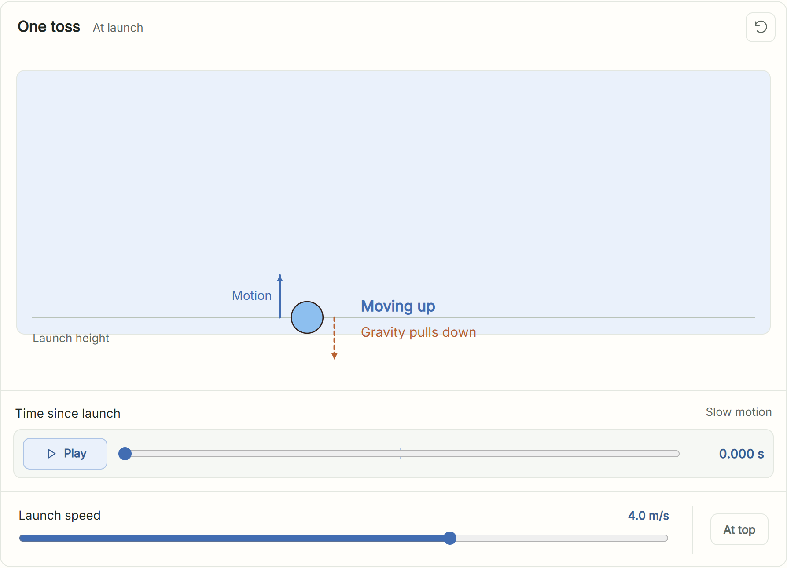 | 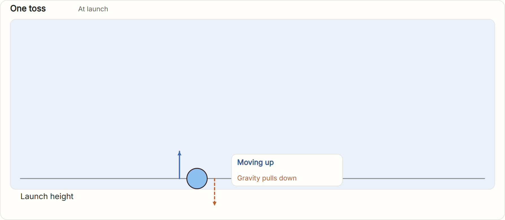 | **Renderer / SDK limit:** the heading row (title, state at the right) is inside the frame at the lane's top left, the state not right-aligned; the ghost ball is a faint filled disc, not a dashed outline; guide and floor lines are one ink grey (Codex: light wire grey, dashed guide); `Launch height` is 14 px ink, Codex 13 px muted; the reading is a white card with fixed 28 px rows (Codex: bare text on the lane, state 17 px bold). **Program choice:** no `Motion` label on the blue arrow (a label inside a lane fails the layout rule `text-box`, see below), `Launch height` sits below the lane because inside it the callout card collides with it. **Not done:** nothing in the scene; the chrome row, Reset, transport and slider are outside this change. |
| Standard | 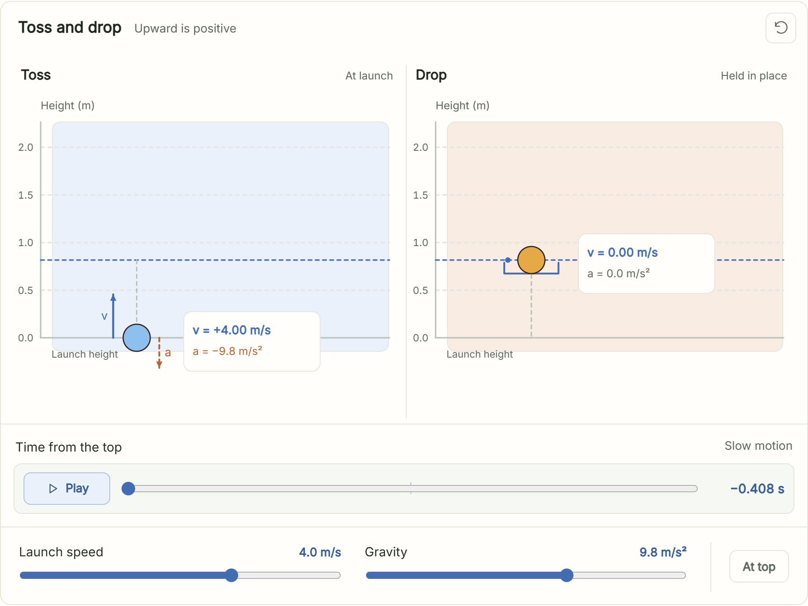 | 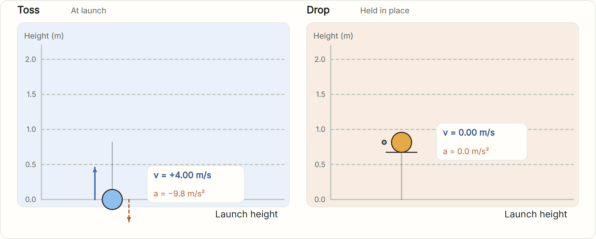 | **Renderer / SDK limit:** the height axis, ticks and dashed grid are drawn inside each lane (Codex: a gutter left of the tinted box); lane headings are title then state at the left (Codex: state right-aligned, a shared `Toss and drop` heading); gate strokes are black and 22 px long when open (Codex: short grey strokes); the ghost is a filled disc; the zero-velocity mark is a ringed dot; callout line 2 is always orange even when `a = 0.0` (Codex: grey); vector `v`, `a` letters absent (below). **Program choice:** no `v` and `a` letters beside the arrows; no blue dashed apex line across the lane (a frame line cannot be blue: ink, or a role hue that is not this blue); `Launch height` moved to the right below the lane, because the falling `v` arrow runs through the left side. **Not done:** nothing in the scene. |
| Deep | 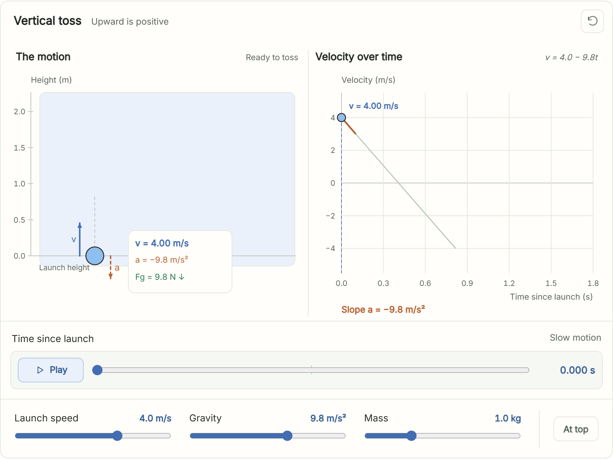 | 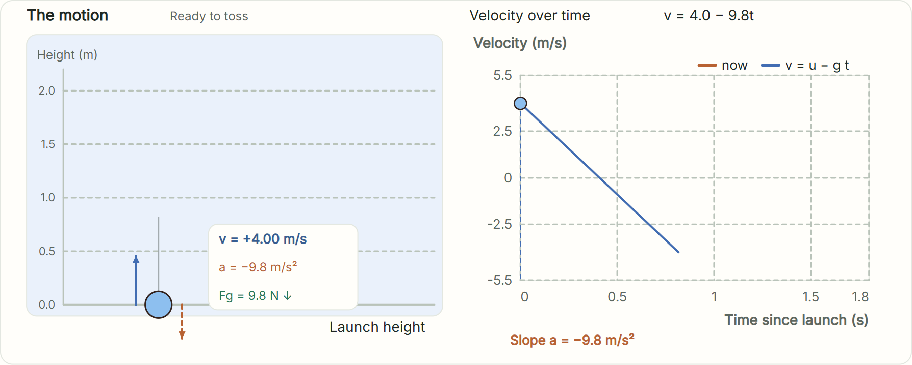 | **Renderer / SDK limit:** plot ticks are the written plot's own (0, 0.5, 1, 1.5, 1.8 and -5.5 to 5.5 in 2.5s; Codex 0.3 s steps and -4 to 4 in 2s), titles bold, a legend row (Codex none) whose `now` swatch is orange while the dot is blue, a heavier dashed grid; the lane axis is inside the lane. **Program choice:** two series only, so no blue trace up to now, no orange local slope segment, no `v = ...` label beside the marker and no `At the top` label; `Velocity over time` and `v = 4.0 - 9.8t` are plain 14 px text above the plot (Codex: 15 px bold, equation italic at the right); no `v` and `a` letters on the ball arrows. **Not done:** the third series (the slope segment) would fit the sdk; left out because the brief names two series. |

More states, same rows:

| | Codex | Ours |
|---|---|---|
| Overview at the top | 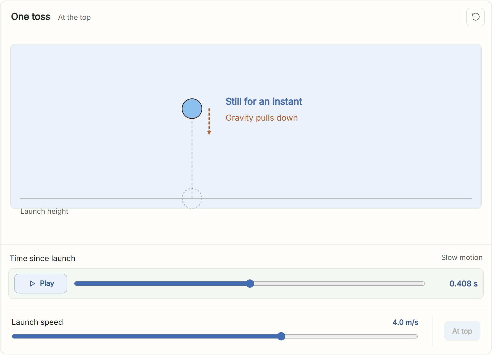 | 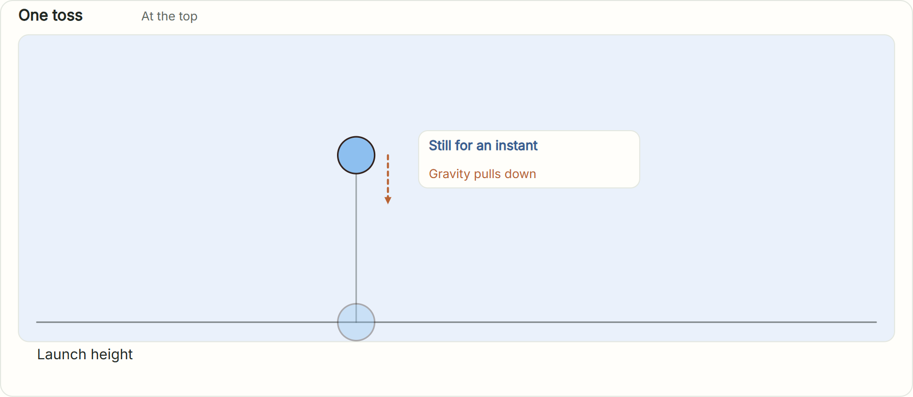 |
| Standard at the top | 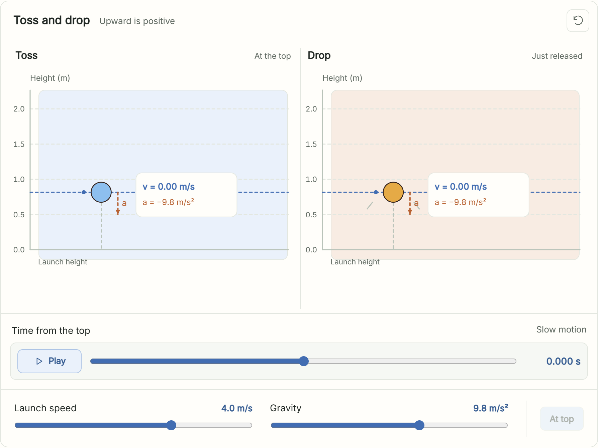 | 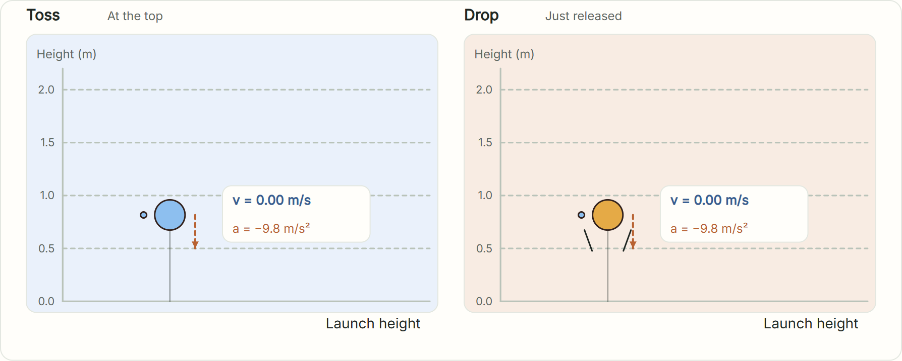 |
| Standard 0.10 s after the top | 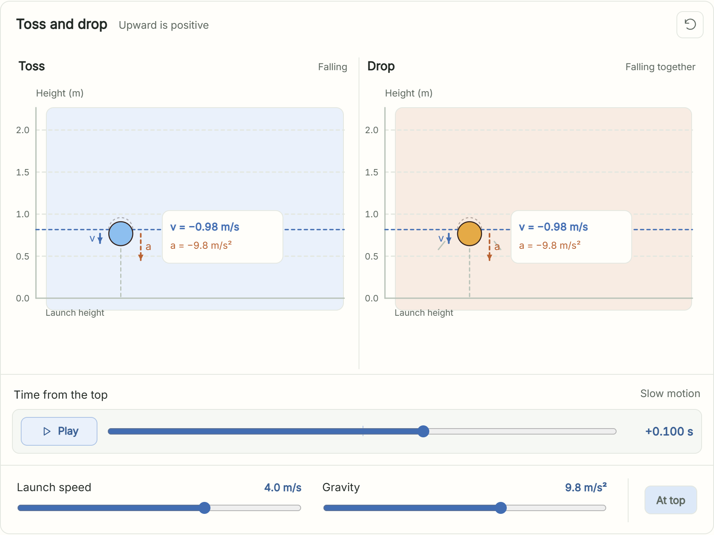 | 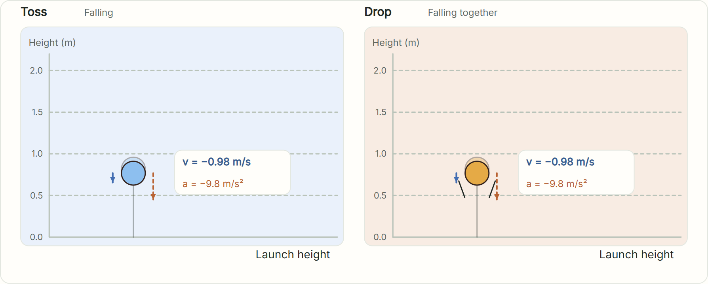 |
| Deep at the top | 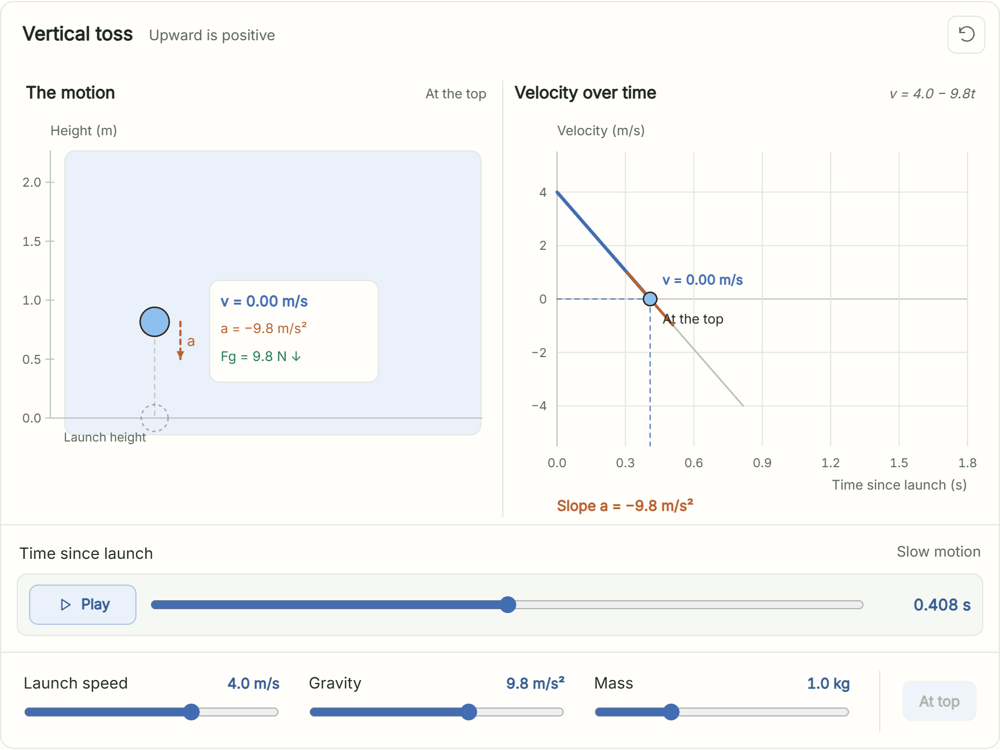 | 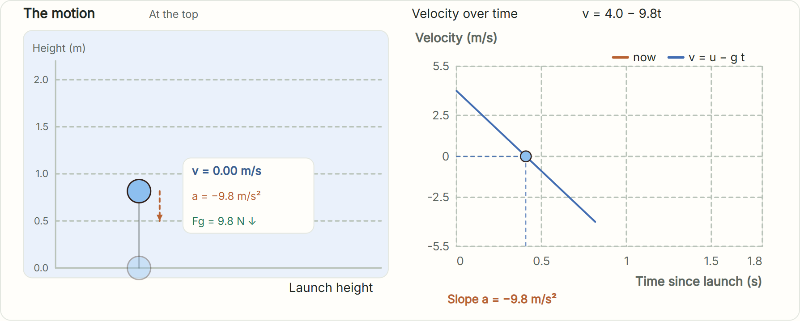 |

## Layout rules while authoring (a repair trigger for google-low; no rule was changed)

`frame-overlap.js` rules, counted over the three programs while they were written. "problems" is what `checkSceneAgainstPlan` reports (each pair once, at its first state); "hits" is every
rule hit at every capture case and probe of the plan (`headlessCaptureCard`), Overview / Standard / Deep.

| Step | problems | hits (all cases) | Rules | Cause |
|---|---|---|---|---|
| Probe before writing: an `sdk.panel` lane, one text and one `sdk.vector` label inside it | 2 | 2 | text-box 2 | any text over the lane's own box |
| First complete programs (no vector labels) | 1 / 4 / 4 | 8 / 23 / 18 | text-box only | `Launch height` 5.4 and 3.4 px into the lane; callout card at the Codex position hung over that label (Overview start, Standard start and end, Deep start) and over the lane heading (Deep fast toss) |
| `Launch height` 9 px lower, callout position clamped inside the lane in the program | 0 / 0 / 0 | 0 / 0 / 0 | none | |
| Geometry moved to the Codex proportions (892 px frames, lane height, floor), re-run, then 66 / 268 / 536 states over speeds, gravities, masses and times | 0 / 0 / 0 | 0 / 0 / 0 | none | |
| Measured variant: the same programs with `v` and `a` labels beside the arrows (label side chosen by direction) | 2 / 4 / 2 | 13 / 24 / 17 | text-box only | each label over the lane box |
| Measured variant, crude: labels always on the left | 4 / 8 / 4 | 13 / 24 / 17 text-box, 3 / 6 / 2 text-circle, 0 / 1 / 0 text-line | text-box, text-circle, text-line | a downward `v` label lands on the ball; Standard after the release 5.7 px from a gate stroke |

`text-body` fired 0 times in every run; `text-arrow`, `text-frame` and figure-text rules 0. The only rule that fired is `text-box`.

**A rule and the lane look cannot both be satisfied by a label.** `textBoxes`/`frameOverlaps` treat the lane's own `box` (the object `sdk.panel` returns, which `frame-look.js` draws as the tinted lane) like any
box: a text object anywhere inside a lane overlaps it (`text-box`, the label's whole width). So every text inside a lane, a vector label (`vec.v.tossL`), `Launch height`, anything, fails the rules; only text
above or below the lane, a callout (box objects with text, no text object) or a figure passes. The programs therefore carry no vector letters and the callout carries the readings. This is a rule/renderer
conflict: not loosened here and not worked around in the renderer. A fix on either side (for example, the text rules skipping the lane box that holds a text) would let the Codex `v` and `a` letters come
back; `interact-toss-programs.test.js` pins the finding so a change shows there.

## Programs and checks

- `packages/web/src/interact-toss-programs.js`: `TOSS_PROGRAMS` (`tossOverview`, `tossStandard`, `tossDeep`, each `{manifest, source}`), `tossDraft(name)`, `sealTossProgram(name)` (sdk-8 stamps, capabilities `time_playback`, `number_inputs`, `props`, `figures`).
- `packages/control-plane/test/interact-toss-programs.test.js`: each program seals with the plan's tuple, passes every deterministic check and the layout rules at every capture case, matches the oracle
  (18 / 46 / 36 rows compared), shows +0.98 / 0.00 / -0.98 m/s, F = 9.8 N and 29.4 N, and has no layout hit anywhere on a grid of inputs and times.
- Not covered: pixels of the real card, the real render service and any real model; these frames are drawn by the same Frame from a static page, not by the app.
