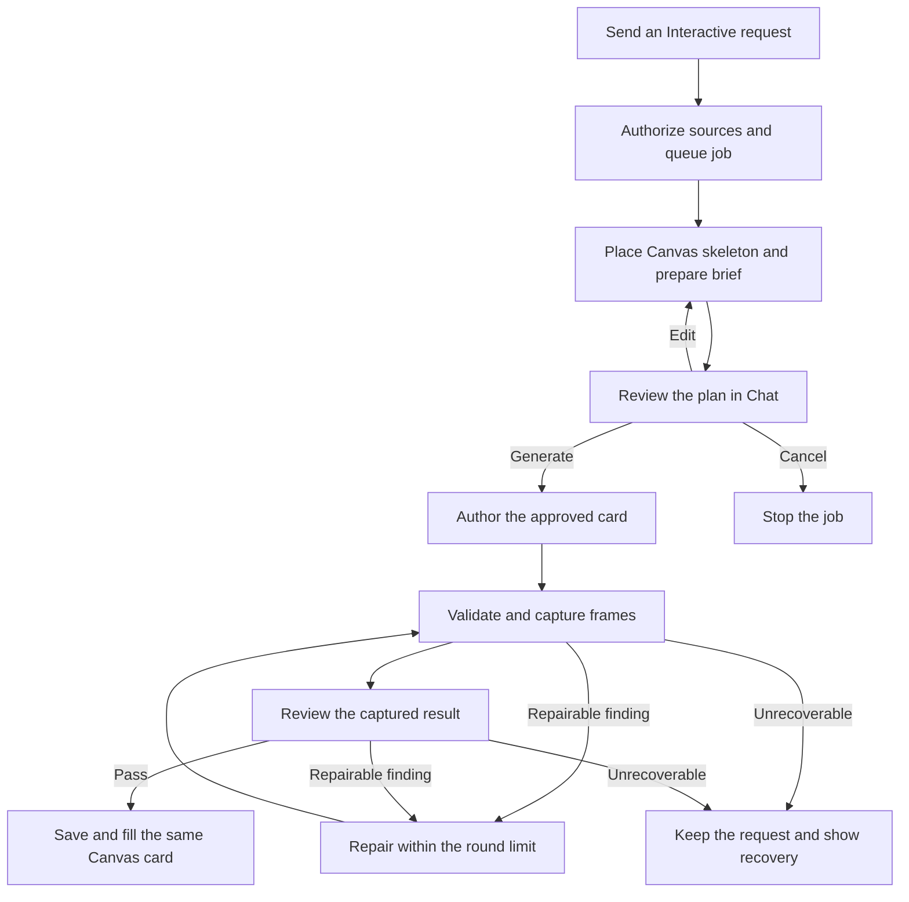

# Interact — historical implementation audit, November 7, 2026

This is preserved historical evidence, not the current build specification or proof of current deployment. Use [interact.md](../interact.md) for the target workflow, roadmap, checklist and latest owner decisions. All dates, source references, test counts, limits and present-tense implementation descriptions below belong to the original audit. They have not been rerun by the documentation review.

| Audit anchor | Evidence |
| --- | --- |
| Repository | `Rabbit-Hole-App/Rabbit-Hole` |
| Main | `80eb86183de67e2baabaa4b8edb58b4d932e40bc`, reviewed November 7, 2026 |
| Production | GitHub Actions run `42391379665`. The Release and Release receipt steps succeeded on this SHA. |
| Verification | Source search and focused local Node checks. Signed-in production generation and browser interaction were outside this audit. |

## What the four examples show

**The four HTML examples cover the presentation choices and a small subset of the controls.** The Chat brief offers Static, Steps, Over time and Experiment. The delivered scene can combine playback or steps with experiment controls. The drawing and its controls depend on the generated artifact.

The pendulums in `interactive-before.html` illustrate the UI. The actual **View → Slash Commands** showcase is a saved coffee-cooling program with playback and an adjustable room temperature. **Use example** fills the composer without sending or making another model call. The repository’s separate declarative pendulum experiment uses discrete length and mass picker chips and depicts a settled pendulum.

Sources at the audited SHA are `packages/web/src/learn-slash.js:52`, `packages/web/src/slash-sheet.js:53`, `packages/web/src/SlashCommandPreview.jsx:89`, and `packages/web/src/visual-components/examples/pendulum-experiment.json`.

### Interactive Card Composition Workflow

Use this diagram as the reference for the order of content in an Interactive card. It starts with the title and description, includes supporting static visuals when needed, and branches into Static, Over time, or Experiment. Playback and experiment controls sit outside the scene, directly beneath the live visual. [interactive-card-composition-workflow.html](https://chatgpt.com/library?file_id=libfile_da441ff3913c819198ccb93f1f3063ba&account_id=personal)

### Depth stories and scene examples

The examples pair the learner-facing story with what the scene shows at Overview, Standard and Deep. [tutor-scene-examples.md](https://chatgpt.com/library?file_id=libfile_23b41d2e75c48191adb50046d0116489&account_id=personal)

### Toss-and-drop HTML reference

Use the toss-and-drop examples as the layout reference for the shared Explanation card. [standard-toss-drop-card.html](https://chatgpt.com/library?file_id=libfile_6112489040548191a9e1b9519276fb63&account_id=personal)

| Example | Layout after the description |
| --- | --- |
| **Overview · Static** | Show the still comparison and let the card fit its content. |
| **Standard · Over time** | **Three moments around the top**, then the live toss and drop, then playback. |
| **Deep · Interact** | **Compare the two peaks** and the supporting diagram, then the animated **Full flight** plot, then playback and **Launch speed**. |

Put the explanation in the description above the visuals. Place the existing controls directly beneath the live view, outside the scene frame. The playback row contains Play/Pause/Replay, the scrubber, and the current time. Give **Launch speed** its own row with the current value and unit.

## 1. Names and entry points

| Name | What it reaches |
| --- | --- |
| **Interactive** or `/interactive` | Playable 2D explanation. Stable command ID `explain`, durable endpoint `/api/learn/explain/jobs`, Canvas block type `animation`. The Canvas header still says **Explanation** on this block. |
| `/interact` | Can match the picker by prefix. The registry declares `/interactive` as the full typed name, with no `/interact` alias. |
| **Explanation** or `/explain` | Written Explanation. Stable ID `explanation`. Uses the written card pipeline, its Markdown, tables and diagram renderer. |
| **3D animation** or `/animation` | Separate live 3D generation job and `animation3d` card. |
| **Animated explainer** or `/motion`, and **Whiteboard** or `/whiteboard` | Separate video generators, renderers and review contracts. |

Stable IDs preserve existing drafts, messages, proposals and jobs through the public command rename. Search both `interactive` and `explain`, including `explain_brief`, `ExplainJobs`, `ProgramScene` and `type: 'animation'`. Old comments and feature docs often call this engine “/explain v2.”

| Entry | What happens |
| --- | --- |
| Chat slash picker or typed command | Both resolve to the same registry item under **Tutor**. Send runs `runLearnCommand → startExplain` directly, before generic artifact planning. A bare command can use a selected card as the subject. With no subject, it asks the learner what to explore. |
| Ctrl+K | The same explicit command is handed to the same dispatcher with the inline selection. Plain language in Ctrl+K has its own inline router. Its internal `explain` route is a written explanation, so use the explicit command to request this playable engine there. |
| Selected Markdown or PDF excerpt | A held source reference can travel with the command. The existing Markdown passage action opens Ctrl+K with **Interactive** and the passage filled in. Send starts the job. The Canvas can place that skeleton beside the passage in free space without moving the camera. |
| Natural-language Canvas Chat | Eligible ordinary turns go through a guarded JEV intent choice on this config. The `explain` capability is offered with `EXPLAIN_V2_ENABLED`. It describes an explicitly requested new visual teaching card with diagrams, steps or controls. It distinguishes a question, an edit, and a video request. A chosen visual command enters the same dispatcher. Plain explanation requests and small talk can take the text path directly. The alternate answer-model tool path is gated by `CHAT_ANSWER_TOOLS`, which the checked-in production config leaves unset. |
| Tutor material action | Existing internal `create_material` wiring can call the shared `startExplain` job with Tutor origin and a stamped action. The R12.09 roadmap adapter is a separate pending qualification. |
| Ctrl+K Edit on a delivered card | Starts a revision-bound edit job for the existing card. The original stays visible until the learner applies the checked candidate. See section 7. |

The V2-disabled client path can fall back to the older `/api/learn/artifact` family `explanation / table / animation / narration`. Its historical narrowing rules are still there. Narration is marked unavailable in that family. Those compatibility rules differ from the normal enabled V2 job.

Sources are `packages/web/src/agent/slash.js:43`, `packages/web/src/inline-ai-command.js:56`, `packages/web/src/inline-ai-route.js:19,153`, `packages/web/src/learn-slash.js:302`, `packages/web/src/LearnPage.jsx:1004,1135,1216`, `packages/web/src/AdaptiveCanvas.jsx:2312`, `packages/control-plane/src/chat-capability-route.js:41`, and `packages/web/src/learn-coaching-materials.js:254`.

## 2. What the job receives

The learner can start with just a request. Depth defaults to Standard or the saved Canvas setting when omitted. A Markdown document, highlight, or Tutor roadmap is optional.

| Input | How it is used |
| --- | --- |
| Learner request | Up to 4,000 characters. The brief and author receive the request. A same-card edit sends the learner’s instruction and binds to the accepted result and revision. |
| Depth | `overview`, `standard`, or `deep`. Captured at create time, validated and retained on the job. Non-Standard adds a card-depth instruction to the brief and author. This changes teaching scope and detail. Runtime limits remain separate. |
| Selected card or passage | Selected text, when supplied, goes in context with an 8,000-character client cap. A highlighted passage can also provide the request text. A minted `sourceRefId` is revalidated against current access and revision and carried to the card for navigation. The reference itself is distinct from the model’s evidence payload. A changed or unavailable reference can refuse creation before a model call. |
| Pinned or temporary Chat references | Server resolves readable file text derivatives and repository source lines under the learner’s access. Reads can become evidence with location, revision, digest, bounded excerpt and limitations. The resolver accepts up to 20 refs and bounds excerpt text to 24,000 characters. Labels, graph links without code, unavailable files and learner-quoted PDF excerpts carry their actual coverage. A quotation without a server source read is treated as unchecked context. |
| Image or selection screenshot | Server resolves the uploaded image ID under Canvas access and sends the image to the author as a **layout reference**. An image alone asks for a teaching subject. A still-uploading crop or unavailable image does not silently turn into image-free generation. |
| Proposal revision and extra references | At Generate the server verifies the signed proposal, checks any attached review references again, and applies the approved title, description, assumptions and Presentation to the brief the author receives. Refused references block Generate. |
| Optional composition examples | API accepts up to two known example IDs. They show how to compose a visual. The author is instructed to take facts from the actual request and evidence. |
| Job and destination identity | Request ID, card ID, board ID, source, class and optional Chat thread. The server binds them to the authenticated owner and verifies revisions on edit and delivery. |

There is no automatic whole-document retrieval or web research pass in the standalone job’s stage graph. The engine can consume authorized material and evidence from existing readers. `explain-fetch.js` and `explain-evidence.js` contain bounded fetch and evidence helpers, but the active brief → author path shown here does not run an Exa search loop. Treat future registry integrations and a roadmap’s supporting excerpts as separate work.

Sources are `packages/web/src/learn-slash.js:302`, `packages/web/src/LearnPage.jsx:1135`, `packages/control-plane/src/explain-job.js:183,218,337,522`, `packages/control-plane/src/explain-context-refs.js:17,65`, `packages/control-plane/src/chat-depth.js`, and `packages/control-plane/src/explain-author.js:83,110`.

## 3. Learner and generation workflow



1. **Send creates a job.** The client assigns stable request and card IDs for the press. On the create response it puts a compact pending card on the Canvas. Durable Object alarms do the work even if the learner leaves. `ExplainPending` polls about every two seconds while active, and observes Chat events for approval or refinement. It shows the actual server stage, spinner/shimmer, and actions appropriate to that stage.
2. **The brief is prepared before Generate.** This first model call can use credits. Every new standalone request reaches review. The model returns the subject title, summary, suggested presentation, assumptions, limitations, known evidence IDs and an optional one-line lead-in. The prompt asks for three to five plain sentences. The validator accepts one to ten and caps the normalized summary at 1,500 characters. If there is no supplied thread, the server uses the open Canvas Chat or creates one.
3. **Chat shows the shared generation review.** The deployed card has the **Review explanation** heading, title, description and **Presentation** setting, with Assumptions and Limitations when populated. The learner can change the proposed presentation and use Generate, Edit or the available cancel action. `GenerationProposalCard` reads the shared schema. Conversational Edit uses the **Editing** pill and refines the same job with a new proposal revision. A stale edit or approval is refused. The waiting skeleton’s **Go to plan** points back to the Chat review.
4. **Generate approves that job.** The server checks signature, owner, board, proposal version, brief hash, source access and available allowance. It consumes the current proposal once and moves to authoring. Repeated approval of the same consumed proposal reuses the job. The edited presentation is currently part of the approved payload the author receives.
5. **The author chooses a representation within the approved brief.** It gets the request, approved brief, context, evidence, supported capabilities, limits and any base artifact. It returns catalogue JSON, a bounded JavaScript program and manifest, or a capability gap. The compiler/runtime checks shape, renderability, declared behavior and input limits.
6. **The backend renders and reviews before delivery.** It captures actual frames, asks the independent reviewer to inspect visual and semantic correctness, and makes at most three shared correction rounds across validation, rendering and review. A capability gap or exhausted/unrepairable result ends with the reason. A ready result replaces the existing skeleton with the same card ID and placement.

Durable stages are `queued → preparing → awaiting_approval → authoring → validating → rendering → reviewing → ready`. A correction enters `repairing` and returns to `validating`. Other terminal stages are `failed` and `cancelled`. Stop can end active work while an already-sent provider call settles. The production same-card edit path can start at authoring with no brief, subject to server configuration.

Sources are `packages/web/src/ExplainPending.jsx:20`, `packages/web/src/explain-client.js:6,54,92`, `packages/web/src/generation-confirmation-schema.js:106`, `packages/web/src/generation-proposal-chat.js:46,80`, `packages/web/src/ask.jsx:595`, `packages/control-plane/src/explain-brief.js:22,52`, and `packages/control-plane/src/explain-job.js:464,498,522,653,677`.

## 4. Model roles and prompt contracts

All four dedicated roles are pinned in code to Anthropic **Claude Opus 5.5** (`claude-opus-5-5`). The Chat model picker has no effect on these roles. Each request offers one role-specific tool with `tool_choice: auto` and accepts exactly one valid call. The production Anthropic path uses an ephemeral system-prompt cache block. The task has no configured model fallback or explicit thinking effort.

| Role and tool | Output limit | What it decides |
| --- | ---: | --- |
| `explain_brief` → `explain_brief` | 4,000 tokens | Plan one idea in learner-friendly language. Choose the simplest presentation that teaches, specify what the learner sees or changes, name assumptions and omissions, and return a gap when the available runtime cannot do it. Stateful rules allow planned actions and targets when enabled. |
| `explain_author` → `author_explanation` | 10,000 tokens | Build the approved idea. Catalogue output must use known components, parameters and anchors. Program output computes the readouts from the variables driving the drawing and declares useful controls in its manifest. State-driven actions must visibly change the result. |
| `explain_review` → `report_review` | 3,000 tokens | Compare the actual PNG captures, sampled inputs/events, evidence and runtime traces with the request and approved brief. Check what the learner sees, reads and can change. A blocker or major finding prevents acceptance even if the reply says pass. |
| `explain_repair` → `repair_explanation` | 6,000 tokens | Correct validation problems or review findings while preserving the requested teaching behavior. Catalogue changes use allowed layout hints or a corrected spec. A program correction supplies a revised source and manifest. A repeated unchanged draft or unfixable problem stops. |

The router’s JEV choice, where used, precedes these roles and chooses a capability. The code defines `jev-1.13.0` for direct TypeSafe transport and `typesafe-ai/jev` for the Vercel gateway. The selected transport depends on server configuration. The four generation role IDs, limits and transport rules are in `packages/control-plane/src/learn-models.js:59` and `explain-policy.js:19,77`. The actual system prompts and tool schemas are in `packages/control-plane/src/agents/explain-brief.js`, `agents/explain-author.js`, `explain-review.js`, and `agents/explain-repair.js`. JEV IDs are in `packages/control-plane/src/learn-grade-jev.js:11,19`.

### Call, render and recovery policy

- **Preparation and Generate have separate usage phases.** One initial brief plus at most five refinements. The build admits one author call, up to four reviews, and up to three repairs. The learner must have room for the full generation bound before approval. Individual provider operations are tracked and settled. Already-sent calls can settle even when the job stops. Browser capture compute is platform-funded.
- **Role input ceilings** are 40,000 / 60,000 / 40,000 / 40,000 in the conservative request-bound units for brief, author, review and repair. The policy treats JSON bytes conservatively. Image ceilings are 4 / 4 / 6 / 2 respectively. The normal Canvas path supplies one optional layout image to authoring.
- **Time ceilings** in policy are 120 seconds per model call, 180 seconds for preparation and 600 seconds for the job window. The Generate action opens a fresh job window. These are guards. The job also records timestamps and stage counts so latency can be benchmarked separately for brief, author, render, review and repair.
- **Recovery uses the same card.** A renderer outage can offer **Render again** for the retained candidate. A provider cap or overload can pause the job and retain completed stages so Retry can resume. The server fences retries by attempt. Exhausted corrections, no progress and unsupported capabilities stop with the recorded reason. A failed build must not be treated as successful or as a ready card.

Sources are `packages/control-plane/src/explain-policy.js:19,26,165`, `explain-job.js:171,413,431,442,566,586,740`, and `packages/web/src/ExplainPending.jsx:63`.

## 5. Renderers and complete control inventory

Both renderer paths use the Canvas `AnimationBody` and its shared SVG `Frame`. React/Vite provides the card and controls. Motion supports presentation and reduced-motion behavior. Trusted KaTeX renders supported math text. The generated artifact drives which controls are mounted.

| Surface or control | Declarative Scene via `AnimatedScene` | Generated Program via `ProgramScene` |
| --- | --- | --- |
| Static | Finished frame. No transport row. | One evaluated frame when duration is absent. Inputs can still change it. |
| Named steps | Current name, Step N / total, Previous, Next with next title, and Last step. | Stateful generated actions can advance a sequence. The shared native StepPager belongs to the declarative renderer. |
| Timed playback | Play / Pause / Replay, scrubber and time readout. Mute / Unmute for a timed scene with sound. | Play / Pause / Replay, scrubber and time readout when the manifest declares duration. The Program renderer has no audio or mute control. |
| Parts pager | Optional named sub-card pager above the scene, with progress marks and current part. Independent of the timeline or step pager. | No built-in parts pager in this renderer. |
| Numeric or discrete inputs | Discrete picker chips, index range with Previous / Next and a readout, switches, single-choice chips, multi-select marks, and configured diagram pick targets. Hidden inputs have no widget. Locked inputs are read-only. | Bounded numeric range sliders with value and optional unit, and segmented choice buttons. |
| Actions | Changes through declared inputs and scene selection. | Schema 2 can declare labeled action buttons with ordered state transitions. |
| Scene object selection | A supported object can show a selected label and clear action. Escape can clear selection. | Schema 2 targets have Select controls and can be clicked in the drawing. Targets marked draggable can move by pointer and keyboard arrow keys. Shift+arrow is the larger nudge. |
| Reset experiment | Restores declared inputs and clears selection while retaining time. Shown when the experiment has changed. | Restores inputs and time zero. Schema 2 also validates a fresh initial state before committing reset. |
| Notes, values and sources | Source chip can link back to a held passage. Other common Canvas card chrome applies where wired. | Optional collapsed **Notes** with live frame Values and assumptions. An owner can also see **Sources & evidence** when the result has provenance. Notes in a delivered card are separate from the Chat review. |
| Practice | Shared optional `SceneActivity` under the visual when the block has an activity. **Start practice**, **Back to explore**, the declared response controls, **Check**, feedback and **New attempt**. | Same shared activity area when supplied. Program actions themselves are exploration, with no automatic scoring. |
| Focus and failure | Shared card title and Focus controls. A Prompt affordance can expose the saved request. | Same card shell. Focus sizes the visual against the room left for controls. Runtime errors can keep the saved card and offer **Restart explanation** on that artifact. |

Experiments sit under the frame independently of the transport. A timed simulation can have both a scrubber and inputs. There is no universal learner-facing speed selector or loop control in this player. A declared action or control can implement teaching-specific behavior within the program contract.

Sources are `packages/web/src/LearningBlocks.jsx:1462`, `AnimatedScene.jsx:679,723,793`, `SceneControls.jsx:38,63,85`, `SceneActivity.jsx:26`, `explain-program/ProgramScene.jsx:252,275,331`, `explain-program/ProgramNotes.jsx:4`, and `focus-adapter-explanation.js` in the same web source directory.

## 6. What the author can build

### Component-backed VisualSpec

The model returns data that names versioned catalogue components, parameters, anchors and connections. It can assign parts, step appearances, and supported experiment bindings. Trusted compilation produces an `animation-scene` for deterministic evaluation into SVG. Validation covers component/version/parameter shape, finite geometry, layout and consistency, budget, evidence IDs and example copying. The catalogue and runtime keep saved declarative cards usable.

The current v1 component registry includes `section`, `module`, `stack`, `flow`, `callout`, `legend`, `pattern-stack`, `attention-fanout`, `attention-steps`, `router-experts`, `state-space-block` and `pendulum`. These are reusable authoring components. The trusted Scene renderer has lower-level objects including shapes, text, arrows, equations, code, grids, strips, bars, tokens and polylines.

With generated Programs enabled, authoring exposes a filtered catalogue for static or stepped component composition. Timed and experimental VisualSpec candidates are refused on that configuration. The author prompt asks for a Program for those behaviors. Catalogue repair works on the existing spec, so the rejection is no guarantee of an automatic switch to a Program.

### Generated JavaScript Program

The model returns `{source, manifest}`. Host code validates it, computes source/manifest/bundle hashes, and seals exact schema, interpreter, SDK, renderer, runtime policy and permission versions. On load, the server and client check the artifact and execution policy before a Worker starts.

| Version | Contract |
| --- | --- |
| Schema 1 | `evaluate({inputs, time, seed, state: null})` returns a bounded frame and calculated quantities. The manifest can declare duration, numeric and choice inputs, labels, readouts and assumptions. |
| Schema 2 | Adds viewport, actions, targets, `initialState` and `reduce`. Ordered input, action, select and declared drag events update bounded JSON state. A transition commits only after a valid frame. Scrubbing evaluates the current state at a different time. |

The sandbox runs generated ES modules in **QuickJS/WASM 0.32.0** inside a dedicated Web Worker. Guest code gets a small frozen SDK, a seeded random source, validated inputs and bounded state. It has no DOM, network, wall-clock access, external imports or host callbacks. The host receives structured JSON and draws an allowlisted frame of boxes, circles, text/math, lines, arrows and polylines. This is an isolated visual program inside a trusted player.

| Bound | Code value |
| --- | --- |
| Program source and manifest | 16 KiB source, 4 KiB manifest |
| Output and persistent state | 256 KiB output, 32 KiB state, depth 32 |
| Frame and inputs | Up to 60 objects on a frame, 4 inputs, 8 options per choice, 8 readouts |
| Stateful interactions | Up to 8 actions and 8 targets, with bounded viewport and drag coordinates |
| Duration | Up to 120 seconds of declared playback |
| Execution | 50 ms guest operation, 250 ms host watchdog, 2 s boot bound, 16 MiB nominal heap, 32 MiB hard WASM memory bound, 256 KiB stack |
| Resource lifetime | Two active Workers per page, idle eviction after 30 seconds. Offscreen or hidden playback pauses. A timed frame overrun can retain the last frame. Three consecutive overruns stop playback and offer restart. |

Sources are `packages/web/src/visual-components/{registry,compile,budget}.js`, `packages/web/src/animation-scene.js`, `packages/web/src/explain-program/{contract,limits,stamps,runtime,host,playback,interaction}.js`, and `packages/control-plane/src/{explain-author,explain-program,explain-program-stage}.js`.

### Render and review stack

- The app Worker uses Cloudflare **Browser Rendering** (`BROWSER`) through `@cloudflare/puppeteer` 1.4.0. The capture player uses built assets under an intercepted origin and denies arbitrary external requests. The Program capture uses the same sealed QuickJS host and trusted frame renderer as the Canvas.
- A declarative card is checked over the distinct admitted combinations of parts, inputs, steps or time checkpoints. Duplicate frames are collapsed. The capture uses both themes when the reservation fits, otherwise light. A declarative candidate with too many distinct states is rejected before capture.
- A Program gets bounded sampled states. Captures include the default, selected time checkpoints and input boundaries. Stateful sampling prioritizes real action, select, drag, input and reset transitions. It records what was sampled and omitted. A normal review fits at most six captures per candidate. A sample pass establishes only what was checked.
- Captures, source evidence, the manifest, visible quantities and bounded runtime traces inform visual review. Trusted checks require a declared control for an approved Program experiment and duration for an approved timed Program. Review then checks whether the visible behavior actually teaches what was approved.

Sources are `packages/control-plane/src/explain-render.js:49,110,139,198,233`, `explain-review.js:19,73,153`, `explain-author.js:171`, and `packages/web/render/{render-scene,program-render}.jsx`.

## 7. Persistence, editing, sharing and Chat context

| Layer | What is stored or read |
| --- | --- |
| App backend | The Cloudflare app Worker delegates the Learn route to `explainRoute`. One SQLite-backed `ExplainJobs` Durable Object per Canvas stores request fences, job state, results and bounded candidate history. The create route requires an owned board in D1. Reusing a request ID for different input conflicts. |
| API | `POST /api/learn/explain/jobs` creates. `GET /api/learn/explain/jobs?board=…` lists and `GET /api/learn/explain/jobs/:id?board=…` observes. `POST …/:id/approve`, `/refine`, `/cancel` and `/retry` are explicit actions. `GET …/results/:resultId?board=…` resolves an owner’s saved Program result. |
| Chat | D1 `threads`, `messages` and `chat_message_meta` store the signed plan and revision state. The job retains its brief hash and the proposal ID and version. |
| Media | R2 Learn media holds layout reference images and render captures. The job records capture identity and review findings. |
| Canvas board | D1 `learn_boards.state_json` stores the placed block through the client board save flow. A declarative block can keep the compiled scene. A Program block keeps a bundle hash and result identity. The artifact’s source and manifest live in the authorized result store. The pending and delivered card are reconciled by job, board and card IDs. Pruning an old job keeps the Program result that its card needs. |
| Learner interaction | The owner’s settled inputs, paused time and validated schema 2 state save quietly to the board. Runtime state binds to the bundle hash, seed, revision and input snapshot. Viewers’ and Proposed preview interactions stay local. Playing, scrubbing, changing inputs, resetting, reloading and restarting run the retained artifact without a new generation call. |
| Sharing | The shared-board card endpoint checks the share token or publication, that the card is on that board, and that the accepted identity and artifact match. It returns the scoped artifact and execution decision. Private provenance, other results and pending edit candidates are excluded. |
| Chat / Tutor context | A loaded card can describe its title, what it shows, current inputs, time, action/target labels and the latest committed event. Readouts are described only when the drawn frame matches the current state and inputs. This context uses structured visible information, without passing generated source code. |

**Delivered-card Edit and plan Edit are different.** Plan Edit revises what Chat asks the learner to approve. Ctrl+K Edit on a saved card checks the base revision, re-reads accessible inherited sources, and builds a separate candidate. **Current / Proposed** switches the preview. **Apply changes** checks the base again, keeps the layout and card ID, swaps the result and drops obsolete state. **Discard** leaves the accepted card as it was. Legacy cards without an accepted revision cannot enter the same-card edit path.

Sources are `packages/web/{app-worker,dev-worker}.js`, `packages/control-plane/src/explain-job.js:198,282,328,379,464,766`, `learn-boards.js:896`, and `packages/web/src/{explain-client.js,ExplainEditBar.jsx,explain-program/program-card.js}`.

## 8. Production switches and evidence boundaries

| Checked-in production variable | Value and effect |
| --- | --- |
| `EXPLAIN_V2_ENABLED` | `true`. Enables standalone job routes and guarded Chat capability. |
| `EXPLAIN_PROGRAM_ENABLED` | `true`. Enables authoring and editing generated Programs. Turning this off still allows accepted Programs to load under the execution policy. |
| `EXPLAIN_PROGRAM_STATEFUL` | `true`. Allows new schema 2 authoring. Existing accepted cards have their own versioned load check. |
| `EXPLAIN_PROGRAM_EXECUTION_KILL` | `false`. A kill affects later loads without deleting saved cards. An already-open player learns about it on reload. |
| `EXPLAIN_BRIEF_THRESHOLDS` | `components=12, credits=400`. The thresholds annotate brief reasons and preserve the direct same-card edit path. A new standalone card still waits for Generate. |
| `EXPLAIN_DIAGNOSTICS` | Unset in checked-in production. Private job and candidate diagnostics have a separate server gate. |

The latest successful production workflow and the checked-in switches establish the deployed baseline for this document. Historical evidence in `docs/features/explain-sandbox-checklist.md` includes real cooling, sorting and gravity results. The historical genuine-card evidence for drag and selection is narrower than the fixture coverage. Production interaction on the audited SHA remains unverified here.

### Local checks run during this audit

The focused Node runs reused a dependency-equipped source snapshot. Explain-specific engine, player and test files were checked against the GitHub delta from `04219878da7360131138c9059ce74854a51a1c0e` to the audited SHA. Changed integration files such as `LearnPage.jsx`, `ask.jsx`, `LearningBlocks.jsx` and the Tutor handoff were read at the audited SHA. The counts below are fixture evidence for the engine, web contracts and controls.

| Local check | Result |
| --- | --- |
| 14 backend files covering brief, author, jobs, edit, context, renderer, capture manifest, review, repair, program draft/budget, stateful behavior, provider refusal and shared-card isolation | **131 passed** |
| 6 web files covering the client, declarative scenes and holdouts, program contract/safety and Notes | **81 passed** |
| QuickJS runtime suites in this workspace | Runtime modules could not load locally because the pinned QuickJS dependency was absent. |

The fixture suites can be invoked from the repository root with dependencies installed.

```bash
node --test packages/control-plane/test/explain-{brief,author,job,capture-manifest,render,review,program-draft,program-budget,repair,stateful,context-refs,edit,provider-cap}.test.js packages/control-plane/test/shared-program-card.test.js
node --test packages/web/src/explain-client.test.mjs packages/web/src/interactive-{scenes,holdouts}.test.mjs packages/web/src/explain-program/{contract,contract-safety,program-notes}.test.mjs
```

Existing interaction checks include `packages/web/e2e/explain-program-card-check.mjs`, `explain-program-state-check.mjs`, `explain-program-render-check.mjs` and `explain-scene-check.mjs`. Those were inspected as code. No paid provider or production browser run was made for this audit.

### Separate work tracked elsewhere

- **Standalone Interactive is implemented.** The shared Chat review still exposes Presentation and the old description and disclosure layout. The approved mockup with a model-chosen presentation, short learner-friendly copy, visual preview and Generate / Edit is a design reference for later work.
- **Tutor R12.09 is pending.** The handoff still calls for a roadmap-owned acceptance and allocation before paid preparation, then a version-bound native brief, delivery and checked failure path. The standalone job and existing Tutor material action provide the engine and entry seam. They do not establish roadmap acceptance, spend binding or adapter verification.
- **Written Explanation is a separate project surface.** Its newer inline tables, TutorDiagram or illustration work is distinct from the Interactive Program’s manifest and SVG frame. There is no Recraft, Gemini Flash, Celeris or Cerebras role wired into the current Interactive generation chain.

Relevant references are `docs/features/explain-on-canvas/handoff/tutor-implementation-checklist.md:1968`, `docs/features/generation-review-contract.md`, `docs/features/explain-sandbox-checklist.md`, and `docs/features/explain-program-support.md`. Use the pinned code for current switches and controls when a historical note describes an earlier release.
